# Field of view

Status: fixed on branch `feat/cs-fov`. This page tells how CS 1.6 and Sven Co-op read a field of view (FOV), how the CS
weapons now show CS's view and scope in Sven, and how much they still differ. Defect 6 of the
[asset audit](research/asset-audit.md) is the start of this work.

## What CS 1.6 does

- CS reads every FOV as the horizontal angle of a 4:3 view. Its normal view is `default_fov 90`. On a wide screen,
  `gl_widescreen_yfov 1` keeps the vertical angle of that 4:3 view, 73.74° (`Half-Life/hw.so` `R_SetupGL` 0x16ead0). So
  the focal length in pixels is f = (H / 2) / (0.75 tan(fov / 2)) at every aspect ratio.
- Zoom values (ReGameDLL_CS `wpn_shared`): AUG and SG552 55; Scout, G3SG1 and SG550 40 then 15; AWP 40 then 10
  (`wpn_awp.cpp:80`).
- The view model uses the world FOV (`R_DrawViewModel` 0x16da90 changes only the depth range).
- The scope is not a model. Valve's `CHudSniperScope::Draw` (`cstrike/cl_dlls/client.so` 0xc7210) draws it while
  `m_iFOV` ≤ 44:
  - black outside a circle in a square of H − 2 floor(H / 16) pixels at the screen centre (`sprites/scope_arc.tga`);
  - two 1-pixel black lines at column W / 2 and row H / 2 + 1, with a gap of 10 VGUI units of a 480-line screen around
    the centre (18 pixels at 900 lines, 30 at 1440);
  - the engine also draws `sprites/sniper_scope.spr` (the weapon list's `zoom` crosshair) pixel for pixel, half a pixel
    off. The mil-dots sit 23 to 113 pixels from the centre at every resolution, the red centre covers 4 × 4 pixels, and
    the sprite's own 1-pixel lines blend to two 50 % grey lines.
- Valve's client sets `r_drawviewmodel` back to 1 every 0.5 s (`CHud::Redraw` 0xb61a0). The fixture hides the view model
  with `r_drawentities 0` instead.

## What Sven Co-op does

- Sven's `liblist.gam` sets `vertical_fov 1`, so Sven reads every FOV as the vertical angle: f = (H / 2) / tan(fov / 2).
  The client's `default_fov` is 70 (`client.so` 0xd6a7b). View models also use the world FOV.
- The client takes the FOV only from the `SetFOV` message, one byte of whole degrees (`client.so` 0xD49D4). The server
  sends it when `m_iFOV` changes (`server.so` 0x4ae061). 0 means the player's own `default_fov`.
- The engine clamps the view to 10°–150° (`hw.so` 0x136580).
- When `m_iFOV` differs from `default_fov`, the client multiplies the mouse sensitivity by FOV / `default_fov` ×
  `zoom_sensitivity_ratio` (1.2 by default; `client.so` 0xDA3AE, 0xE0F66).
- The server sets `m_iFOV` to 0 on death (`server.so` 0x4a125a) and on spawn (0x49eb8d).

## Conversion

sven = 2 atan(0.75 tan(cs / 2)), rounded to whole degrees, and never below Sven's 10:

| CS 1.6 | Use                   | Exact vertical | Sent to Sven | World scale against CS |
| ------ | --------------------- | -------------- | ------------ | ---------------------- |
| 90     | normal view           | 73.74°         | 74           | −0.5 %                 |
| 55     | AUG, SG552            | 42.68°         | 43           | −0.9 %                 |
| 40     | first zoom of a scope | 30.54°         | 31           | −1.6 %                 |
| 15     | Scout, G3SG1, SG550   | 11.28°         | 11           | +2.5 %                 |
| 10     | AWP second zoom       | 7.51°          | 10 (clamped) | −25.0 %                |

The world scale is the ratio of the focal lengths, tan(exact / 2) / tan(sent / 2) − 1.

## What changed

- `scripts/cs16/base.as`:
  - `SetFOV` takes a CS value and sends `SvenFov(value)`. 0 still gives the view back to the player's `default_fov`.
  - `Deploy` sets CS's 90 for every CS weapon. Unzooming (`ResetFoV`) returns to it. `CommonHolster` sends 0, so Sven's
    own weapons keep the player's view.
  - `CsFov(player)` gives a player's FOV in CS degrees, for code that compares with CS values. Whole Sven degrees and
    the 10° minimum make it differ from CS's value: zoom 40 reads 40.6, the AWP's 10 reads 13.3.
  - `AWP_2X_ZOOM_VALUE = 10` and the scope sequence `SCP_IDLE_FOV10` for the AWP's second zoom.
- The scope view model is `models/cs16/scope/cs_scope.mdl`, a new path, because a client never downloads a path that it
  already has. `tools/scopegen.ts` (`just scope-model`) builds it from CS's `sniper_scope.spr`:
  - Sven draws view models with the vertical world FOV, so a flat model keeps its share of the screen height at every
    resolution, as CS's circle does. Each sequence puts the plane at the distance for one zoom's Sven FOV (74, 31, 11,
    10), so the scope is the same at every zoom level. A new model with new sequences was the smallest change: the old
    `scope.mdl` had two sequences for FOV 40 and 15 as vertical angles (circle 9 % and 4 % too large), a 32-sided circle
    and 2-pixel lines.
  - A black ring outside a 128-sided circle of radius 393 lines (of a 900-line screen).
  - Cross lines 0.75 lines wide that start at the screen centre, so they cover one pixel from 600 to 1800 lines. They
    begin at CS's gap of 18.75 lines.
  - The reticle sprite, texel for texel at 900 lines, without its own lines.
  - The old `models/cs16/wpn/scope.mdl` is removed.
- Tests: `tests/fixture/fov.ts` (CS 1.6, `just fixture-fov`), `tests/e2e/fov.ts` (Counter-Life, `just e2e-fov`),
  `tests/fixture/fov-metrics.ts` (`just fov-metrics`) and `tests/e2e/fov-reset.ts`. The e2e plugin has two new commands:
  `turn` and `fov`.

### Crosshair

The CS dynamic crosshair (branch `feat/hud-crosshair`) hides at FOV 54 or less in CS degrees. `m_iFOV` now holds Sven
degrees, so in `scripts/cs16/hud/crosshair.as` `OnTick` replace

```angelscript
const int fov = player.m_iFOV;
```

with

```angelscript
const float fov = CS16BASE::CsFov( player );
```

`CsFov` gives 90 for 0, so the `fov != 0` test can stay.

## Method

- CS 1.6: Valve's client against a ReGameDLL_CS listen server on de_dust2 (the kill-feed fixture), offscreen.
  Counter-Life: the Sven client against a sandbox server on testcenter, offscreen. Both at 1600 × 900 and 2560 × 1440.
- View model: the largest patch of pixels that changes when the view model is hidden. The bottom 6 % (HUD numbers) is
  cut, so the box shows the left, top and right edges. The left edge of the AK-47 is the arm where the cut crosses it.
- Scope: rays from the screen centre find the first black pixel; a least-squares circle gives the centre and the
  diameter. The lines are the columns and rows that are black on 95 % of the outer part of the circle.
- World: two frames of the same view, turned by a known yaw. A pure rotation about the eye moves every pixel by a
  homography that depends only on the focal length, so a search over the focal length needs no map geometry. CS's client
  keeps its yaw in steps of 1/65536 turn and truncates after every mouse event; the capture counts the turn in those
  steps. The CS focal lengths then agree with f = (H / 2) / (0.75 tan(fov / 2)) within 0.01 %, and the Sven ones with f
  = (H / 2) / tan(fov / 2) within 0.1 %.

## Measurements

"Before" is base `fc34436`, "after" is this branch. f is the focal length in pixels; "vertical" is 2 atan(H / 2f).

### World, 1600 × 900

| State             | CS 1.6 f / vertical | Before f / vertical | Before vs CS | After f / vertical | After vs CS |
| ----------------- | ------------------- | ------------------- | ------------ | ------------------ | ----------- |
| Normal view (USP) | 600.0 / 73.74°      | 642.5 / 70.01°      | +7.1 %       | 597.7 / 73.95°     | −0.4 %      |
| AUG zoom          | 1152.6 / 42.65°     | 866.1 / 54.91°      | −24.9 %      | 1142.6 / 42.99°    | −0.9 %      |
| Scout zoom 1      | 1648.5 / 30.54°     | 1235.6 / 40.02°     | −25.0 %      | 1622.5 / 31.00°    | −1.6 %      |
| Scout zoom 2      | 4557.3 / 11.28°     | 3418.4 / 15.00°     | −25.0 %      | 4673.5 / 11.00°    | +2.6 %      |
| AWP zoom 1        | 1648.5 / 30.54°     | 1237.4 / 39.97°     | −24.9 %      | 1622.5 / 31.00°    | −1.6 %      |
| AWP zoom 2        | 6857.5 / 7.51°      | 3417.6 / 15.00°     | −50.2 %      | 5143.7 / 10.00°    | −25.0 %     |

### World, 2560 × 1440

| State             | CS 1.6 f / vertical | Before f / vertical | Before vs CS | After f / vertical | After vs CS |
| ----------------- | ------------------- | ------------------- | ------------ | ------------------ | ----------- |
| Normal view (USP) | 960.0 / 73.74°      | 1028.2 / 70.00°     | +7.1 %       | 955.4 / 74.01°     | −0.5 %      |
| AUG zoom          | 1844.1 / 42.65°     | 1382.6 / 55.02°     | −25.0 %      | 1827.9 / 43.00°    | −0.9 %      |
| Scout zoom 1      | 2637.6 / 30.54°     | 1978.0 / 40.00°     | −25.0 %      | 2596.4 / 31.00°    | −1.6 %      |
| Scout zoom 2      | 7291.9 / 11.28°     | 5468.9 / 15.00°     | −25.0 %      | 7477.4 / 11.00°    | +2.5 %      |
| AWP zoom 1        | 2637.6 / 30.54°     | 1978.0 / 40.00°     | −25.0 %      | 2596.4 / 31.00°    | −1.6 %      |
| AWP zoom 2        | 10973.1 / 7.51°     | 5468.8 / 15.00°     | −50.2 %      | 8229.3 / 10.00°    | −25.0 %     |

### View models (left, top, right in pixels)

| State    | Resolution  | CS 1.6          | Before          | After           |
| -------- | ----------- | --------------- | --------------- | --------------- |
| USP      | 1600 × 900  | 962, 571, 1186  | 974, 579, 1198  | 961, 570, 1185  |
| AK-47    | 1600 × 900  | 844, 527, 1442  | 870, 533, 1469  | 840, 527, 1442  |
| AUG zoom | 1600 × 900  | 1082, 596, 1599 | 1011, 558, 1599 | 1079, 593, 1599 |
| USP      | 2560 × 1440 | 1540, 913, 1898 | 1558, 926, 1918 | 1538, 911, 1897 |
| AK-47    | 2560 × 1440 | 1348, 844, 2308 | 1392, 852, 2351 | 1343, 843, 2309 |
| AUG zoom | 2560 × 1440 | 1731, 954, 2559 | 1618, 893, 2559 | 1726, 948, 2559 |

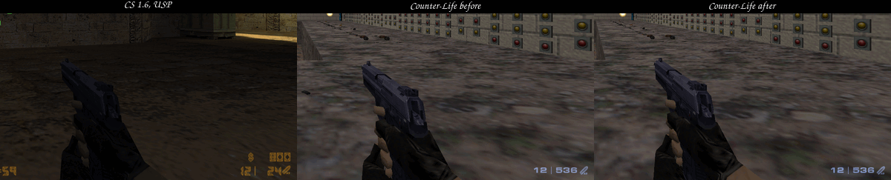 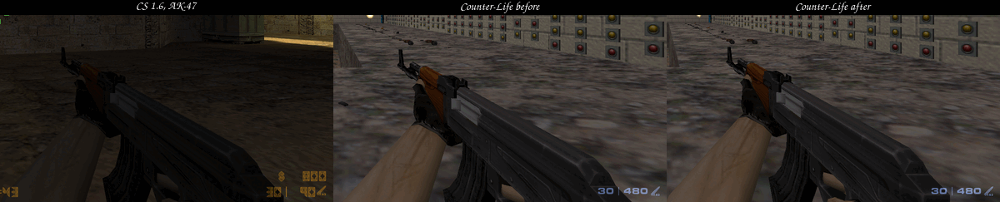
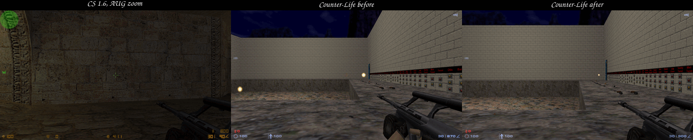 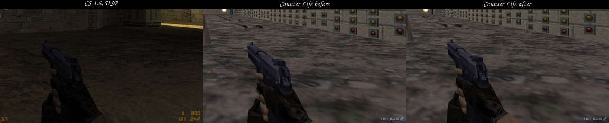

### Scope

After the change the scope is the same at every zoom level of every rifle (largest difference 0.8 pixels), so the tables
give one value per game. A "before" value that differs between zoom levels names its zoom.

| Item                                              | CS 1.6, 1600 × 900 | Before, 1600 × 900             | After, 1600 × 900 |
| ------------------------------------------------- | ------------------ | ------------------------------ | ----------------- |
| Circle centre                                     | 799.4, 449.6       | 799.5, 449.5                   | 799.6, 449.6      |
| Circle diameter                                   | 786.1              | 855.7 (zoom 1), 817.6 (zoom 2) | 786.9             |
| Largest step from a circle                        | 1.5                | 2.1 (32 sides)                 | 0.9               |
| Lines (column, row)                               | 800, 451           | 799–800, 449–450 (2 pixels)    | 800, 450          |
| First black line pixel above and below the centre | 431, 468           | 429, 470 (zoom 1)              | 430, 469          |
| Red centre (columns × rows)                       | 798–801 × 450–453  | 799–800 × 449–450              | 799–801 × 449–451 |
| Mil-dots from the crossing                        | ±22.5 to ±114      | not measured (2-pixel lines)   | ±23 to ±113       |

| Item                                              | CS 1.6, 2560 × 1440 | Before, 2560 × 1440            | After, 2560 × 1440  |
| ------------------------------------------------- | ------------------- | ------------------------------ | ------------------- |
| Circle centre                                     | 1279.4, 719.6       | 1279.5, 719.5 (zoom 2)         | 1279.5, 719.5       |
| Circle diameter                                   | 1256.3              | 1351 (zoom 1), 1307.5 (zoom 2) | 1258.4–1259.2       |
| Lines (column, row)                               | 1280, 721           | 1279–1280, 719–720             | 1280, 720           |
| First black line pixel above and below the centre | 700, 743 (dots)     | –                              | 689, 750            |
| Red centre (columns × rows)                       | 1278–1281 × 720–723 | –                              | 1278–1282 × 718–722 |
| Mil-dots from the crossing                        | ±22.5 to ±114       | –                              | ±36.5 to ±181.5     |

At 2560 × 1440 the first black pixels of CS's lines are its innermost dots, 23 pixels out; its line gap ends 30 pixels
out. The zoom-1 circle of the old model reaches the HUD numbers at 1440 lines, which moves its fitted centre.

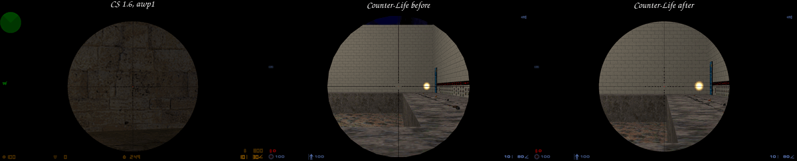 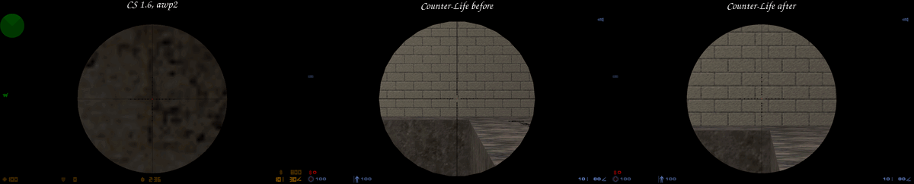
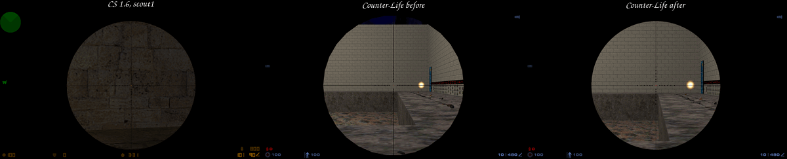
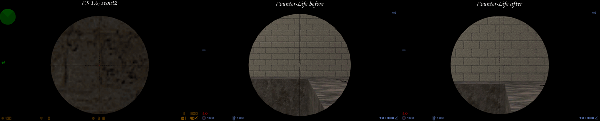 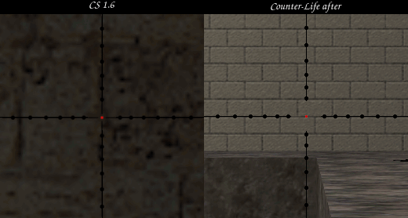
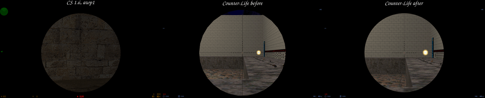 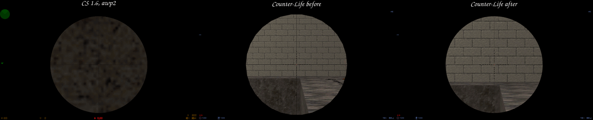
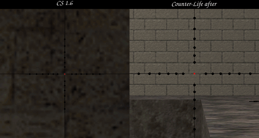

### Reset paths

`tests/e2e/fov-reset.ts` passes all nine checks: a CS weapon shows 74, Sven's medkit 0 (the player's view), the AWP
zooms to 31 and 10, and switching to Sven's medkit while zoomed, death, respawn and dropping the held weapon end
unzoomed. In Counter-Life a dead player holds the next CS weapon (the C4), so the death view is 74, which is CS's 90.

## Limits

- Whole degrees: the normal view and the zooms differ from CS by −0.5 % to +2.5 % in scale (table above).
- AWP second zoom: Sven's engine stops at 10°. The view shows 25 % less magnification than CS's 7.5°. The scope itself
  matches.
- Mouse: with Sven's defaults (`default_fov 70`, `zoom_sensitivity_ratio 1.2`) the normal view of a CS weapon turns 1.27
  times as fast as before, because the client scales the sensitivity whenever the FOV differs from `default_fov`. A
  player who sets `default_fov 74` gets CS's view with no scaling. The zoomed sensitivities are close to CS's: for
  example 31 / 70 × 1.2 = 0.53 against CS's 40 / 90 × 1.2 = 0.53.
- Reticle: CS draws `sniper_scope.spr` pixel for pixel, a model scales with the screen height. The dots match at 900
  lines and are 1.6 times as far apart at 1440 lines. The weapon list's `zoom` crosshair, which Sven also draws pixel
  for pixel at FOV 49 or less, could carry the reticle at every resolution, but the HUD branches hide Sven's crosshair
  (`HIDEHUD_CROSSHAIR`).
- Lines: one pixel wide from 600 to 1800 lines, two at 2160. The horizontal line and the reticle sit one row above CS's
  (row H / 2, CS: H / 2 + 1). CS blends the sprite's own lines to grey inside its centre gap; the model leaves the gap
  empty.
- Walking: Sven's view bob moves the view model forward and back, so the circle grows and shrinks by up to 0.4 % (3
  pixels at 900 lines). CS's scope does not move.
- A `trigger_camera` sets `m_iFOV` to 0 (`server.so` 0x5253d6). A CS weapon gets CS's view back at its next deploy or
  zoom.
- The measurements use software GL under Xvfb, and the two games show different maps (de_dust2 and testcenter). The
  focal lengths do not depend on the map.

## Reproduce

```sh
# CS 1.6 reference: writes .e2e/fov/cs16-1600x900 (development.md, "Compare with Counter-Strike 1.6").
just fixture-fov :96 1600x900
# Counter-Life on an isolated server with the e2e plugin (development.md, "Install on a server").
just sandbox /abs/.svends-fov
export SVEN_SERVER_DIR=/abs/.svends-fov CL_RESOLUTION=1600x900
just install && just install-e2e
just e2e-fov 27017 "$PWD/.e2e/fov/counter-life-1600x900"
just fov-metrics .e2e/fov/cs16-1600x900 .e2e/fov/counter-life-1600x900
deno run -A tests/e2e/fov-reset.ts 27017
# The scope model and the self-checks. A changed model needs a new path.
just scope-model
deno test -R tools/scopegen.ts && deno test -A tests/fixture/fov-metrics_test.ts
```
