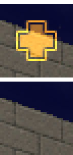
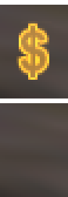
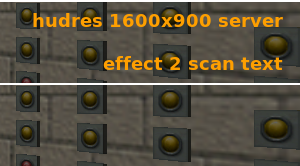
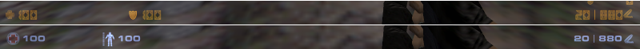
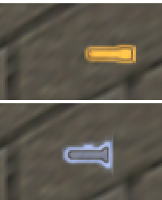
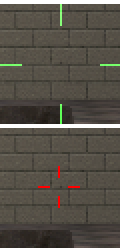
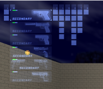
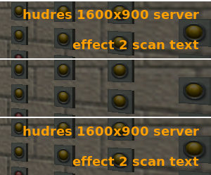
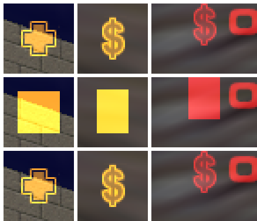
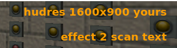

# CS 1.6 HUD foundation

The CS16 Weapons plugin draws a Counter-Strike 1.6 HUD with Sven Co-op custom HUD elements and HUD texts. This page
describes the shared foundation in `scripts/cs16/hud/`. The element code (status, crosshair, kill feed) uses only this
API.

Research that this design uses:

- `docs/research/sven-client-hud.md`: client channels, byte layouts, positions, lifetime of custom elements.
- `docs/research/sven-client-hudtext.md`: `TE_TEXTMESSAGE`, text slots, text positions and font.
- `docs/research/cs16-hud-spec.md`: the CS 1.6 HUD and its proposed Sven mapping (section 5).
- `docs/hud-sprites.md`: the generated sprites in `sprites/cs16/hud/`.
- `docs/hud.md`: the elements that use this foundation, and their comparison with CS 1.6.

## Files

| File                                             | Content                                                                       |
| ------------------------------------------------ | ----------------------------------------------------------------------------- |
| `scripts/cs16/hud/hud.as`                        | entry file, element registry, update loop, resends, precache, cvar `cs16_hud` |
| `scripts/cs16/hud/channels.as`                   | channel map and text slot map                                                 |
| `scripts/cs16/hud/rawhud.as`                     | raw `CustSpr`, `ToggleElem` and `TE_TEXTMESSAGE` senders                      |
| `scripts/cs16/hud/screen.as`                     | screen size of each player, `.hudres`, cvar `cs16_hud_res`                    |
| `scripts/cs16/hud/hidenative.as`                 | hiding of native Sven HUD parts                                               |
| `scripts/cs16/cs16_register.as`                  | calls `CS16HUD::PluginInit()` and `CS16HUD::MapInit()`                        |
| `tests/e2e/hudproof.as`, `tests/e2e/hudproof.ts` | in-game proof (see [In-game proof](#in-game-proof))                           |
| `docs/hud-architecture/*.png`                    | crops of the proof screenshots                                                |

## Write an element

An element is a class that implements `CS16HUD::IHudElement`. Put it in its own file under `scripts/cs16/hud/`, include
the file from `cs16_register.as`, and register it in `PluginInit` after `CS16HUD::PluginInit()`.

```angelscript
namespace CS16HEALTH
{
  final class Health : CS16HUD::IHudElement
  {
    void OnSpawn( CBasePlayer@ player ) {}
    void OnDeath( CBasePlayer@ player ) {}
    void OnTick( CBasePlayer@ player, float dt ) {} // send when the value changes
    void OnResend( CBasePlayer@ player ) {} // send the element from the current state
  }

  void Register()
  {
    CS16HUD::PrecacheSprite( CS16HUD::GENERATED_SPRITE_DIR + "health.spr" );
    CS16HUD::Register( Health() );
  }
}
```

Rules for element code:

1. Draw only with `CS16HUD::SendSprite`, `CS16HUD::HideElement` and `CS16HUD::SendText`, and use the constants of
   `channels.as`. Do not use `g_PlayerFuncs.HudCustomSprite`, `HudNumDisplay` or `HudMessage`. These functions change
   the channel by module type, and `cs16_hud 0` cannot remove what they drew.
2. Draw the full element in `OnResend`. Send an update in `OnTick` only when the value changes. Each message is reliable
   and costs about 70 bytes.
3. `OnSpawn` runs before the client resets its HUD. Update state there, but do not draw. The foundation calls `OnResend`
   after the reset.
4. Code that sends from its own hooks (for example a kill hook) must check `CS16HUD::IsActive( player )` first.
5. Call `Register` and `PrecacheSprite` in `PluginInit`. `MapInit` precaches the sprites for each map. Never use
   `g_Game.PrecacheModel` for a HUD sprite. See [Precache](#precache).
6. Do not return a script class by value from a conditional over handles. See [Screen size](#screen-size).

## API

All names are in the namespace `CS16HUD`.

| Name                   | Declaration                                                                                                                      | Use                                                                                    |
| ---------------------- | -------------------------------------------------------------------------------------------------------------------------------- | -------------------------------------------------------------------------------------- |
| `IHudElement`          | `void OnSpawn(CBasePlayer@)`, `void OnDeath(CBasePlayer@)`, `void OnTick(CBasePlayer@, float dt)`, `void OnResend(CBasePlayer@)` | callbacks of one element. They run only while `cs16_hud` is 1 and the player is ready. |
| `Register`             | `void Register(IHudElement@ element, const bool everyFrame = false)`                                                             | adds an element. `everyFrame`: `OnTick` runs from `PlayerPostThink`.                   |
| `PrecacheSprite`       | `void PrecacheSprite(const string& in spriteName)`                                                                               | name relative to `sprites/`, as in `HUDSpriteParams.spritename`                        |
| `GENERATED_SPRITE_DIR` | `const string GENERATED_SPRITE_DIR = "cs16/hud/"`                                                                                | directory of the generated sprites (`docs/hud-sprites.md`)                             |
| `TICK_PERIOD`          | `const float TICK_PERIOD = 0.05f`                                                                                                | period of the shared tick in seconds                                                   |
| `IsEnabled`            | `bool IsEnabled()`                                                                                                               | `cs16_hud` is 1                                                                        |
| `IsActive`             | `bool IsActive(CBasePlayer@ player)`                                                                                             | `cs16_hud` is 1 and the player is in the server on this map                            |
| `RequestResend`        | `void RequestResend(CBasePlayer@ player)`                                                                                        | `OnResend` of every element at the next tick                                           |
| `SendSprite`           | `void SendSprite(CBasePlayer@ player, uint clientChannel, const HUDSpriteParams& in params)`                                     | `CustSpr` on client channel 0–31. `params.channel` is not used.                        |
| `HideElement`          | `void HideElement(CBasePlayer@ player, uint clientChannel)`                                                                      | `ToggleElem` with visible 0. To show the element again, send it again.                 |
| `SendText`             | `void SendText(CBasePlayer@ player, uint engineSlot, const HUDTextParams& in params, const string& in text)`                     | `TE_TEXTMESSAGE` on engine slot 0–7. `params.channel` is not used.                     |
| `ScreenSize`           | class: `int width`, `int height`, `string ToString() const`                                                                      | screen size in pixels                                                                  |
| `GetScreenSize`        | `ScreenSize GetScreenSize(CBasePlayer@ player)`                                                                                  | the size that the player renders at (a copy)                                           |
| `NATIVE_HIDE_BITS`     | `const int NATIVE_HIDE_BITS`                                                                                                     | the `m_iHideHUD` bits that the foundation sets (810)                                   |

`PluginInit`, `MapInit`, `Tick` and the `On*` hook functions are for `cs16_register.as` and the scheduler only.

## Channel map

The Sven client has 32 custom element slots. A plugin that uses the stock API gets client channels 16–31, and a map
script gets 0–15 (`sven-client-hud.md` 1.3). The raw senders write the client channel directly, so this plugin can use
both groups. The client draws channel 0 first and channel 31 last. One channel holds one element. A message of another
element type on a used channel deletes the old element.

| Client channel | Group  | Constant                         | Element                           | Owner     |
| -------------- | ------ | -------------------------------- | --------------------------------- | --------- |
| 0              | map    | `KILLFEED_ICON_ROW4`             | kill feed weapon icon, row 4      | kill feed |
| 1–4            | map    | `KILLFEED_HEADSHOT_FIRST` + n    | kill feed headshot icon, rows 1–4 | kill feed |
| 5              | map    | `MONEY_DELTA_HIGH`               | money change, high part           | status    |
| 6              | map    | `MONEY_DELTA_LOW`                | money change, low part            | status    |
| 7              | map    | `FLASHLIGHT`                     | flashlight                        | status    |
| 8              | map    | `FLASHLIGHT_ENERGY`              | flashlight, energy part           | status    |
| 9              | map    | `STATUS_ICON`                    | status icon (the carried C4)      | status    |
| 10             | map    | `RADAR_BACKGROUND`               | radar background                  | none yet  |
| 11–15          | map    | `RADAR_DOT_FIRST` + n            | radar dots (`RADAR_DOTS` = 5)     | none yet  |
| 16             | plugin | `CROSSHAIR_WEST`                 | crosshair, west line              | crosshair |
| 17             | plugin | `CROSSHAIR_EAST`                 | crosshair, east line              | crosshair |
| 18             | plugin | `CROSSHAIR_NORTH`                | crosshair, north line             | crosshair |
| 19             | plugin | `CROSSHAIR_SOUTH`                | crosshair, south line             | crosshair |
| 20             | plugin | `HEALTH`                         | health                            | status    |
| 21             | plugin | `ARMOUR`                         | armour                            | status    |
| 22             | plugin | `ARMOUR_FULL`                    | armour, full part                 | status    |
| 23             | plugin | `CLIP`                           | ammo in the clip                  | status    |
| 24             | plugin | `RESERVE_HIGH`                   | reserve ammo, high part           | status    |
| 25             | plugin | `RESERVE_LOW`                    | reserve ammo, low part            | status    |
| 26             | plugin | `AMMO_ICON`                      | ammo icon                         | status    |
| 27             | plugin | `MONEY_HIGH`                     | money, high part                  | status    |
| 28             | plugin | `MONEY_LOW`                      | money, low part                   | status    |
| 29–31          | plugin | `KILLFEED_ICON_PLUGIN_FIRST` + n | kill feed weapon icon, rows 1–3   | kill feed |

`KillfeedIconChannel(row)` gives the weapon icon channel of a kill feed row (row 0 is the oldest line on screen).

Armour and flashlight are two elements each, because their bright part overlaps the base icon (`docs/hud-sprites.md`).
So the always-visible HUD needs 17 elements: the 4 crosshair lines, health, both armour parts, clip, both reserve parts,
the ammo icon, both money parts and the kill feed weapon icons. That is one more than the plugin group holds. Everything
that is always on screen stays in the plugin group, with kill feed rows 1–3. The transient or optional parts (row 4, the
headshot icons, the money change, the flashlight, the status icon and the radar) go to the map group, which the few
stock maps with their own HUD can share (see [Conflicts](#conflicts)). Both parts of an element draw additively, so
their order on the client does not change the picture.

The engine keeps 8 text slots. The stock API gives plugins slots 0–3 and map scripts slots 4–7 (`sven-client-hudtext.md`
1.2). A new text on a slot replaces the old text on that slot. Text and custom elements never share a slot.

| Engine text slot | Constant                         | Text                            | Owner     |
| ---------------- | -------------------------------- | ------------------------------- | --------- |
| 0–3              | `KILLFEED_VICTIM_SLOT_FIRST` + n | kill feed victim name, rows 1–4 | kill feed |
| 4–7              | `KILLFEED_KILLER_SLOT_FIRST` + n | kill feed killer name, rows 1–4 | kill feed |

`KILLFEED_ROWS` is 4. Sven Co-op is a co-operative game, so players do not kill other players. A kill feed row shows a
player who kills a monster, or a monster or the world that kills a player.

## Conflicts

### Stock Sven maps

These stock maps load map scripts that draw custom elements (map group) or texts (map slots):

| Map            | Map script                                     | Client channels                                     | Text slot | Our elements on the same targets                                                         |
| -------------- | ---------------------------------------------- | --------------------------------------------------- | --------- | ---------------------------------------------------------------------------------------- |
| `polar_rescue` | `scripts/maps/polar_rescue.as`                 | 0 timer (time display), 1–5 objective sprites       | none      | kill feed icon row 4, headshot icons rows 1–4, money change high part                    |
| `th_escape`    | `scripts/maps/th_escape/CustomHUD.as`          | 0 timer (time display), 1–3 item sprites            | 4         | kill feed icon row 4, headshot icons rows 1–3, killer name row 1                         |
| `suspension`   | `scripts/maps/bridge/CustomHUD.as` (`bridge3`) | 0 tickets (number display), 1 award sprite          | 4         | kill feed icon row 4, headshot icon row 1, killer name row 1                             |
| `snd`          | `scripts/maps/snd/CustomHUD.as`                | 0–1 tickets and caches (number displays), 2–5 zones | 4         | kill feed icon row 4, headshot icons rows 1–4, money change high part, killer name row 1 |
| `bm_sts`       | `scripts/maps/bm_sts/bm_sts_hudtimer.as`       | 1 timer sprite                                      | none      | headshot icon row 1                                                                      |

The map files are in `svencoop/maps/<map>.cfg` (`map_script` lines) of the dedicated server. No stock map uses client
channels 6–15 or text slots 5–7. Thus the money change low part, the flashlight, the status icon and the radar have no
conflict with stock maps.

On these maps the map script and this plugin write the same targets:

- The last sender wins. A sprite deletes a time or number display on the same channel, and the reverse.
- The map script sends again when its own state changes. Then our element is gone until our next send.
- `HudToggleElement( null, channel, false )` from the map script also hides our element on that channel.
- A map text on slot 4 replaces our killer name of row 1, and the reverse.

The foundation cannot find out if a map script uses a channel. The owner of a map-group element must accept the conflict
or avoid it. Two ways to avoid it: merge the headshot icon into the weapon icon frame (`cs16-hud-spec.md` 5.5,
`killicons.spr`), or show the money change only on maps without these scripts.

### This repository

Before the HUD elements, older code of this repository drew on channels that this map gives to other elements: the money
number display of `BuyMenu.as` (client channel 16), the C4 sprite of `weapon_c4.as` (20) and the old kill feed (21–28
and text slots 0–3). The integrated HUD (`docs/hud.md`) removed all of them: the money element replaces the number
display, the status icon (9) replaces the C4 sprite, and the new kill feed uses its own channels and slots. No other
code of this repository sends custom elements or HUD texts. Other plugins on the same server that use the stock API
still draw on client channels 16–31 and text slots 0–3.

## Raw senders

`rawhud.as` writes the client messages with `NetworkMessage( MSG_ONE, …, player.edict() )`, as the stock API does for
one player. All messages are reliable.

`SendSprite` writes `CustSpr` (ID 140) in the layout of `sven-client-hud.md` 1.2:

| #     | Type    | Field                                     | What `SendSprite` does                       |
| ----- | ------- | ----------------------------------------- | -------------------------------------------- |
| 1     | byte    | client channel                            | refuses a channel above 31                   |
| 2     | long    | flags                                     | as given                                     |
| 3     | string  | sprite name                               | as given                                     |
| 4–5   | byte    | left, top                                 | as given (the type is `uint8`)               |
| 6–7   | short   | width, height                             | clamps to 0–512, as the stock writer         |
| 8–9   | float   | x, y                                      | as given                                     |
| 10–11 | 4 bytes | color1, color2 (r, g, b, a)               | as given                                     |
| 12–13 | byte    | frame, numframes                          | as given                                     |
| 14    | float   | framerate                                 | clamps to 0 or more                          |
| 15–18 | float   | fadeinTime, fadeoutTime, holdTime, fxTime | clamps to 0 or more (holdTime to −1 or more) |
| 19    | byte    | effect                                    | as given                                     |

`HideElement` writes `ToggleElem` (ID 139): byte channel, byte 0. `ToggleElem` cannot show an element again after its
hold time. Send the element again to show it.

`SendText` writes `SVC_TEMPENTITY` with `TE_TEXTMESSAGE` (29) in the layout of `sven-client-hudtext.md` 1.1:

| #     | Type    | Field                   | What `SendText` does                             |
| ----- | ------- | ----------------------- | ------------------------------------------------ |
| 1     | byte    | `TE_TEXTMESSAGE`        |                                                  |
| 2     | byte    | engine slot             | refuses a slot above 7                           |
| 3–4   | short   | x, y                    | `int(value × 8192)`, clamped to −32768–32767     |
| 5     | byte    | effect                  | as given                                         |
| 6–13  | 8 bytes | r1 g1 b1 a1 r2 g2 b2 a2 | as given                                         |
| 14–16 | short   | fadein, fadeout, hold   | `int(seconds × 256)`, clamped to 0–65535         |
| 17    | short   | fxTime                  | `int(seconds × 256)`, written only for effect 2  |
| 18    | string  | text                    | cut to 267 bytes (the client line buffer, below) |

The time fields are unsigned on the client, but `WriteShort` takes an `int16`. AngelScript wraps `int16(51200)` to
−14336 (measured on the server), so the client reads the same 16 bits as 51200, which is 200 s.

A channel above 31 makes the client write past its element array (`sven-client-hud.md` 1.3). Thus `SendSprite` and
`HideElement` refuse it, and `SendText` refuses a slot above 7. The server log then shows a line such as
`[CS16HUD] refused sprite channel 32 (valid: 0-31) for <player>`.

The client copies each text line into a 268-byte stack buffer with no length check (`client.so` 0xE9F7E), so a longer
line overruns the stack and crashes the client. A single 300-byte line segfaults the Sven 5.26 client; 267 bytes is
safe. The server also drops any `TE_TEXTMESSAGE` above its 512-byte message buffer. Thus `SendText` cuts the text to 267
bytes, which fits the line buffer and always sends. An element that needs more text uses more than one slot.

The senders record each client channel and text slot that they used for each player, and the last position of each text.
`ClearText( player, slot )` empties one slot that the plugin drew: it sends an empty text with no hold to the recorded
position, because the client clears every other text at the position of a new text (`sven-client-hudtext.md` 1.4); an
empty text at the default position would clear a map or plugin text that sits there. `cs16_hud 0` (`ClearSent`) hides
the recorded channels and calls `ClearText` for each recorded slot; the kill feed uses `ClearText` for rows that go
empty. Thus turning the CS HUD off does not touch the elements or texts of maps or other plugins.

## Screen size

`GetScreenSize( player )` gives the size that the player renders at. The server cannot read it from the client, but Sven
draws custom sprites 1:1 in screen pixels and scales the text font with the screen height. The crosshair scale and the
kill feed layout need the size.

Sources, highest priority first:

1. The value that the player set with `.hudres <W>x<H>`. The server stores it in
   `scripts/plugins/store/cs16_hudres_<auth id>.txt`. The store cannot make directories, so the name is flat. Each
   character of the auth id that is not a letter or a digit becomes `_`.
2. The server cvar `cs16_hud_res` (default `1920x1080`).

Commands:

- Console: `.hudres` or `.hudres <W>x<H>`.
- Chat: `.hudres`, `/hudres` or `!hudres`, with or without `<W>x<H>`. The chat line is not shown to other players.

Each command tells the player the active size and its source in chat:

```text
[CS HUD] Screen size 1600x900 (yours).
[CS HUD] Screen size 1920x1080 (server default). Set yours with .hudres <width>x<height>.
```

A valid value or no value also draws the whole HUD again. The width must be 640–16384 and the height 480–16384. The
client draws no HUD below 640 px width. A bad value gets an error message and changes nothing. `cs16_hud_res` refuses a
bad value and keeps the old one. A new value draws the HUD again for each player who follows the server value.

On a LAN server (`sv_lan 1`) all players have the auth id `STEAM_ID_LAN` and thus share one stored value. A player whose
auth id is not validated yet (`STEAM_ID_PENDING`) keeps the value only until the next map.

`GetScreenSize` returns a copy, as the API asks. AngelScript in Sven 5.26 needs a default constructor and a copy
constructor for this. The function uses two `return` statements on purpose. A probe plugin showed that
`return own !is null ? own : g_ServerScreen;` (a conditional over handles, copied into a value) crashes the dedicated
server with a segmentation fault. The same copy with `if` and `return`, or a new object, works.

## Native HUD hiding

`hidenative.as` sets these bits in `CBasePlayer.m_iHideHUD`. Their sum is 810.

| Bit | Name                 | Native part that the CS HUD replaces |
| --- | -------------------- | ------------------------------------ |
| 2   | `HIDEHUD_FLASHLIGHT` | flashlight                           |
| 8   | `HIDEHUD_HEALTH`     | health, pain arrows, damage icons    |
| 32  | `HIDEHUD_SUITPOWER`  | armour                               |
| 256 | `HIDEHUD_CROSSHAIR`  | crosshair                            |
| 512 | `HIDEHUD_AMMO`       | ammo numbers and ammo icon           |

Rules:

- The foundation sets the bits with a bitwise OR at each connection, each spawn and each tick. Thus a map or Sven cannot
  clear them for longer than one tick.
- The foundation never sets `HIDEHUD_WEAPONS` (1) or `HIDEHUD_WEAPON_SELECT` (16). These bits also stop weapon selection
  with the slot keys (`sven-client-hud.md` 2.3). The native weapon menu stays.
- The foundation never sets `HIDEHUD_ALL` (4), `HIDEHUD_CUSTOM_MAPS` (64) or `HIDEHUD_CUSTOM_PLUGINS` (128). These bits
  hide the custom elements of the CS HUD.
- The foundation records for each player the bits that it turned on. Bits that were on before stay with their owner.
  `cs16_hud 0` clears only the recorded bits.
- A plugin reload treats the bits that are on as its own, because the previous instance most likely set them.

Limit: when a map sets one of these bits after the foundation set it, `cs16_hud 0` clears it. The foundation cannot see
who else wants a bit.

## Update loop and resends

### Tick

One `g_Scheduler` interval runs `CS16HUD_Tick` every `TICK_PERIOD` (0.05 s). Each tick asserts the hide bits of each
active player, serves a pending resend, and calls `OnTick` of each element that is not an every-frame element. The
fastest automatic CS weapon (P90) fires every 0.066 s, so a 20 Hz tick shows each shot on the ammo counter.

An element can ask for `OnTick` in each player frame with `Register( element, true )`. Sven has no frame hook for
plugins (the hook namespaces are `Game`, `Monster`, `PickupObject`, `Player` and `Weapon`). Thus the foundation uses
`PlayerPostThink`, which runs once for each user command of the player. Its rate is the frame rate of the client.

Measured on the test server and client (the proof logs the rates every 5 s):

- Tick: 17.6–19.1 per second in five runs, not 20. The scheduler runs only in server frames, so each period is a little
  longer than 0.05 s. `OnTick` gets the real time step as `dt`.
- `PlayerPostThink`: 5–87 per second, the frame rate of the test client (the low values when other test clients loaded
  the machine). A fast client gives more calls. An every-frame element must send only when its picture changes.

### When elements draw again

| Event                                   | What the foundation does                                                                |
| --------------------------------------- | --------------------------------------------------------------------------------------- |
| connection, `changelevel`, reconnection | marks the player ready, sets the hide bits, calls `OnResend` after the client HUD reset |
| respawn, revive                         | sets the hide bits, calls `OnSpawn`, then `OnResend` after the client HUD reset         |
| death                                   | calls `OnDeath`                                                                         |
| `cs16_hud 0`                            | clears the recorded hide bits, hides the recorded channels, empties the recorded slots  |
| `cs16_hud 1`                            | sets the hide bits, calls `OnResend` at the next tick                                   |
| `.hudres`, `cs16_hud_res`               | calls `OnResend` at the next tick                                                       |
| plugin reload                           | takes over the connected players, calls `OnResend` at the next tick                     |
| video mode change on the client         | nothing: the server cannot see it. The player types `.hudres` to get the HUD back.      |

Two client resets make these resends necessary:

1. `CHudCustom::VidInit` deletes all 32 custom elements at each level load (`sven-client-hud.md` 1.11). The engine also
   calls `VidInit` when the video mode changes.
2. The `ResetHUD` message clears all HUD texts but no custom element. The `ResetHUD` handler (`client.so` 0xD94D0) calls
   vtable slot 6 (`Reset`) of each HUD part. `CHudMessage::Reset` (0xE99B2) clears its 16 message pointers, their start
   times and the game title. `CHudCustom::Reset` (0xD7F26) is a bare `ret`. The server sends `ResetHUD` after each
   spawn.

The first run of the proof showed the second reset. The foundation drew its texts at the first tick after the
connection, and they never appeared, while the sprites did. The server sends `ResetHUD` from the next `PreThink` of the
player after a spawn (this is the Half-Life SDK order, `UpdateClientData`, and agrees with the proof). Thus the
foundation now waits for two `PostThink` calls after a spawn before it calls `OnResend`. Two calls cover a spawn that
runs before a `PreThink` (connection) and a spawn that runs inside one (respawn). The proof shows the texts after the
first connection, a respawn, a `changelevel` and a reconnection.

At a connection the proof saw no `OnSpawn` call: the first spawn comes before the `ClientPutInServer` hook marks the
player ready. Thus an element must not start only in `OnSpawn`. `OnResend` runs for each connection.

## Precache

`PrecacheSprite( name )` records a sprite name relative to `sprites/`. `MapInit` calls
`g_Game.PrecacheGeneric( "sprites/" + name )` for each recorded name, so clients download the file. Call
`PrecacheSprite` in `PluginInit`, after `CS16HUD::PluginInit()`.

Never precache a HUD sprite with `g_Game.PrecacheModel`. The proof found this defect: when the server precaches a sprite
sheet as a model and the native HUD also loads that sheet, every HUD sprite that is drawn from the sheet becomes a solid
block of its colour after a `changelevel`. The native sprite breaks too. The sprites stay broken until the client
connects again.

`BuyMenu.as` precached its money sign sheet `sprites/cs16/640hud7.spr` as a model. Before `main` moved the weapon lists
to `sprites/cs16/icons/` (merge `fc34436`), the weapon lists loaded the same sheet for the ammo icons. Thus the money
sign and the native ammo icons broke at each `changelevel`. Now the weapon lists load `cs16/icons/640hud7`, so the two
paths differ, but the money sign line was the only model precache of a HUD sheet. This branch changes it to
`PrecacheGeneric`, so the defect cannot come back when two users share a sheet again (for example a CS ammo icon element
that draws from `cs16/icons/640hud7.spr`).

Evidence (the proof element on testcenter before the merge of `fc34436`, a shot before and after
`changelevel testcenter`):

| Users of the sheet                                                                         | After `changelevel`                                              |
| ------------------------------------------------------------------------------------------ | ---------------------------------------------------------------- |
| `cs16/640hud7.spr`: model precache (`BuyMenu.as`), weapon txts, custom elements            | solid blocks, native ammo icon too                               |
| the same, and the proof also precaches the sheet as a model                                | solid blocks                                                     |
| `cs16/640hud7.spr`: generic precache, weapon txts. A copy: model precache, custom elements | all sprites correct                                              |
| a copy only for the proof: generic precache, custom elements                               | proof sprites correct, money sign on `640hud7.spr` a solid block |
| `cs16/640hud7.spr`: generic precache (the `BuyMenu.as` fix), weapon txts, custom elements  | all sprites correct (the proof)                                  |

The cause is not proved in the client binary. A model precache seems to give the sheet the lifetime of a level model,
while the HUD sprite table keeps its handle across levels (`sven-client-hud.md` 1.12). The solid block is what the
renderer draws when the texture of the frame is gone.

The generated sprites of `docs/hud-sprites.md` are in `sprites/cs16/hud/`, thus their names start with
`GENERATED_SPRITE_DIR`. The foundation does not precache them itself. A plugin cannot read files below `sprites/`
(`g_FileSystem.OpenFile` returned null for `sprites/cs16/640hud7.spr` in a probe), so it cannot check if the generator
ran. A precache of a missing file would ask each client for a download that fails. Each element precaches the files that
it uses.

The engine allows 256 HUD sprite paths for one connection (`sven-client-hud.md` 1.12). The generated set uses 14.

## Cvars and commands

| Name                            | Where                  | Default     | Effect                                                  |
| ------------------------------- | ---------------------- | ----------- | ------------------------------------------------------- |
| `cs16_hud`                      | server, administrators | `1`         | 1: CS 1.6 HUD. 0: native Sven HUD, CS elements removed. |
| `cs16_hud_res`                  | server, administrators | `1920x1080` | screen size of players who did not set `.hudres`        |
| `.hudres [<W>x<H>]`             | client console         |             | set or show the own screen size, draw the HUD again     |
| `.hudres`, `/hudres`, `!hudres` | chat                   |             | the same as the console command                         |

The server console reaches the cvars with `as_command`. With this repository's `default_plugins.txt` the plugin has no
`concommandns`, so the name is `.cs16_hud`. With the `README.md` setup (`concommandns "cs16"`) the name is
`cs16.cs16_hud`.

```sh
as_command .cs16_hud 0
as_command .cs16_hud_res 2560x1440
```

## In-game proof

`tests/e2e/hudproof.ts` installs the plugins into a sandbox server and adds the proof element `tests/e2e/hudproof.as` to
the sandbox copy of `cs16_register.as` only. The element draws through the raw senders:

- the CS cross (`640hud7.spr` rect 48, 25, 24×24) on map-group client channel 3 at x 100, y 200,
- the CS dollar (`640hud7.spr` rect 192, 25, 18×25) on plugin-group client channel 31 at x −50, y −60,
- with `HUD_ELEM_ABSOLUTE_X | HUD_ELEM_ABSOLUTE_Y | HUD_ELEM_NO_BORDER` and colour (255, 160, 0, 255),
- a text on engine slot 5 (effect 0) and a text on engine slot 6 (effect 2), both at x = −1/8192, with a hold of 200 s,
- a sprite on channel 32 and a text on slot 8, which the senders must refuse.

Run it on a sandbox with its own display and ports:

```sh
just sandbox "$PWD/../.svends-hudfoundation"
SVEN_SERVER_DIR="$PWD/../.svends-hudfoundation" CL_DISPLAY=:105 CL_LISTEN_PORT=27062 just e2e-hudproof 27061
```

The scenario writes `report.json` and the crops to `.e2e/proof`. It exits with an error when a check fails.

### Results

Last run: the integrated branch `feat/cs16-hud` with all HUD elements (`docs/hud.md`), map testcenter, client at
1600×900 on Xvfb (Mesa llvmpipe), `hud_bordersize` 16. All 55 checks passed. In each crop below, the top part is with
`cs16_hud 1` and the next part is with `cs16_hud 0`.

**(a) Raw sprites at exact pixels.** With `ABSOLUTE` and `NO_BORDER`, x ≥ 0 is the left edge and a negative x puts the
right edge −x pixels from the screen edge (`sven-client-hud.md` 1.5). Thus the cross rect starts at (100, 200) and the
dollar rect at (1600 − 50 − 18, 900 − 60 − 25) = (1532, 815).

The client draws a sprite a little soft. Up to about 10 % of the light of a texel reaches the next pixel (at most 23 of
255), and bright texels clip at 255. Thus the proof compares the box of pixels whose light grew by 64 or more with the
box of texels of 64 or more. The expected boxes are cross (102, 202) 20×20 and dollar (1535, 816) 13×24. The measured
boxes are the same in all four states (first connection, `changelevel`, respawn, reconnection) and again after each
`cs16_hud 1`.

| Map-group client channel 3                                           | Plugin-group client channel 31                                             |
| -------------------------------------------------------------------- | -------------------------------------------------------------------------- |
|  |  |

At each draw the senders build no message for the targets past the limits, and the server log shows:

```text
[CS16HUD] refused sprite channel 32 (valid: 0-31) for Stefan
[CS16HUD] refused text slot 8 (valid: 0-7) for Stefan
```

**(b) Raw text on engine slots 5 and 6.** The text edge is `int((1 − 1/8192) × (1600 − 2 × 16) + 16)` = 1583. Both texts
end exactly there (the box of changed pixels ends at 1583), and their first rows are 3 px below the line tops 450
and 493. The effect 2 text has all its characters, so `fxTime` is at the correct place. 140 s after the first send both
texts were still visible, so a hold above 127.99 s works.



**(c) Native parts hidden, weapon menu working.** With `cs16_hud 1` the native health, armour, ammo, flashlight and
crosshair are not drawn (the CS elements are), and `m_iHideHUD` is 810. The slot key 2 and fire changed the weapon from
`weapon_m4a1` to `weapon_csglock18`.



| Flashlight                                              | Crosshair                                             | Weapon menu (slot 2) with the CS HUD on            |
| ------------------------------------------------------- | ----------------------------------------------------- | -------------------------------------------------- |
|  |  |  |

**(d) Back after `changelevel`, respawn and `cs16_hud`.** The crop shows the texts after `changelevel testcenter` with
`cs16_hud 1`, then 0, then 1 again. The respawn crops are the same image to the byte, because the player came back at
the same place and view. The sprite boxes after these events are in (a).



Before the merge of `fc34436` and without the precache fix, the same `changelevel` broke every sprite from `640hud7.spr`
(row 1: before, row 2: after the `changelevel` with the model precache, row 3: after it with the generic precache):



**(e) `.hudres` and the plugin store.** The server log shows these steps:

1. `cs16_hud_res 1366x768`: a resend with 1366x768.
2. `cs16_hud_res bogus`: `refused cs16_hud_res "bogus" … kept 1366x768`.
3. `cs16_hud_res 1920x1080`: a resend with 1920x1080.
4. `.hudres 1280x720` in the console: a resend with 1280x720.
5. `/hudres 1600x900` in chat: a resend with 1600x900. The store file `cs16_hudres_STEAM_ID_LAN.txt` then contained
   `1600x900`.
6. `.hudres 100x100` in the console: no resend. A bare `!hudres` in chat: one resend with 1600x900.
7. `retry` (a new connection): the first resend used `1600x900 yours` from the store.

The client console shows the replies:

```text
[CS HUD] Screen size 1280x720 (yours).
[CS HUD] Screen size 1600x900 (yours).
[CS HUD] "100x100" is not a screen size. Use .hudres <W>x<H> with W 640-16384 and H 480-16384.
[CS HUD] Screen size 1600x900 (yours).
[CS HUD] Screen size 1600x900 (yours).
```

The chat on the screen shows only the newest line:




## Known limits

- Map-group elements conflict with five stock maps (see [Stock Sven maps](#stock-sven-maps)).
- The server cannot see a video mode change on the client. The player must type `.hudres`.
- On a LAN server all players share one stored `.hudres` value.
- The `m_iHideHUD` ownership cannot see a map that sets the same bit later (see
  [Native HUD hiding](#native-hud-hiding)).
- Each element message is reliable. A crosshair that sends in each frame can overflow the reliable channel. Send only
  changes.
