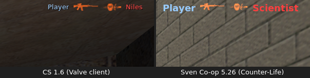
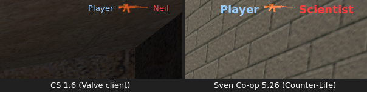
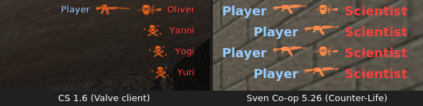
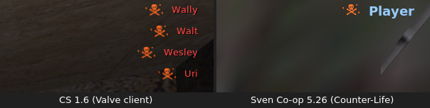
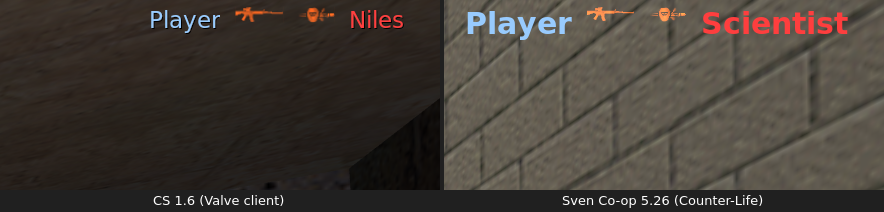
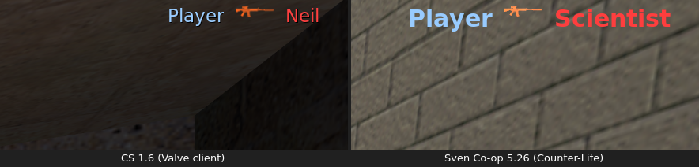
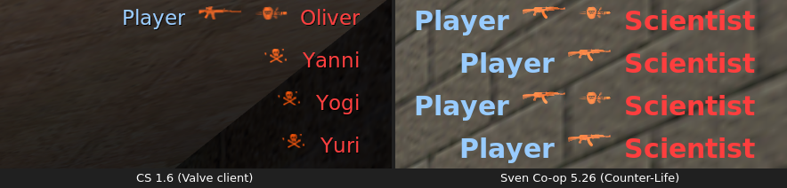
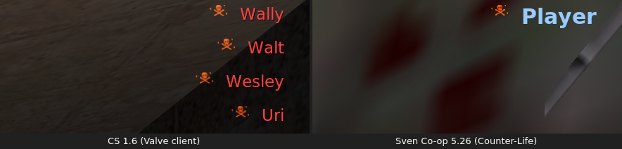

# CS 1.6 HUD in Sven Co-op

The CS16 Weapons plugin draws the Counter-Strike 1.6 HUD from the server, because the Sven Co-op client is closed
source. Each part is an element of the HUD foundation in `scripts/cs16/hud/` (`CS16HUD::IHudElement`, the channel map in
`channels.as`). This document tells how each part copies CS 1.6, how it was measured, and what Sven cannot copy.

## Kill feed

`scripts/cs16/killfeed.as` (namespace `CS16KILLFEED`) copies `CHudDeathNotice` of the Valve CS 1.6 client. The reference
is [cs16-killfeed-reference.md](research/cs16-killfeed-reference.md), which measured the Valve client.

### Layout and timing

`W` and `H` are the screen width and height of the player. `s(n) = ⌊n × H / 480⌋`.

| Item      | Value                                                                                                                                                                                                          |
| --------- | -------------------------------------------------------------------------------------------------------------------------------------------------------------------------------------------------------------- |
| Rows      | 4 at most. A new notice goes to the bottom. A fifth notice removes the oldest.                                                                                                                                 |
| Lifetime  | 6.0 s. The oldest notice expires first, and the rows below it move up together.                                                                                                                                |
| Row top   | `s(32) + i × s(16)` for row `i` (0 is the top row). The icons and the names use the same top.                                                                                                                  |
| Parts     | Right to left: the victim name ends at `W − s(12)`, then `s(5)`, the headshot icon and `s(5)` (headshots only), the weapon icon, `s(5)`, and the killer name.                                                  |
| Names     | Players in the CT colour (153,204,255), monsters in the T colour (255,63,63).                                                                                                                                  |
| Icons     | `d_<weapon>` rects of `cs16/icons/640hud1.spr`, `640hud2.spr` and `640hud16.spr` (the `hud.txt` 640 rows), 16 px high, 1:1, added to the screen with the tint (255,80,0). The headshot icon has the same tint. |
| No killer | A death from the world or from the victim itself has no killer name, as a CS suicide.                                                                                                                          |
| Console   | Each notice also prints the `death.cpp` line to the console of every player, for example `*** Player killed Scientist with a headshot from m4a1 ***`.                                                          |

The data for one notice comes from the `PlayerKilled` and `MonsterKilled` hooks:

- Victims: every player death, and every monster that a player kills. A monster counts once, while its dead flag is
  still `DEAD_NO` (Sven calls the hook again for a monster that takes damage while it dies). Monsters show by Sven's
  name for them (`m_FormattedName`, for example "Head Crab").
- Weapon: the weapon string of the CS `DeathMsg` (ReGameDLL `CHalfLifeMultiplay::DeathNotice`). When the killer is a
  player and also the inflictor, the weapon is the item in his hands. The CS weapons inflict their bullets with the
  player, so this is the usual case. Else the inflictor (`pev.dmg_inflictor` of the victim) names the weapon, for
  example `weapon_m4a1` for the scripted e2e kills and `proj_cs16grenade` for an HE grenade. The prefixes `weapon_`,
  `monster_` and `func_` are removed, and the plugin classes get their CS names (`weapon_csdeagle` is `deagle`, the
  grenade is `grenade`). A weapon without a `d_` icon shows `d_skull`, as in CS.
- Headshot: the victim's `m_LastHitGroup` is `HITGROUP_HEAD` when it dies. `WeaponBase` gives `TraceAttack` the hit
  group `HITGROUP_GENERIC`, so that the engine adds no multiplier of its own. `CS16BASE::RestoreHitGroup` then puts the
  real hit group back before the damage lands. Thus real bullets and `e2e.kill head` both give a headshot.

### Messages

| Part          | Where                                                                                   |
| ------------- | --------------------------------------------------------------------------------------- |
| Weapon icon   | `KillfeedIconChannel(row)`: plugin channels 29–31 for rows 0–2, map channel 0 for row 3 |
| Headshot icon | map channels 1–4 (`KILLFEED_HEADSHOT_FIRST + row`)                                      |
| Victim names  | engine text slots 0–3 (`KILLFEED_VICTIM_SLOT_FIRST + row`)                              |
| Killer names  | engine text slots 4–7 (`KILLFEED_KILLER_SLOT_FIRST + row`)                              |

- The icons use `HUD_ELEM_ABSOLUTE_X | HUD_ELEM_ABSOLUTE_Y | HUD_ELEM_NO_BORDER`, so x and y are screen pixels. Their
  width and height are never 0 (0 means "to the edge of the sheet").
- A row goes out only when it shows another notice: a new notice, rows that move up, or a resend (connection, map
  change, `cs16_hud 1`, a new screen size). For each player the server keeps the serial number of the notice in each
  row, so each text goes out once for each change.
- Every part goes out with the remaining time of its notice as the hold time. Thus the client removes an expired row by
  itself. The server moves the other rows up at its next HUD tick (at most 50 ms later).
- A new notice shows at the next HUD tick after the kill (at most 50 ms).

### Name position and width

A `HudMessage` position is a fraction of the screen inside the HUD border `b` (`hud_bordersize`, default 16). For
`−1 < x < 0` the client puts the left end of a line of width `w` at `⌊(x + 1) × (W − 2b) + b − w⌋`
([sven-client-hudtext.md](research/sven-client-hudtext.md) §2). To end a name at the pixel column `R`, the server sends

`x = round(((R + 0.5 − b) / (W − 2b) − 1) × 8192) / 8192`, at most `−1/8192`,

and `y = round((top + 0.5 − b) / (H − 2b) × 8192) / 8192` for the top. The half pixel keeps the 1/8192 step and the
float rounding of the client inside the wanted pixel. The server uses `b = 16`, because it cannot read the value of the
player. With `hud_bordersize b'` the names move about `16 − b'` px to the right and `b' − 16` px down, against the
icons. Above `W − b` the client moves the line back inside the border.

The server must know the width of each name in pixels, to put the icons and the killer name next to it. The Sven client
adds the width of each byte of the text (`charWidths`) in the face of the `HudMessage` font:

1. `svencoop/resource/TrackerScheme.res` gives `CreditsFont` the name "Ariel", tall 12 and weight 600. VGUI2 scales the
   tall with the screen height: `tall = ⌊12 × H / 480⌋`, at most 128.
2. On Linux, `hw.so` (0x1C9E90, 0x1CA070) asks fontconfig for the family, the weight 600 as it is, and the slant. With
   the default fontconfig of this host, "Ariel" gives `NotoSans-Black.ttf`. `hw.so` then selects the Apple Roman cmap of
   the face (`FT_Select_Charmap(face, 'armn')`, 0x1CA27B). Noto Sans has none, so the client cannot create the font: its
   log shows `Unable to create font 'Ariel': Can't select charmap`. VGUI2 then uses the fallback "Tahoma", which `hw.so`
   asks for as "Bitstream Vera Sans", and fontconfig gives `VeraBd.ttf` (Bitstream Vera Sans Bold).
3. The em size is `⌊tall × unitsPerEm / (usWinAscent + usWinDescent)⌋` = `⌊tall × 2048 / 2384⌋`: 18 px at H = 900, 30 px
   at H = 1440. Each byte is one glyph code of the Apple Roman cmap. Its width is the hinted advance (FreeType
   `FT_MulFix`), rounded to whole pixels.

`tools/hudfont.ts` reads the face and writes `scripts/cs16/hud/textfont.as`: the advances in font units, by byte.
`just hud-font` finds the face with the same two fontconfig requests. `TextWidth` in `killfeed.as` and `lineWidth` in
the tool do the same sum. The client draws an outline around each text line with `hud_debug 2`, and its width is the sum
of the glyph widths. `tools/hudfont_test.ts` holds 20 outlines measured that way (printable ASCII, bytes 128–254 and
four names) at 1600x900 and 2560x1440. All 40 widths agree with the table.

This corrects [sven-client-hudtext.md](research/sven-client-hudtext.md) §3: fontconfig maps "Ariel" to Noto Sans, but
the client cannot use that face.

### Screen size

The icons are in screen pixels, and the name widths depend on `H`. Thus each player needs his real screen size: the
player types `.hudres <W>x<H>`, or the server sets `cs16_hud_res` (default 1920x1080) for players who did not
(`scripts/cs16/hud/screen.as`). With a wrong size the names stay near the corner (they are fractions), but the icons do
not. For example, with 1920x1080 on a 1600x900 client the icons are off the screen. A new size sends the rows again. The
e2e driver sets `cs16_hud_res` to `CL_RESOLUTION` when it starts the server.

### Measured against CS 1.6

`just e2e-killfeed` and `just e2e-hud` (step `killfeed-4`) made the Counter-Life captures on display `:109`.
`just fixture-metrics` measured the lit pixels against a frame of the same view without notices (the `-clear` frame, or
the `hurt` step for `killfeed-4`). The CS 1.6 values come from the reference captures.

| Fact (lit pixels)                       | CS 1.6, 1600x900          | Counter-Life, 1600x900    | CS 1.6, 2560x1440         | Counter-Life, 2560x1440   |
| --------------------------------------- | ------------------------- | ------------------------- | ------------------------- | ------------------------- |
| Icon tops, rows 0–3                     | 61, 91, 121, 151          | 61, 91, 121, 151          | 97, 145, 193, 241         | 97, 145, 193, 241         |
| Name tops, rows 0–3                     | 63, 93, 123, 153          | 63, 93, 123, 153          | 100, 148, 196, 244        | 101, 149, 197, 245        |
| Right margin (last lit pixel to edge)   | 22–23                     | 22                        | 36–37                     | 36                        |
| Gaps, killer → icon → headshot → victim | 9, 11, 9                  | 9, 11, 10                 | 15, 17, 16                | 15, 17, 17                |
| `d_m4a1` lit box                        | 48 × 15                   | 47 × 14                   | 48 × 15                   | 47 × 14                   |
| Name colour (brightest pixels)          | 255,63,63 and 153,204,255 | 254,62,62 and 152,203,254 | 255,63,63 and 153,204,255 | 254,62,62 and 152,203,254 |
| Icon tint: added green ÷ red, blue      | 0.314, 0                  | 0.315, 0                  | 0.314, 0                  | 0.315, 0                  |

The rect rule is the same in both clients. With the headshot captures at 1600x900:

| Rect                   | CS 1.6 (victim "Niles", box 33 px) | Counter-Life (victim "Scientist", box 90 px) |
| ---------------------- | ---------------------------------- | -------------------------------------------- |
| Victim box             | 1545–1578                          | 1488–1578                                    |
| `d_headshot` (36 × 16) | x 1500 = 1545 − 9 − 36             | x 1443 = 1488 − 9 − 36                       |
| `d_m4a1` (48 × 16)     | x 1443 = 1500 − 9 − 48             | x 1386 = 1443 − 9 − 48                       |
| Killer box ends        | 1434 = 1443 − 9                    | 1377 = 1386 − 9                              |

The x positions differ only by the width of the victim name. A timed run at 1600x900 killed five scientists 1 s apart
(at 0.15, 1.14, 2.09, 3.13 and 4.12 s) and counted the rows: 4 at 5.5 s and 6.5 s, 3 at 7.8 s, 2 at 8.8 s, 1 at 9.8 s
and none at 10.8 s. Each notice stayed 6 s, the fifth notice removed the first, and the rows moved up.

The tint row is the median over the icon pixels whose red did not reach 255 (80/255 = 0.314). The added red peaks at
164–194 in the Counter-Life captures and at 207–211 in the CS captures, because the Counter-Life captures have a bright
wall behind the feed and an additive draw stops at 255.

Comparison crops (CS 1.6 left, Counter-Life right):

 
 
 
 

The CS world-death crop shows the `max4` capture (`bot_kill` deaths), because the reference has no single world death.

### What Sven cannot copy

- Font face, size and weight. CS draws the names with its console font (Verdana, which fontconfig gives as Noto Sans
  Regular here, 14 px at H = 900 and 24 px at H = 1440). Sven draws `HudMessage` text with its scheme font, here
  Bitstream Vera Sans Bold at an 18 px em (H = 900) or a 30 px em (H = 1440). The names are larger and bolder. The tops
  agree within 1 px, but the Sven names go further down and further left.
- The drop shadow. CS draws each name a second time in black, 1 px right and 1 px down. `HudMessage` has no shadow, and
  the eight text slots already hold the eight names, so a black copy is not possible.
- Other systems. The table is correct for a Linux client with the default fontconfig of this host. A Windows client maps
  "Ariel" with GDI and gets other widths, so its icons and killer names can be some pixels away from the victim names.
  The server cannot know the face of a client.
- The name colour. The Sven client draws the text one step darker than the colour that it gets (254,62,62 for
  255,63,63). 255 is the largest value, so the server cannot add the step.
- The icon edges. CS draws the HUD sprites with bilinear filtering half a pixel off the texel grid, so each CS icon
  spreads 1 px to the right and down. Sven draws the sheet rects 1:1, so the lit box of each icon is 1 px narrower and
  shorter. The positions of the rects are the same.
- `hud_bordersize`. The server assumes 16 (see [Name position and width](#name-position-and-width)).
- The console line. CS prints it to the console only. The Sven client also shows console prints for some seconds in the
  top-left corner of the screen. At 2560x1440 that corner showed unreadable characters for every console print, also for
  an `echo` from the server, so this comes from the client, not from the kill feed.
- Sven's own death message. The Sven server also prints each death as a notify line in the top-left corner (for example
  "Player fell or something."). No AngelScript API stops it ([sven-client-hudtext.md](research/sven-client-hudtext.md)
  §6).
- Team colours and team kills. In co-op all players are one team, so every player name is CT blue, every monster name is
  T red, and there is no green team-kill icon. Monsters that monsters kill, and monsters that die from the world, get no
  notice.

### Test

```sh
export SVEN_SERVER_DIR=/abs/path/.svends-x CL_DISPLAY=:109 CL_LISTEN_PORT=27076 CL_RESOLUTION=1600x900
just install && just install-e2e
just e2e-killfeed 27075 weapon_m4a1 head     # also body (real shots) and world (e2e.hurt 500 with no armour)
just fixture-metrics .e2e/shots/killfeed-weapon_m4a1-head.png .e2e/shots/killfeed-weapon_m4a1-head-clear.png
just e2e-hud 27075 run1                      # step killfeed-4: four rows from e2e.kill, head and body in turn
deno test -R -E tools/hudfont_test.ts        # the width model against the measured outlines
```

The head scenario shoots real bullets at a pinned scientist until it dies. `e2e.aim head` aims 8% of the box height
below the top of the monster's box, as the CS fixture does, because a monster's eye position lies below its head hit
box. A first shot can still miss, and then the loop shoots again.
