# CS 1.6 HUD

The CS16 Weapons plugin draws the Counter-Strike 1.6 HUD in Sven Co-op 5.26. The Sven client is closed source, so the
server draws each HUD part with Sven custom HUD elements (`CustSpr`) and HUD texts (`TE_TEXTMESSAGE`). This page gives
the architecture, the channel map, the behaviour of each element, the measured comparison with CS 1.6 at 1600×900 and
2560×1440, and the limits that a server cannot remove.

Related pages:

- [`hud-architecture.md`](hud-architecture.md): the foundation in detail (API, raw senders, resends, precache, proof).
- [`hud-sprites.md`](hud-sprites.md): the generated HUD sprites in `sprites/cs16/hud/`.
- [`research/cs16-hud-spec.md`](research/cs16-hud-spec.md): the CS 1.6 HUD, from Valve's `client.so`.
- [`research/sven-client-hud.md`](research/sven-client-hud.md) and
  [`research/sven-client-hudtext.md`](research/sven-client-hudtext.md): how the Sven client draws elements and texts.
- [`research/cs16-killfeed-reference.md`](research/cs16-killfeed-reference.md): the measured CS 1.6 kill feed.

## Architecture

### Files

| File                                                                              | Content                                                                                    |
| --------------------------------------------------------------------------------- | ------------------------------------------------------------------------------------------ |
| `scripts/cs16/hud/hud.as`                                                         | foundation: element registry, 20 Hz tick, per-frame tick, resends, precache, `cs16_hud`    |
| `scripts/cs16/hud/channels.as`                                                    | the channel map and the text slot map                                                      |
| `scripts/cs16/hud/rawhud.as`                                                      | raw `CustSpr`, `ToggleElem` and `TE_TEXTMESSAGE` senders, `ClearText`, `ClearSent`         |
| `scripts/cs16/hud/screen.as`                                                      | screen size of each player: `.hudres`, the plugin store, `cs16_hud_res`                    |
| `scripts/cs16/hud/hidenative.as`                                                  | hides the native Sven health, armour, ammo, flashlight and crosshair                       |
| `scripts/cs16/hud/draw.as`                                                        | shared drawing of the status elements: CS colours, fades, a sprite part at its CS position |
| `scripts/cs16/hud/status.as`                                                      | precaches and registers the status elements                                                |
| `health.as`, `armour.as`, `ammo.as`, `money.as`, `flashlight.as`, `statusicon.as` | one status element each                                                                    |
| `scripts/cs16/hud/crosshair.as`                                                   | the dynamic crosshair (namespace `CS16CROSSHAIR`)                                          |
| `scripts/cs16/killfeed.as`, `scripts/cs16/hud/textfont.as`                        | the kill feed (namespace `CS16KILLFEED`) and the glyph widths of the HudMessage font       |
| `scripts/cs16/base.as`                                                            | weapon hooks: the shot counter, the silencer and burst state, the real hit group           |
| `scripts/cs16/BuyMenu.as`, `scripts/DamageMoneyScore.as`                          | report each money change and each failed purchase to the money element                     |
| `scripts/cs16/cs16_register.as`                                                   | calls the foundation and registers the elements                                            |

### Lifecycle

`cs16_register.as` starts the HUD in this order in `PluginInit`:

1. `CS16HUD::PluginInit()`: the foundation. It registers the player hooks, the cvars `cs16_hud` and `cs16_hud_res`, the
   `.hudres` command and the 20 Hz tick.
2. `CS16HUD::RegisterStatus()`: health, armour, ammo, money, flashlight and the C4 status icon, and their sprites.
3. `CS16CROSSHAIR::Register()`: the crosshair, as an element with `everyFrame`.
4. `CS16KILLFEED::PluginInit()`: the kill feed, its icon sheets and its `PlayerKilled` and `MonsterKilled` hooks.

`MapInit` calls `CS16KILLFEED::MapInit()` (old notices go) and then `CS16HUD::MapInit()`, which precaches every sprite
of every element as a generic resource.

Each element implements `CS16HUD::IHudElement`:

| Callback   | When                                                                                                                                                           | What the elements do                                                            |
| ---------- | -------------------------------------------------------------------------------------------------------------------------------------------------------------- | ------------------------------------------------------------------------------- |
| `OnTick`   | every 0.05 s; the crosshair in every `PlayerPostThink` of its player                                                                                           | read the player state and send only what changed                                |
| `OnResend` | after a connection and a map change, two `PlayerPostThink`s after each spawn (after the client's `ResetHUD`), after `cs16_hud 1`, `.hudres` and `cs16_hud_res` | send the whole element again; a running fade continues, it does not start again |
| `OnSpawn`  | after a spawn or a revive, before the client resets its HUD                                                                                                    | update state only: the ammo fade restarts, the money fades in from green        |
| `OnDeath`  | when the player dies                                                                                                                                           | the crosshair hides its lines                                                   |

All callbacks run only while `cs16_hud` is 1 and the player is in the server on this map. With `cs16_hud 0` the
foundation removes every element and text that it drew (`ClearSent`) and gives the native Sven HUD back. With
`cs16_hud 1` it hides the native parts again and resends all elements.

The data goes one way: game state (player fields, weapon scripts, the buy menu wallet, kill hooks) → elements → raw
senders → client. No element reads another element. The weapon scripts only count shots (`g_PlayerShotsFired`) and give
their silencer and burst state (`IWeaponState`). The buy menu and the damage money only call `CS16HUD::ShowMoney` and
`CS16HUD::BlinkMoney`.

### Screen size

Sven draws HUD sprites 1:1 in screen pixels and scales the HudMessage font with the screen height. The server cannot
read the client's screen size. Thus each player has a size: the player's own `.hudres <W>x<H>` (kept in the plugin
store), else the server cvar `cs16_hud_res` (default `1920x1080`). The crosshair scale, the kill-feed layout and the
name widths use this size. The status elements are placed from the screen edges or as screen fractions, so they do not
need it.

## Channel map

The Sven client keeps 32 custom elements: client channels 0–15 (the map-script group) and 16–31 (the plugin group). The
raw senders write the client channel directly, so this plugin uses both groups. The engine keeps 8 text slots. The map
is in `scripts/cs16/hud/channels.as`; [`hud-architecture.md`](hud-architecture.md#channel-map) explains the choice and
the conflicts with five stock maps.

| Client channel | Group  | Element                                                  | File            |
| -------------- | ------ | -------------------------------------------------------- | --------------- |
| 0              | map    | kill feed weapon icon, row 4                             | `killfeed.as`   |
| 1–4            | map    | kill feed headshot icons, rows 1–4                       | `killfeed.as`   |
| 5, 6           | map    | money change row: sign and hundreds, the last two digits | `money.as`      |
| 7, 8           | map    | flashlight: casing and beam, energy bar                  | `flashlight.as` |
| 9              | map    | status icon (the carried C4)                             | `statusicon.as` |
| 10–15          | map    | radar background and dots (reserved)                     | none            |
| 16–19          | plugin | crosshair lines: west, east, north, south                | `crosshair.as`  |
| 20             | plugin | health                                                   | `health.as`     |
| 21, 22         | plugin | armour: icon and digits, full part                       | `armour.as`     |
| 23             | plugin | clip and bar                                             | `ammo.as`       |
| 24, 25         | plugin | reserve: first two cells, last cell                      | `ammo.as`       |
| 26             | plugin | ammo icon                                                | `ammo.as`       |
| 27, 28         | plugin | money: dollar and three cells, last two cells            | `money.as`      |
| 29–31          | plugin | kill feed weapon icons, rows 1–3                         | `killfeed.as`   |

| Engine text slot | Text                             | File          |
| ---------------- | -------------------------------- | ------------- |
| 0–3              | kill feed victim names, rows 1–4 | `killfeed.as` |
| 4–7              | kill feed killer names, rows 1–4 | `killfeed.as` |

No other code of this repository draws custom elements or HUD texts. `HUD_PRINTCENTER` messages of the C4 use the
centre-print path, not the text slots.

## Status elements

The status elements are the CS 1.6 HUD parts that are always on the screen: health, armour, ammo, money, flashlight and
the c4 status icon. `CS16HUD::RegisterStatus()` (`scripts/cs16/hud/status.as`) precaches their sprites and registers
them. `cs16_register.as` calls it in `PluginInit`, after `CS16HUD::PluginInit()`.

| Element    | File            | Client channels                                                                                    | Sprites                                                                                | CS 1.6 reference       |
| ---------- | --------------- | -------------------------------------------------------------------------------------------------- | -------------------------------------------------------------------------------------- | ---------------------- |
| Health     | `health.as`     | 20 `HEALTH`                                                                                        | `health.spr`                                                                           | `cs16-hud-spec.md` 3.1 |
| Armour     | `armour.as`     | 21 `ARMOUR`, 22 `ARMOUR_FULL`                                                                      | `armor.spr` + `armor_full.spr`, or `armor_helmet.spr` + `armor_helmet_full.spr`        | 3.2                    |
| Ammo       | `ammo.as`       | 23 `CLIP`, 24 `RESERVE_HIGH`, 25 `RESERVE_LOW`, 26 `AMMO_ICON`                                     | `clip.spr`, `two_cells.spr`, `reserve_lo.spr`, a rect of `cs16/icons/640hud7.spr`      | 3.3                    |
| Money      | `money.as`      | 27 `MONEY_HIGH`, 28 `MONEY_LOW`; change row: 5 `MONEY_DELTA_HIGH`, 6 `MONEY_DELTA_LOW` (map group) | `money_hi.spr`, `two_cells.spr`, `money_delta_plus_hi.spr`, `money_delta_minus_hi.spr` | 3.5                    |
| Flashlight | `flashlight.as` | 7 `FLASHLIGHT`, 8 `FLASHLIGHT_ENERGY` (map group)                                                  | `flashlight.spr` + `flashlight_energy.spr`                                             | 3.13                   |
| c4 icon    | `statusicon.as` | 9 `STATUS_ICON` (map group)                                                                        | the rect (0, 148, 32, 32) of `cs16/icons/640hud7.spr`                                  | 3.10                   |

`draw.as` has the shared parts: the CS colours, the fades, the part of a sprite at its CS position, and the gate
`ShowsStatus`.

### Positions

Each part has the content size of its sprite as `width` and `height`, and the x and y of the contract in
[`hud-sprites.md`](hud-sprites.md). `tests/hud-elements.test.ts` compares each size with the generated sprite.

| Part                          | x, y                                | Flags                                                   | CS box at 1600×900   |
| ----------------------------- | ----------------------------------- | ------------------------------------------------------- | -------------------- |
| Health                        | 12, −12                             | `ABSOLUTE_X`, `ABSOLUTE_Y`, `NO_BORDER`                 | (12, 863)            |
| Armour, both parts            | 0.2 (fraction), −12                 | `ABSOLUTE_Y`, `NO_BORDER`                               | (320, 863) = W/5     |
| Clip and bar                  | −112, −12                           | `ABSOLUTE_X`, `ABSOLUTE_Y`, `NO_BORDER`                 | (1416, 863)          |
| Reserve, first two cells      | −62, −12 (no clip: −64)             | as the clip                                             | (1498, 863)          |
| Reserve, last cell            | −42, −12 (no clip: −44)             | as the clip                                             | (1538, 863)          |
| Ammo icon                     | −18, −16 (no clip: −20)             | as the clip                                             | (1558, 860)          |
| Money, dollar and three cells | −56, −50 (no suit: −100)            | as the clip                                             | (1466, 825)          |
| Money, last two cells         | −16, −50 (no suit: −100)            | as the clip                                             | (1544, 825)          |
| Change row                    | as the money, y −87 (no suit: −137) | as the clip                                             | `+` at (1467, 788)   |
| Flashlight, both parts        | 1.0 (fraction), 16                  | `ABSOLUTE_Y`, `NO_BORDER`                               | (1552, 16)           |
| c4 icon                       | 12, −21                             | `ABSOLUTE_X`, `ABSOLUTE_Y`, `SCR_CENTER_Y`, `NO_BORDER` | (12, 413) = H/2 − 37 |

The fraction 0.2 gives W/5 at every screen width. The fraction 1.0 puts the flashlight flush with the right edge, which
pixels cannot do (`sven-client-hud.md` 1.5). The c4 icon y is relative to the screen centre, so it follows H.

### Colours and fades

Each element sends the raw CS colour with the CS alpha in A. Sven multiplies RGB by A with the truncation of CS
`ScaleColors` (`sven-client-hud.md` 1.9), so the pixels are the CS pixels. No element sets `HUD_ELEM_DYNAMIC_ALPHA` or
`HUD_ELEM_DEFAULT_ALPHA`, and every element has `holdTime` −1.

A CS fade is Sven effect 2 (`HUD_EFFECT_RAMP_DOWN`) from the start colour (`color2`) to the end colour (`color1`) with
`HUD_ELEM_EFFECT_ONCE`. Sven ramps all four bytes and then multiplies, as CS does, so the fade is exact. An element that
is sent again during its fade (a resend after `.hudres`, a reserve change, a new armour type) starts its ramp at the
colour that the fade reached and keeps the time that is left. Thus the fade continues and does not start again.

| Element    | Colour                                                                                 | Fade                                                       |
| ---------- | -------------------------------------------------------------------------------------- | ---------------------------------------------------------- |
| Health     | HUD orange (255, 160, 0); 25 or less: low red (250, 0, 0)                              | alpha 228 to 100 in 5 s after each new value               |
| Health     | 15 or less: low red at alpha 255                                                       | none                                                       |
| Armour     | HUD orange                                                                             | 228 to 100 in 5 s after each new value                     |
| Ammo       | HUD orange                                                                             | 200 to 100 in 5 s after a new weapon, clip, FOV or a spawn |
| Money      | gain: green (0, 255, 0) to HUD orange; loss: red (255, 0, 0) to HUD orange             | 228 to 100 in 5 s after each change                        |
| Change row | the money colour, faded out in 2.5 s                                                   | see [Money](#money)                                        |
| Flashlight | HUD orange; battery below 20 %: alert red (255, 16, 16)                                | none: alpha 225 when on, 100 when off                      |
| c4 icon    | status green (0, 160, 0) at alpha 255; in a bomb target it flashes low red every 0.1 s | none                                                       |

### Values and frames

| Element    | Source                                                                           | Frame                                                                                    |
| ---------- | -------------------------------------------------------------------------------- | ---------------------------------------------------------------------------------------- |
| Health     | `pev.health`: an int, 1 for a living player below 1                              | 0–255                                                                                    |
| Armour     | `pev.armorvalue`                                                                 | 0–255; the full part 0–100                                                               |
| Ammo       | the active weapon: `m_iClip`, `m_rgAmmo(PrimaryAmmoIndex())`                     | clip 0–255; reserve 0–999                                                                |
| Money      | the CS16 buy menu wallet (`BuyMenu::BuyPoints`)                                  | 0–25599: `money_hi.spr` frame = money / 100, `two_cells.spr` frame of the last two cells |
| Flashlight | `FlashlightIsOn()`, `m_iFlashBattery`                                            | on 1 / off 0; energy 0–100                                                               |
| c4 icon    | `weapon_c4` in the inventory with ammo; the bomb target keyvalue `$i_inBombZone` | –                                                                                        |

CS sends the reserve ammo as a byte, but the weapons of this port carry up to 1000 rounds. The two cell groups of the
reserve can show 0–999, so the reserve shows its real value up to 999.

The elements read their values at each tick (20 Hz) and send only what changed. The money is the exception: the buy menu
and the damage money report each change (see [Money](#money)).

### Gates

- Health, armour, ammo and the flashlight need the HEV suit and are hidden for a spectator, as in CS (`cs16-hud-spec.md`
  2.5). The native Sven parts that they replace need the suit too.
- Without the suit, the money moves up to H − 125 (CS `H - 5 fh`). A spectator sees no money.
- The c4 icon shows while the player carries the C4.

### Ammo

CS draws the ammo counter only for a weapon with a primary ammo type. Thus the knife shows nothing, as in CS.

A weapon with a clip shows clip, bar, reserve and icon. A weapon without a clip (HE grenade, C4) shows the reserve and
the icon 2 px further left, as CS does.

The icon comes from the ammo type of the weapon (`AMMO_ICONS` in `ammo.as`):

| Ammo type                                  | Icon (rect on `640hud7.spr`) |
| ------------------------------------------ | ---------------------------- |
| `cs16_12gauge`, Sven `buckshot`            | buckshot (0, 72)             |
| `cs16_.50ae`                               | .50 AE (24, 72)              |
| `cs16_9mm`, Sven `9mm`                     | 9 mm (48, 72)                |
| `cs16_7.62nato`, Sven `m40a1`              | 7.62 mm (72, 72)             |
| `cs16_45acp`                               | .45 ACP (96, 72)             |
| `cs16_.357sig`, Sven `357`                 | .357 (120, 72)               |
| `cs16_5.56nato`, `cs16_5.56ap`, Sven `556` | 5.56 mm (0, 96)              |
| `cs16_.338lapua`                           | .338 (24, 96)                |
| `weapon_hegrenade`, Sven `Hand Grenade`    | HE grenade (72, 96)          |
| `weapon_c4`                                | C4 (96, 96)                  |
| `cs16_5.7mm`                               | 5.7 mm (120, 96)             |
| Sven `health` (the medkit)                 | the CS health cross (48, 25) |

Decisions for weapons that CS does not have:

- A Half-Life or Sven weapon that a map gives out shows its ammo with the CS digits at the CS place. Its icon is the CS
  icon of the same calibre. An ammo type without a CS calibre (rockets, uranium, bolts, hornets, snarks, satchels, trip
  mines, spores, shock charges) shows the digits without an icon.
- The medkit shows its charge as the reserve of a weapon without a clip, with the CS health cross as its icon.
- CS has a second ammo row for a second ammo type, but no CS weapon uses it. The channel map has no channel for it, so
  the second ammo of a Half-Life weapon (the grenades of the 9mmAR) does not show.

`tests/hud-elements.test.ts` checks that the icon of each CS weapon is the `ammo` row of its weapon list, which is the
row of `cstrike/sprites/weapon_*.txt`.

### Money

The buy menu calls `BuyMenuCVARS::ShowPointsSprite( player, tracked )` after each change of `BuyPoints`. This calls
`CS16HUD::ShowMoney( player, amount, tracked )`. The damage money (`scripts/DamageMoneyScore.as`) uses the same call.
Each "Not enough money" answer of the buy menu calls `CS16HUD::BlinkMoney( player )`.

| Call                                 | When                                                             | What the element shows                                       |
| ------------------------------------ | ---------------------------------------------------------------- | ------------------------------------------------------------ |
| `ShowMoney( player, amount, true )`  | a change in play: a purchase, the pay for score, a damage reward | the colour fade and the change row, as the CS tracked change |
| `ShowMoney( player, amount, false )` | the wallet was loaded: connect, map change, spawn                | the colour fade from 0 (green), no change row                |
| `BlinkMoney( player )`               | a purchase failed                                                | two bright blinks                                            |

CS resets its money display to 0 at each spawn and then receives the amount without tracking (CS client.so
`CHudAccountBalance::Reset` 0x9c490; ReGameDLL `dlls/player.cpp:7653`). So the money fades in from green at each spawn.
The element does the same in `OnSpawn`.

- **Change row.** It shows `+` or `−` and the change for 2.5 s above the money. CS gives it the money colour and then
  scales it once more by the time that is left (`ScaleColors(…, 256 · t / 2.5)`, CS client.so 0x9ca68). The element
  sends the money ramp with `fadeoutTime` 2.5 and `holdTime` 0. Sven multiplies the alpha by the share of the fade-out
  that is left (`sven-client-hud.md` 1.9), so the row gets the product of the two CS fades, and Sven hides the row at
  the end. This follows from the verified Sven fade rules; the scenario does not measure the row during its fade.
  (`cs16-hud-spec.md` 5.6 proposed one ramp to alpha 0, which is not exact.)
- **Blink.** CS blinks twice: HUD orange at alpha 255 for 0.1 s, the money colour for 0.1 s, HUD orange for 0.1 s, then
  the money colour (CS client.so `MsgFunc_BlinkAcct` 0xa3bf0, `Draw` 0x9cada). The element sends effect 7
  (`HUD_EFFECT_TOGGLE`) with a period of 0.2 s. The client starts the toggle when the element arrives, so the element
  sends the money again 0.325 s after that send: in the middle of the normal phase after the second bright phase,
  because the tick that sends it can come up to 0.05 s late.

The old money display (`HudNumDisplay` on API channel 0 = client channel 16, the crosshair) and its model precache of
`sprites/cs16/640hud7.spr` are removed.

### c4 icon

The icon replaces the old C4 sprite of `weapon_c4.as` (API channel 4 = client channel 20, the health). The element
checks the inventory at each tick, so a drop, a plant, a death or a strip removes the icon without code in the weapon.
Inside an `info_bomb_target` the icon flashes, as CS flashes the icon of the bomb carrier in a bomb zone.

### Evidence

`just e2e-elements <port> <label> [crop dir]` (`tests/e2e/elements.ts`) runs the elements in game and compares them with
the CS 1.6 screenshots `.e2e/reference/cs16-ref-hud.png` (1600×900) and `cs16-1440-hud.png` (2560×1440). These show
health 100, armour 0, $800 and the USP with 12 | 24. The scenario:

1. Starts testcenter without a MOTD and waits until the client joins.
2. Puts a flat screen of the CS floor colour (39, 32, 22) under the HUD with `e2e.backdrop`. The engine draws a screen
   fade before the HUD, so only the HUD is on it, and the glyphs read as CS's glyphs on its floor.
3. Sets the CS state with `e2e.health`, `e2e.armor`, `e2e.ammo 12 24` (the USP) and `e2e.frags 80` (the buy menu pays
   $10 for each point), and waits 5.6 s until the fades end.
4. Measures every HUD glyph with `tests/e2e/hudboxes.ts` in both images and checks each edge of each box within 1 px and
   the added red and green within 12 levels (`tests/e2e/hudcompare.ts`). The CS floor adds noise to its estimate, and
   HUD orange has no blue.
5. Checks the c4 icon on a black backdrop against the sheet rect, pixel by pixel.
6. Captures the other states. For the blink and the flash it records the screen at 30 frames per second (ffmpeg).

Result at 1600×900 (all checks passed). Each row is one glyph: its box and its added red and green. The integrated
branch `feat/cs16-hud` gave the same boxes and colours at both sizes ([Compared with CS 1.6](#compared-with-cs-16)).

| CS 1.6         | Counter-Life   | Largest edge error | CS colour | Our colour |
| -------------- | -------------- | ------------------ | --------- | ---------- |
| 14,865 21×21   | 14,865 21×21   | 0                  | 93, 58    | 91, 56     |
| 47,864 6×24    | 47,864 6×24    | 0                  | 95, 60    | 96, 60     |
| 56,864 16×24   | 56,864 16×24   | 0                  | 94, 59    | 98, 61     |
| 76,864 16×24   | 76,864 16×24   | 0                  | 100, 64   | 98, 61     |
| 323,866 19×21  | 323,866 19×21  | 0                  | 91, 55    | 87, 54     |
| 386,864 16×24  | 386,864 16×24  | 0                  | 102, 64   | 98, 61     |
| 1449,864 6×24  | 1449,864 6×24  | 0                  | 97, 60    | 96, 60     |
| 1459,864 16×24 | 1459,864 16×24 | 0                  | 99, 64    | 98, 61     |
| 1469,826 14×25 | 1469,826 14×24 | 1                  | 94, 56    | 96, 60     |
| 1486,863 2×25  | 1486,863 2×25  | 0                  | 102, 71   | 100, 62    |
| 1521,864 16×24 | 1521,864 16×24 | 0                  | 96, 61    | 98, 61     |
| 1527,826 16×24 | 1527,826 16×24 | 0                  | 97, 61    | 97, 61     |
| 1541,864 16×24 | 1541,864 16×24 | 0                  | 97, 64    | 93, 58     |
| 1545,826 17×24 | 1546,826 16×24 | 1                  | 96, 61    | 94, 59     |
| 1559,861 23×23 | 1559,861 23×23 | 0                  | 102, 67   | 100, 62    |
| 1565,826 17×24 | 1566,826 16×24 | 1                  | 97, 61    | 94, 59     |

The settled HUD orange at alpha 100 is (100, 62, 0) (`cs16-hud-spec.md` A.1).

Result at 2560×1440 (all checks passed):

| CS 1.6          | Counter-Life    | Largest edge error | CS colour | Our colour |
| --------------- | --------------- | ------------------ | --------- | ---------- |
| 14,1405 21×21   | 14,1405 21×21   | 0                  | 94, 58    | 91, 56     |
| 47,1404 6×24    | 47,1404 6×24    | 0                  | 96, 60    | 96, 60     |
| 55,1404 18×24   | 56,1404 16×24   | 1                  | 95, 57    | 98, 61     |
| 75,1404 17×24   | 76,1404 16×24   | 1                  | 96, 60    | 98, 61     |
| 515,1405 19×22  | 515,1406 19×21  | 1                  | 96, 61    | 87, 54     |
| 577,1404 18×24  | 578,1404 16×24  | 1                  | 102, 68   | 98, 61     |
| 2409,1404 6×24  | 2409,1404 6×24  | 0                  | 97, 60    | 96, 60     |
| 2419,1404 16×24 | 2419,1404 16×24 | 0                  | 95, 60    | 98, 61     |
| 2429,1366 14×25 | 2429,1366 14×24 | 1                  | 100, 63   | 96, 60     |
| 2446,1403 2×25  | 2446,1403 2×25  | 0                  | 105, 68   | 100, 62    |
| 2481,1404 16×24 | 2481,1404 16×24 | 0                  | 100, 64   | 98, 61     |
| 2487,1366 16×24 | 2487,1366 16×24 | 0                  | 101, 62   | 97, 61     |
| 2501,1404 16×24 | 2501,1404 16×24 | 0                  | 93, 59    | 93, 58     |
| 2506,1366 17×24 | 2506,1366 16×24 | 1                  | 96, 63    | 97, 61     |
| 2520,1401 22×23 | 2519,1401 23×23 | 1                  | 93, 57    | 100, 62    |
| 2525,1366 17×24 | 2526,1366 16×24 | 1                  | 101, 70   | 97, 61     |

At 2560×1440 the CS floor behind the two health digits and the armour digit is brighter, so the colour threshold takes
one more column on both sides of these CS glyphs. Each edge is still within 1 px. The health and money positions are the
same as at 1600×900 relative to their screen edges, and the armour is at W/5 (512).

Other checks at 1600×900:

- c4 icon: the sheet rect drawn in (0, 160, 0) at (12, 413) differs by at most 20 levels from the screen. Sven draws
  sprites a little soft. One pixel off in any direction, the difference is 103 to 138 levels.
- Health 20: low red at alpha 100, (96, 0, 0) on the digits (CS: 98).
- Without the suit: no health, armour or ammo glyph, and the money glyphs at y 776 = H − 124.
- Blink, at 30 frames per second from the purchase: `…000 111 00 11 000…`: two bright phases, then the money colour.
- Flash in a bomb target: red and green phases of about 0.1 s.

Crops (1:1, on the backdrop unless the name says otherwise), in [`hud/elements/`](hud/elements/):

| Crop                                                                                      | State                                                               |
| ----------------------------------------------------------------------------------------- | ------------------------------------------------------------------- |
| 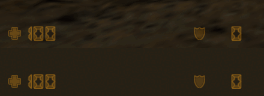              | CS 1.6 (top) and Counter-Life (bottom): health 100, armour 0        |
| 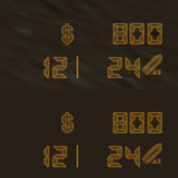                    | CS 1.6 (top) and Counter-Life (bottom): $800, USP 12 \| 24          |
| 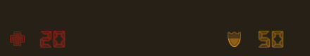                               | health 20 (low red), armour 50 (the full part fills the lower half) |
| 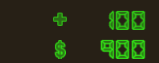                                                | 0.3 s after +$100: green, change row `+ 100`                        |
| 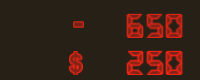                                                | 0.3 s after a $650 purchase: red, change row `- 650`                |
| 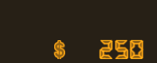                                              | a bright phase of the blink after a failed purchase                 |
|                                         | flashlight off (alpha 100)                                          |
|                                           | flashlight on (alpha 225, beam)                                     |
| 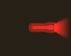                                        | battery 10 %: alert red                                             |
|                                                            | c4 icon                                                             |
| 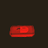                                     | c4 icon in a bomb target, red phase                                 |
| 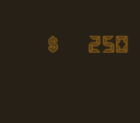                                                      | no suit: the money moved up, no ammo                                |
| 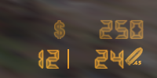                                    | money and ammo over the testcenter world                            |
| 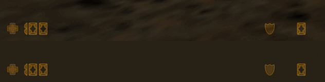 | 2560×1440, CS 1.6 (top) and Counter-Life (bottom)                   |
| 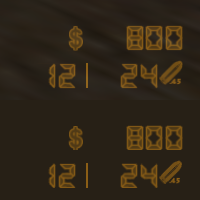       | 2560×1440, CS 1.6 (top) and Counter-Life (bottom)                   |

The broad scenario `just e2e-hud <port> <label>` (`tests/e2e/hud.ts`) also captures the elements, for each CS weapon and
after kills. Runs at 1600×900 and 2560×1440 showed: nothing for the knife; 12 | 536 with the .45 icon for the USP; 30 |
480 with 7.62 for the AK-47; 8 | 120 with 12G for the M3; 10 | 80 with .338 for the AWP; 1 with the HE icon, 2 px
further left, for the HE grenade; health 80 and armour 50, then health 20 in red; a hit that the armour took (armour 49
flashes, health 20 stays dim). Its bottom-left crop is 480 px wide, so at 2560×1440 it does not show the armour at 512.

The software-rendered test client (Xvfb, llvmpipe) can stall at 2560×1440 when the machine is busy. One run of
`e2e-elements` at a load average of 60 got no HUD on the screen and failed; the next run passed.

### Limits

- Each message is reliable and costs about 70 bytes. A shot changes the clip and restarts the fade of all four ammo
  parts, so a P90 (15 shots per second) sends about 4 KB/s to its player.
- `HUD_ELEM_EFFECT_ONCE` holds a fade at 99.9 % of its time, so a settled colour can be 1 level from the CS colour.
- The armour shows the Sven armour (`pev.armorvalue`), which protects against all damage. The CS16 buy menu's Kevlar
  sets the plugin's own CS armour (`CS16BASE::g_PlayerArmor`), which only bullets of CS weapons use. The HUD does not
  show that value.
- With more than one `info_bomb_target`, each target writes the player's in-zone keyvalue every 0.1 s and the last one
  wins, so the c4 icon can flash only part of the time (`CInfoBombTarget.as`).
- A first connection downloads the 13 sprites of the elements, 7.9 MB without compression. The test client took about 10
  minutes for them from a local server (about 13 KB/s). A server should offer them on an HTTP download server
  (`sv_downloadurl`). A key press during the download can hit Cancel on the download dialog and drop the connection.

## Crosshair

The CS 1.6 dynamic crosshair: four green lines around the screen centre. The gap between the lines grows with each shot
and with the movement of the player, then it shrinks back. Source: `scripts/cs16/hud/crosshair.as`. Specification:
[`research/cs16-hud-spec.md`](research/cs16-hud-spec.md) section 3.12 (Valve `client.so`, "BIN").

### What it draws

- Four boxes of `cs16/hud/fill.spr` (64×64 white, [`hud-sprites.md`](hud-sprites.md)), each 1 px thick, on the client
  channels `CROSSHAIR_WEST`, `CROSSHAIR_EAST`, `CROSSHAIR_NORTH` and `CROSSHAIR_SOUTH` (16–19).
- Colour (50,250,50), the CS default of `cl_crosshair_color`, with the CS alpha (120–255). The lines are additive. Sven
  multiplies RGB by the alpha as CS `FillRGBA` does (`sven-client-hud.md` 1.9).
- The element registers with `everyFrame`, so `OnTick` runs in each `PlayerPostThink` of the player.

### When it draws

The lines show when all of these are true (spec 3.12.1). Else the element hides them.

| Condition      | Value                                                                    |
| -------------- | ------------------------------------------------------------------------ |
| Player         | alive                                                                    |
| Weapon         | a weapon in hand that is not the Scout, SG550, AWP or G3SG1              |
| FOV (`m_iFOV`) | 0 (the default FOV) or more than 54. The AUG and SG552 zoom to 55.       |
| `m_iHideHUD`   | `HIDEHUD_WEAPONS` and `HIDEHUD_ALL` clear                                |
| `cs16_hud`     | 1. With 0 the foundation hides the lines and shows the native crosshair. |

CS does not update a crosshair that it does not draw. Thus the state stays as it is while the lines are hidden.

`cs16_hud` 1, then 0, then 1 again (AK-47, 1600×900): the CS lines, then the native Sven crosshair of the weapon list,
then the CS lines again.

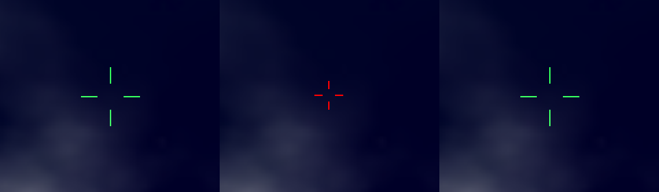

### Weapons

The classname gives the CS weapon id. The id gives the base gap, the shot delta, the accuracy flags and the run limit
(spec 3.12.3). Accuracy flags: 1 jump, 2 run, 4 duck, 8 inaccurate, 16 very inaccurate.

| Classname           | CS id | Base gap | Shot delta | Flags              | Run limit |
| ------------------- | ----- | -------- | ---------- | ------------------ | --------- |
| `weapon_p228`       | 1     | 8        | 3          | 7                  | 0         |
| `weapon_scout`      | 3     | 5        | 3          | 0 (no crosshair)   | –         |
| `weapon_hegrenade`  | 4     | 8        | 3          | 0                  | –         |
| `weapon_xm1014`     | 5     | 9        | 4          | 0                  | –         |
| `weapon_c4`         | 6     | 6        | 3          | 0                  | –         |
| `weapon_mac10`      | 7     | 9        | 3          | 1                  | –         |
| `weapon_aug`        | 8     | 3        | 3          | 3                  | 140       |
| `weapon_dualelites` | 10    | 4        | 3          | 0                  | –         |
| `weapon_fiveseven`  | 11    | 8        | 3          | 7                  | 0         |
| `weapon_ump45`      | 12    | 6        | 3          | 1                  | –         |
| `weapon_sg550`      | 13    | 5        | 3          | 0 (no crosshair)   | –         |
| `weapon_galil`      | 14    | 4        | 3          | 3                  | 140       |
| `weapon_famas`      | 15    | 4        | 3          | 3, burst fire: 19  | 140       |
| `weapon_usp`        | 16    | 8        | 3          | 7, silencer on: 15 | 0         |
| `weapon_csglock18`  | 17    | 8        | 3          | 7, burst fire: 23  | 0         |
| `weapon_awp`        | 18    | 8        | 3          | 0 (no crosshair)   | –         |
| `weapon_mp5navy`    | 19    | 6        | 2          | 1                  | –         |
| `weapon_csm249`     | 20    | 6        | 3          | 3                  | 140       |
| `weapon_m3`         | 21    | 8        | 6          | 0                  | –         |
| `weapon_m4a1`       | 22    | 4        | 3          | 3, silencer on: 11 | 140       |
| `weapon_tmp`        | 23    | 7        | 3          | 1                  | –         |
| `weapon_g3sg1`      | 24    | 6        | 4          | 0 (no crosshair)   | –         |
| `weapon_csdeagle`   | 26    | 8        | 3          | 7                  | 0         |
| `weapon_sg552`      | 27    | 5        | 3          | 3                  | 140       |
| `weapon_ak47`       | 28    | 4        | 4          | 3                  | 140       |
| `weapon_csknife`    | 29    | 7        | 3          | 0                  | –         |
| `weapon_p90`        | 30    | 7        | 3          | 3                  | 170       |

- Other weapons (Sven weapons, other plugins) are an unknown id: base gap 4, shot delta 3, no flags, as in CS.
- The silencer and the burst mode come from the weapon script through `CS16BASE::IWeaponState` (`scripts/cs16/base.as`),
  which the `WeaponBase` mixin gives to every CS weapon.
- Shots: `ShootWeapon` in `scripts/cs16/base.as` adds 1 to `CS16BASE::g_PlayerShotsFired` for each call. One call is one
  shot, also for the shotgun pellets and for each bullet of a burst, as one CS fire event. The knife, the HE grenade and
  the C4 do not count, because CS has no fire event for them.

### Per-frame rules

CS updates the crosshair once per client frame at its default `fps_max 100` (spec 3.12.4). The server cannot see client
frames. Thus it replays the CS frames at 100 steps per second of the player's own command time (`g_Engine.time` in
`PlayerPostThink`).

1. Each player frame computes the minimum gap g from the weapon, the pose and the speed (spec 3.12.3). The run test uses
   the truncated 3-D speed and is strict.
2. Each step: if no new shot, `distance -= 0.013 * distance + 0.1` and `alpha += 2`. After a new shot,
   `distance = min(distance + delta, 15)` and `alpha = max(alpha - 40, 120)`. Then `distance = max(distance, g)` and
   `alpha = min(alpha, 255)`.
3. `length = (int)((distance - g) * 0.5) + 5`.
4. After a pause of more than 1 s the element replays 100 steps only. Every state is at rest after 80 steps.

### Scale and position

- `cl_crosshair_size auto`, the CS default (spec 3.12.5): base 1024 for W ≤ 640, 800 for W < 1024, else 640. Then
  `d = (int)(distance * W / base)` and `len = W * length / base`.
- W and H come from `CS16HUD::GetScreenSize( player )`: the `.hudres` of the player, else `cs16_hud_res`.
- The boxes are those of spec 3.12.6: west `(W/2 - d - len + 1, H/2, len, 1)`, east `(W/2 + d, H/2, len, 1)`, north
  `(W/2, H/2 - d - len + 1, 1, len)`, south `(W/2, H/2 + d, 1, len)`.
- The lines use `HUD_ELEM_SCR_CENTER_X | SCR_CENTER_Y | ABSOLUTE_X | ABSOLUTE_Y | NO_BORDER`. The client puts the left
  edge of such an element at `x + ((W - width) >> 1)` (`client.so` 0xDB45D). Thus the plugin sends
  `x = left - ((W - width) >> 1)`, and y in the same way. With a wrong screen size the crosshair stays at the centre;
  only its scale is wrong.

### Updates and network cost

- The element sends the four lines when the drawn gap or length changes, after a shot (the alpha falls), and when the
  alpha is back at 255.
- The client ramps the alpha itself: effect 2 (`HUD_EFFECT_RAMP_DOWN`) from `color2` (the alpha now) to `color1`
  (alpha 255) in `(255 - alpha) / 200` s, with `HUD_ELEM_EFFECT_ONCE`. That is the CS rate of 2 per frame at 100 frames
  per second. The client holds the ramp at 0.999 of its time and truncates the result (`client.so` 0xDB640), so the ramp
  stops at alpha 254. The send at alpha 255 corrects this.
- A shown crosshair moves at most once per 0.1 s. A crosshair that appears goes out at once.
- One update is four `CustSpr` messages of 70 bytes: the message id, the size byte and 68 bytes of fields with the name
  `cs16/hud/fill.spr`. So one update is 280 bytes, and the limit is 2.8 KB/s for each player. A hide is four
  `ToggleElem` messages of 3 bytes.
- With `developer 2` the server prints each update:
  `[CS16HUD] crosshair <slot>: gap <d> length <len> alpha <a> shots
  <n>, <bytes> bytes at <time>`.

Measured bytes for each player (scenario below, `developer 2` log):

| State                                      | 1600×900                | 2560×1440               |
| ------------------------------------------ | ----------------------- | ----------------------- |
| At rest, 3 s                               | 0 B/s                   | 0 B/s                   |
| P90 (the fastest CS weapon) firing for 3 s | 2,707 B/s (29 updates)  | 2,520 B/s (27 updates)  |
| Recovery after the P90 burst               | 1,400 bytes (5 updates) | 1,400 bytes (5 updates) |

At 1600×900 the ten AK-47 shots of the evidence below took 10 updates in 0.94 s, and with the recovery 16 updates (4,480
bytes).

### Evidence

The scenario `tests/e2e/crosshair.ts` ran on stadium4 with the view on the night sky. It freezes short states with the
client pause key before each screenshot. `tests/e2e/crosshair-lines.ts` measures each line in the screenshot. A line is
lit where its green is 40 or more above its red and blue. Gap = pixels from the centre pixel (W/2, H/2) to the inner
end. Length = lit pixels in the line. All four lines had the same gap and length, 1 px thick, in every state.

"g" is the minimum gap of spec Appendix A.2. "Expected" is the rest state of that g: `d = g * W / 640`,
`len = 5 * W / 640`. "Sent last" is the last update in the log before the screenshot.

1600×900 (base 640, scale 2.5):

| State                | g | Expected | Measured | Sent last          | Shots |
| -------------------- | - | -------- | -------- | ------------------ | ----- |
| AK-47 at rest        | 4 | 10 / 12  | 10 / 12  | –                  | 0     |
| AK-47 after 1 shot   | – | –        | 19 / 15  | 19 / 15, alpha 217 | 1     |
| AK-47 after 3 shots  | – | –        | 30 / 22  | 30 / 22, alpha 173 | 3     |
| AK-47 after 10 shots | – | –        | 36 / 25  | 36 / 25, alpha 124 | 10    |
| AK-47 running        | 6 | 15 / 12  | 15 / 12  | 15 / 12, alpha 255 | 0     |
| AK-47 ducking        | 4 | 10 / 12  | 10 / 12  | –                  | 0     |
| AK-47 in the air     | 8 | 20 / 12  | 20 / 12  | 20 / 12, alpha 255 | 0     |
| Desert Eagle at rest | 8 | 20 / 12  | 20 / 12  | –                  | 0     |
| Desert Eagle ducking | 4 | 10 / 12  | 10 / 12  | 10 / 12, alpha 255 | 0     |
| USP at rest          | 8 | 20 / 12  | 20 / 12  | –                  | 0     |
| M3 at rest           | 8 | 20 / 12  | 20 / 12  | –                  | 0     |
| AWP                  | – | none     | none     | –                  | 0     |

2560×1440 (base 640, scale 4):

| State                | g | Expected | Measured | Sent last          | Shots |
| -------------------- | - | -------- | -------- | ------------------ | ----- |
| AK-47 at rest        | 4 | 16 / 20  | 16 / 20  | –                  | 0     |
| AK-47 after 1 shot   | – | –        | 32 / 28  | 32 / 28, alpha 215 | 1     |
| AK-47 after 3 shots  | – | –        | 46 / 32  | 46 / 32, alpha 177 | 3     |
| AK-47 after 10 shots | – | –        | 57 / 40  | 57 / 40, alpha 124 | 10    |
| AK-47 running        | 6 | 24 / 20  | 24 / 20  | 24 / 20, alpha 255 | 0     |
| AK-47 ducking        | 4 | 16 / 20  | 16 / 20  | –                  | 0     |
| AK-47 in the air     | 8 | 32 / 20  | 32 / 20  | 32 / 20, alpha 255 | 0     |
| Desert Eagle at rest | 8 | 32 / 20  | 32 / 20  | –                  | 0     |
| Desert Eagle ducking | 4 | 16 / 20  | 16 / 20  | 16 / 20, alpha 255 | 0     |
| USP at rest          | 8 | 32 / 20  | 32 / 20  | –                  | 0     |
| M3 at rest           | 8 | 32 / 20  | 32 / 20  | –                  | 0     |
| AWP                  | – | none     | none     | –                  | 0     |

Comparison with the AK-47 vector of spec Appendix A.2 (shots from rest):

- First shot: A.2 frame f10 has distance 8 and length 7, f11 has 7.796 and 6. At 2560×1440 the update after the shot was
  32 / 28 (f10: 8 × 4, 7 × 4). At 1600×900 it was 19 / 15, one step later (f11: int(7.796 × 2.5), 6 × 2.5). The alpha
  fell by 40 (255 to 215) in both.
- Ten shots: A.2 frame f100 has distance 15, length 10, alpha 120, then f101 14.705 and alpha 122, f102 14.414 and
  alpha 124. At 2560×1440 the last update was 57 / 40 with alpha 124, the same as f102 (int(14.414 × 4), 10 × 4). At
  1600×900 it was 36 / 25 with alpha 124, also f102 (int(14.414 × 2.5), 10 × 2.5).
- Poses: the AK-47 gaps 4, 6, 4 and 8 (stand, run, duck, air) and the Desert Eagle gaps 8 and 4 (stand, duck) are the
  A.2 values.

Weapon states at rest, 1600×900, after the secondary attack (a manual run with the same tools):

| State                | A.2 g | Expected | Measured | Crop                                             |
| -------------------- | ----- | -------- | -------- | ------------------------------------------------ |
| USP, silencer on     | 11    | 27 / 12  | 27 / 12  | 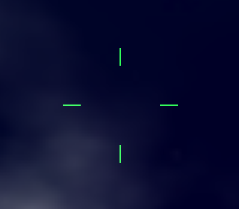  |
| Glock 18, burst fire | 11    | 27 / 12  | 27 / 12  |     |
| M4A1, silencer on    | 5     | 12 / 12  | 12 / 12  |  |
| FAMAS, burst fire    | 5     | 12 / 12  | 12 / 12  |       |

Comparison with CS 1.6 (USP at rest, `.e2e/reference/cs16-ref-hud.png` and `cs16-1440-hud.png`, same crop): the set of
lit pixels is the same, 48 of 48 at 1600×900 and 80 of 80 at 2560×1440, with no pixel only in one image. Both add about
50 red and 50 blue to the background, which is (50,250,50) at alpha 255.

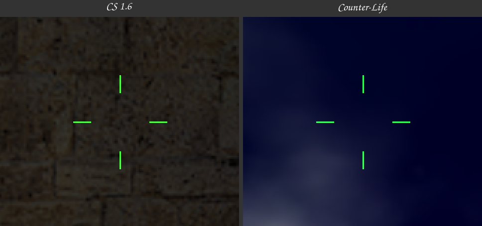

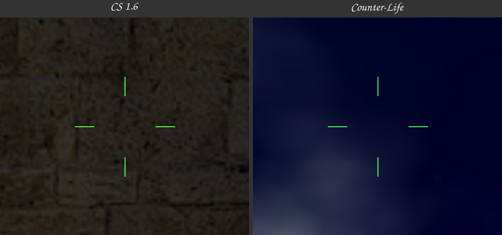

Crops of the screen centre (1600×900: 160×140 px at 3×; 2560×1440: 256×224 px at 3×):

| State                | 1600×900                                       | 2560×1440                                       |
| -------------------- | ---------------------------------------------- | ----------------------------------------------- |
| AK-47 at rest        |       |       |
| AK-47 after 1 shot   | 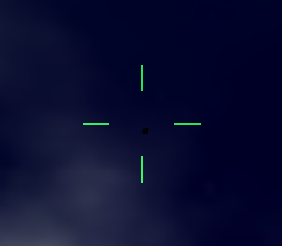     | 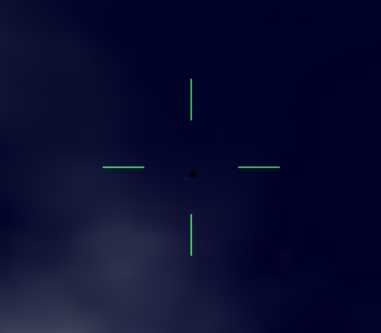     |
| AK-47 after 3 shots  | 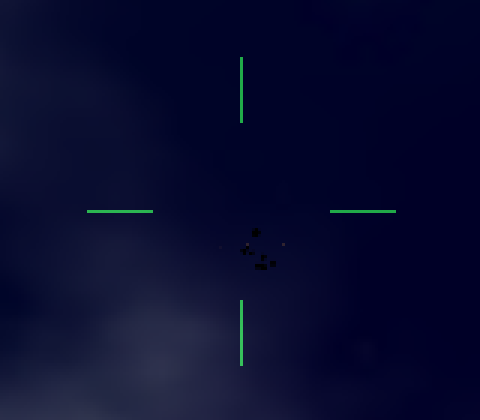     | 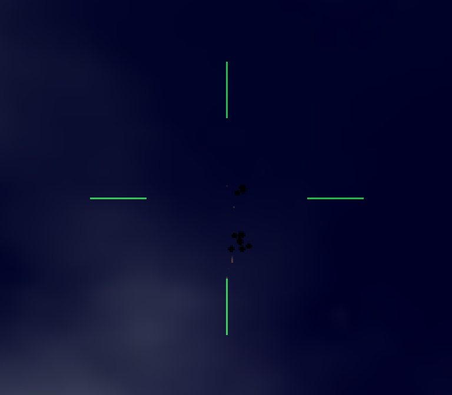     |
| AK-47 after 10 shots | 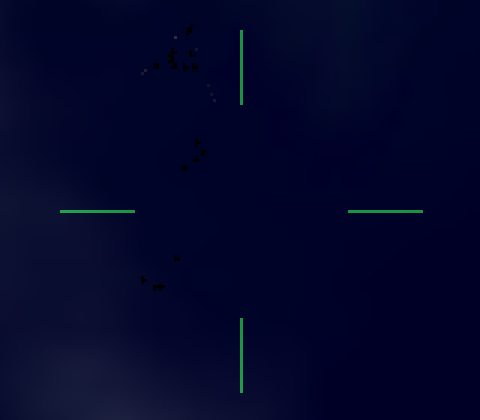    | 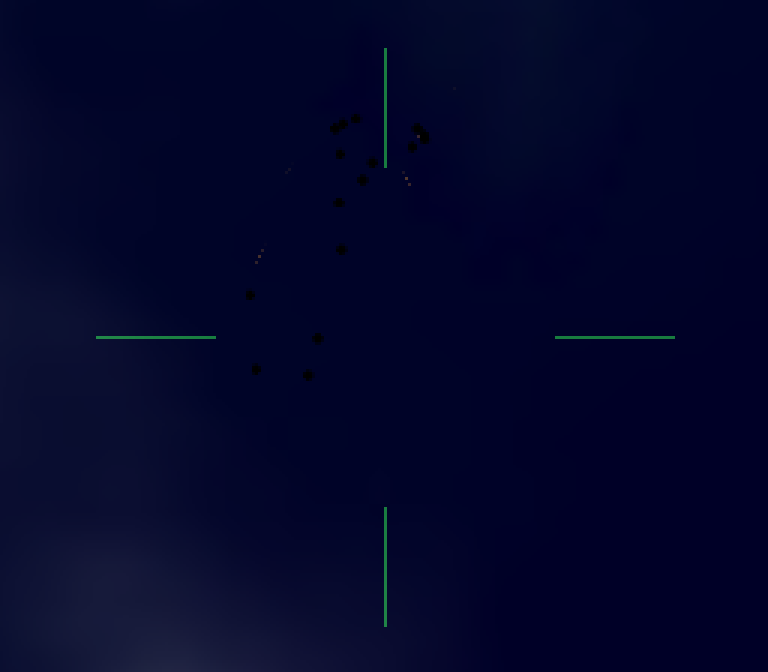    |
| AK-47 running        |    |    |
| AK-47 ducking        | 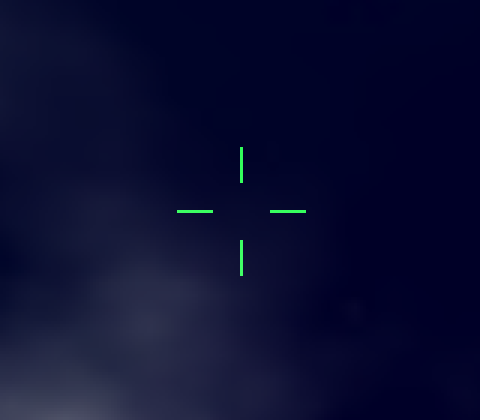   | 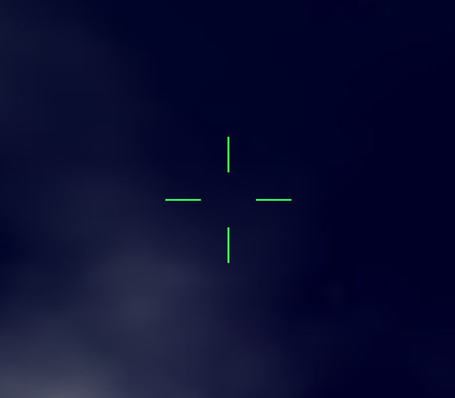   |
| AK-47 in the air     | 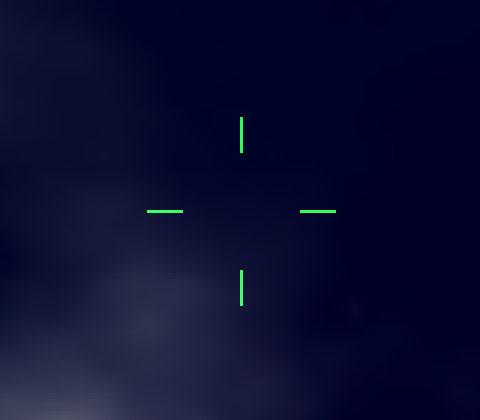       |        |
| Desert Eagle at rest |     |     |
| Desert Eagle ducking |  |  |
| USP at rest          |        |        |
| M3 at rest           |         |         |
| AWP (no crosshair)   |        |        |

### Limits

- `fill.spr` is 64 px. A line longer than 64 px loses its outer end. Such lines occur only at full spread: with the AUG
  on a screen wider than 3723 px, and with the gap-4 weapons on a screen wider than 4096 px.
- The server cannot read client cvars. `cl_crosshair_color`, `cl_crosshair_size`, `cl_crosshair_translucent` and
  `cl_dynamiccrosshair` stay at their CS defaults.
- The scale needs the real screen size. A player whose screen is not `cs16_hud_res` must set `.hudres`.
- The crosshair follows a shot one network round trip later. Between shots it moves in steps of up to 0.1 s; the alpha
  ramp is smooth.
- Shots of weapons that are not CS weapons do not widen the crosshair.

### Reproduce

```sh
deno test -A tests/e2e/crosshair-lines.ts        # the tool measures the CS references (local .e2e/reference)
just sandbox /abs/.svends-crosshair && export SVEN_SERVER_DIR=/abs/.svends-crosshair
just install && just install-e2e
CL_DISPLAY=:108 CL_LISTEN_PORT=27074 CL_RESOLUTION=1600x900 deno run -A tests/e2e/crosshair.ts 27073 x1600
CL_DISPLAY=:108 CL_LISTEN_PORT=27074 CL_RESOLUTION=2560x1440 deno run -A tests/e2e/crosshair.ts 27073 x2560
deno run -A tests/e2e/crosshair-lines.ts .e2e/shots/x1600-usp-rest.png .e2e/reference/cs16-ref-hud.png
```

Stop the Xvfb of the display before you change `CL_RESOLUTION`: `just display` keeps a running one. The scenario sets
`motdfile` to a missing file (no MOTD window), `pausable 1`, `sv_timeout 300` and `cs16_hud_res` on the server, and
binds `p` to `pause` with `showpause 0` and `r_drawviewmodel 0` on the client. The last e2e client to stop puts the
player's own Sven configuration back.

## Kill feed

`scripts/cs16/killfeed.as` (namespace `CS16KILLFEED`) copies `CHudDeathNotice` of the Valve CS 1.6 client. The reference
is [cs16-killfeed-reference.md](research/cs16-killfeed-reference.md), which measured the Valve client.

### Layout and timing

`W` and `H` are the screen width and height of the player. `s(n) = ⌊n × H / 480⌋`.

| Item      | Value                                                                                                                                                                                                          |
| --------- | -------------------------------------------------------------------------------------------------------------------------------------------------------------------------------------------------------------- |
| Rows      | 4 at most. A new notice goes to the bottom. A fifth notice removes the oldest.                                                                                                                                 |
| Lifetime  | 6.0 s. The oldest notice expires first, and the rows below it move up together.                                                                                                                                |
| Row top   | `s(32) + i × s(16)` for row `i` (0 is the top row). The icons and the names use the same top.                                                                                                                  |
| Parts     | Right to left: the victim name ends at `W − s(12)`, then `s(5)`, the headshot icon and `s(5)` (headshots only), the weapon icon, `s(5)`, and the killer name.                                                  |
| Names     | Players in the CT colour (153,204,255), monsters in the T colour (255,63,63).                                                                                                                                  |
| Icons     | `d_<weapon>` rects of `cs16/icons/640hud1.spr`, `640hud2.spr` and `640hud16.spr` (the `hud.txt` 640 rows), 16 px high, 1:1, added to the screen with the tint (255,80,0). The headshot icon has the same tint. |
| No killer | A death from the world or from the victim itself shows `d_skull` and no killer name, as a CS suicide.                                                                                                          |
| Console   | Each notice also prints the `death.cpp` line to the console of every player, for example `*** Player killed Scientist with a headshot from m4a1 ***`.                                                          |

The data for one notice comes from the `PlayerKilled` and `MonsterKilled` hooks:

- Victims: every player death, and every monster that a player kills. A monster counts once, while its dead flag is
  still `DEAD_NO` (Sven calls the hook again for a monster that takes damage while it dies). Monsters show by Sven's
  name for them (`m_FormattedName`, for example "Head Crab").
- Weapon: the weapon string of the CS `DeathMsg` (ReGameDLL `CHalfLifeMultiplay::DeathNotice`). When the killer is a
  player and also the inflictor, the weapon is the item in his hands. The CS weapons inflict their bullets with the
  player, so this is the usual case. Else the inflictor (`pev.dmg_inflictor` of the victim) names the weapon, for
  example `weapon_m4a1` for the scripted e2e kills and `proj_cs16grenade` for an HE grenade. The prefixes `weapon_`,
  `monster_` and `func_` are removed, and the plugin classes get their CS names (`weapon_csdeagle` is `deagle`, the
  grenade is `grenade`). A weapon without a `d_` icon shows `d_skull`, as in CS.
- Headshot: the victim's `m_LastHitGroup` is `HITGROUP_HEAD` when it dies. `WeaponBase` gives `TraceAttack` the hit
  group `HITGROUP_GENERIC`, so that the engine adds no multiplier of its own. `CS16BASE::RestoreHitGroup` then puts the
  real hit group back before the damage lands. Thus real bullets and `e2e.kill head` both give a headshot.

### Messages

| Part          | Where                                                                                   |
| ------------- | --------------------------------------------------------------------------------------- |
| Weapon icon   | `KillfeedIconChannel(row)`: plugin channels 29–31 for rows 0–2, map channel 0 for row 3 |
| Headshot icon | map channels 1–4 (`KILLFEED_HEADSHOT_FIRST + row`)                                      |
| Victim names  | engine text slots 0–3 (`KILLFEED_VICTIM_SLOT_FIRST + row`)                              |
| Killer names  | engine text slots 4–7 (`KILLFEED_KILLER_SLOT_FIRST + row`)                              |

- The icons use `HUD_ELEM_ABSOLUTE_X | HUD_ELEM_ABSOLUTE_Y | HUD_ELEM_NO_BORDER`, so x and y are screen pixels. Their
  width and height are never 0 (0 means "to the edge of the sheet").
- A row goes out only when it shows another notice: a new notice, rows that move up, or a resend (connection, map
  change, a spawn, `cs16_hud 1`, a new screen size). For each player the server keeps the serial number of the notice in
  each row, so each text goes out once for each change.
- An empty row and the killer slot of a notice without a killer are emptied with `CS16HUD::ClearText`. It sends the
  empty text to the last position of that slot, and only for a slot that this plugin drew, because the client removes
  every other text at the position of a new text.
- Every part goes out with the remaining time of its notice as the hold time. Thus the client removes an expired row by
  itself. The server moves the other rows up at its next HUD tick (at most 50 ms later).
- A new notice shows at the next HUD tick after the kill (at most 50 ms).

### Name position and width

A `HudMessage` position is a fraction of the screen inside the HUD border `b` (`hud_bordersize`, default 16). For
`−1 < x < 0` the client puts the left end of a line of width `w` at `⌊(x + 1) × (W − 2b) + b − w⌋`
([sven-client-hudtext.md](research/sven-client-hudtext.md) §2). To end a name at the pixel column `R`, the server sends

`x = round(((R + 0.5 − b) / (W − 2b) − 1) × 8192) / 8192`, at most `−1/8192`,

and `y = round((top + 0.5 − b) / (H − 2b) × 8192) / 8192` for the top. The half pixel keeps the 1/8192 step and the
float rounding of the client inside the wanted pixel. The server uses `b = 16`, because it cannot read the value of the
player. With `hud_bordersize b'` the names move about `16 − b'` px to the right and `b' − 16` px down, against the
icons. Above `W − b` the client moves the line back inside the border.

The server must know the width of each name in pixels, to put the icons and the killer name next to it. The Sven client
adds the width of each byte of the text (`charWidths`) in the face of the `HudMessage` font:

1. `svencoop/resource/TrackerScheme.res` gives `CreditsFont` the name "Ariel", tall 12 and weight 600. VGUI2 scales the
   tall with the screen height: `tall = ⌊12 × H / 480⌋`, at most 128.
2. On Linux, `hw.so` (0x1C9E90, 0x1CA070) asks fontconfig for the family, the weight 600 as it is, and the slant. With
   the default fontconfig of this host, "Ariel" gives `NotoSans-Black.ttf`. `hw.so` then selects the Apple Roman cmap of
   the face (`FT_Select_Charmap(face, 'armn')`, 0x1CA27B). Noto Sans has none, so the client cannot create the font: its
   log shows `Unable to create font 'Ariel': Can't select charmap`. VGUI2 then uses the fallback "Tahoma", which `hw.so`
   asks for as "Bitstream Vera Sans", and fontconfig gives `VeraBd.ttf` (Bitstream Vera Sans Bold).
3. The em size is `⌊tall × unitsPerEm / (usWinAscent + usWinDescent)⌋` = `⌊tall × 2048 / 2384⌋`: 18 px at H = 900, 30 px
   at H = 1440. Each byte is one glyph code of the Apple Roman cmap. Its width is the hinted advance (FreeType
   `FT_MulFix`), rounded to whole pixels.

`tools/hudfont.ts` reads the face and writes `scripts/cs16/hud/textfont.as`: the advances in font units, by byte.
`just hud-font` finds the face with the same two fontconfig requests. `TextWidth` in `killfeed.as` and `lineWidth` in
the tool do the same sum. The client draws an outline around each text line with `hud_debug 2`, and its width is the sum
of the glyph widths. `tools/hudfont_test.ts` holds 20 outlines measured that way (printable ASCII, bytes 128–254 and
four names) at 1600x900 and 2560x1440. All 40 widths agree with the table.

This corrects [sven-client-hudtext.md](research/sven-client-hudtext.md) §3: fontconfig maps "Ariel" to Noto Sans, but
the client cannot use that face.

### Screen size

The icons are in screen pixels, and the name widths depend on `H`. Thus each player needs his real screen size: the
player types `.hudres <W>x<H>`, or the server sets `cs16_hud_res` (default 1920x1080) for players who did not
(`scripts/cs16/hud/screen.as`). With a wrong size the names stay near the corner (they are fractions), but the icons do
not. For example, with 1920x1080 on a 1600x900 client the icons are off the screen. A new size sends the rows again. The
e2e driver sets `cs16_hud_res` to `CL_RESOLUTION` when it starts the server.

### Measured against CS 1.6

`just e2e-killfeed` and `just e2e-hud` (step `killfeed-4`) made the Counter-Life captures on display `:109`.
`just fixture-metrics` measured the lit pixels against a frame of the same view without notices (the `-clear` frame, or
the `hurt` step for `killfeed-4`). The CS 1.6 values come from the reference captures.

| Fact (lit pixels)                       | CS 1.6, 1600x900          | Counter-Life, 1600x900    | CS 1.6, 2560x1440         | Counter-Life, 2560x1440   |
| --------------------------------------- | ------------------------- | ------------------------- | ------------------------- | ------------------------- |
| Icon tops, rows 0–3                     | 61, 91, 121, 151          | 61, 91, 121, 151          | 97, 145, 193, 241         | 97, 145, 193, 241         |
| Name tops, rows 0–3                     | 63, 93, 123, 153          | 63, 93, 123, 153          | 100, 148, 196, 244        | 101, 149, 197, 245        |
| Right margin (last lit pixel to edge)   | 22–23                     | 22                        | 36–37                     | 36                        |
| Gaps, killer → icon → headshot → victim | 9, 11, 9                  | 9, 11, 10                 | 15, 17, 16                | 15, 17, 17                |
| `d_m4a1` lit box                        | 48 × 15                   | 47 × 14                   | 48 × 15                   | 47 × 14                   |
| Name colour (brightest pixels)          | 255,63,63 and 153,204,255 | 254,62,62 and 152,203,254 | 255,63,63 and 153,204,255 | 254,62,62 and 152,203,254 |
| Icon tint: added green ÷ red, blue      | 0.314, 0                  | 0.315, 0                  | 0.314, 0                  | 0.315, 0                  |

The rect rule is the same in both clients. With the headshot captures at 1600x900:

| Rect                   | CS 1.6 (victim "Niles", box 33 px) | Counter-Life (victim "Scientist", box 90 px) |
| ---------------------- | ---------------------------------- | -------------------------------------------- |
| Victim box             | 1545–1578                          | 1488–1578                                    |
| `d_headshot` (36 × 16) | x 1500 = 1545 − 9 − 36             | x 1443 = 1488 − 9 − 36                       |
| `d_m4a1` (48 × 16)     | x 1443 = 1500 − 9 − 48             | x 1386 = 1443 − 9 − 48                       |
| Killer box ends        | 1434 = 1443 − 9                    | 1377 = 1386 − 9                              |

The x positions differ only by the width of the victim name. A timed run at 1600x900 killed five scientists 1 s apart
(at 0.15, 1.14, 2.09, 3.13 and 4.12 s) and counted the rows: 4 at 5.5 s and 6.5 s, 3 at 7.8 s, 2 at 8.8 s, 1 at 9.8 s
and none at 10.8 s. Each notice stayed 6 s, the fifth notice removed the first, and the rows moved up.

The tint row is the median over the icon pixels whose red did not reach 255 (80/255 = 0.314). The added red peaks at
164–194 in the Counter-Life captures and at 207–211 in the CS captures, because the Counter-Life captures have a bright
wall behind the feed and an additive draw stops at 255.

Comparison crops (CS 1.6 left, Counter-Life right):

 
 
 
 

The CS world-death crop shows the `max4` capture (`bot_kill` deaths), because the reference has no single world death.

### What Sven cannot copy

- Font face, size and weight. CS draws the names with its console font (Verdana, which fontconfig gives as Noto Sans
  Regular here, 14 px at H = 900 and 24 px at H = 1440). Sven draws `HudMessage` text with its scheme font, here
  Bitstream Vera Sans Bold at an 18 px em (H = 900) or a 30 px em (H = 1440). The names are larger and bolder. The tops
  agree within 1 px, but the Sven names go further down and further left.
- The drop shadow. CS draws each name a second time in black, 1 px right and 1 px down. `HudMessage` has no shadow, and
  the eight text slots already hold the eight names, so a black copy is not possible.
- Other systems. The table is correct for a Linux client with the default fontconfig of this host. A Windows client maps
  "Ariel" with GDI and gets other widths, so its icons and killer names can be some pixels away from the victim names.
  The server cannot know the face of a client.
- The name colour. The Sven client draws the text one step darker than the colour that it gets (254,62,62 for
  255,63,63). 255 is the largest value, so the server cannot add the step.
- The icon edges. CS draws the HUD sprites with bilinear filtering half a pixel off the texel grid, so each CS icon
  spreads 1 px to the right and down. Sven draws the sheet rects 1:1, so the lit box of each icon is 1 px narrower and
  shorter. The positions of the rects are the same.
- `hud_bordersize`. The server assumes 16 (see [Name position and width](#name-position-and-width)).
- The console line. CS prints it to the console only. The Sven client also shows console prints for some seconds in the
  top-left corner of the screen. At 2560x1440 that corner showed unreadable characters for every console print, also for
  an `echo` from the server, so this comes from the client, not from the kill feed.
- Sven's own death message. The Sven server also prints each death as a notify line in the top-left corner (for example
  "Player fell or something."). No AngelScript API stops it ([sven-client-hudtext.md](research/sven-client-hudtext.md)
  §6). The Counter-Life metamod plugin on `main` drops these lines.
- Suicides with a weapon. CS shows the icon of the weapon for a suicide that has one (an own HE grenade). Counter-Life
  shows the skull for every death without a killer, because a death without damage (the `kill` command) leaves an old
  inflictor in the victim.
- Team colours and team kills. In co-op all players are one team, so every player name is CT blue, every monster name is
  T red, and there is no green team-kill icon. Monsters that monsters kill, and monsters that die from the world, get no
  notice.

### Test

```sh
export SVEN_SERVER_DIR=/abs/path/.svends-x CL_DISPLAY=:109 CL_LISTEN_PORT=27076 CL_RESOLUTION=1600x900
just install && just install-e2e
just e2e-killfeed 27075 weapon_m4a1 head     # also body (real shots) and world (e2e.hurt 500 with no armour)
just fixture-metrics .e2e/shots/killfeed-weapon_m4a1-head.png .e2e/shots/killfeed-weapon_m4a1-head-clear.png
just e2e-hud 27075 run1                      # step killfeed-4: four rows from e2e.kill, head and body in turn
deno test -R -E tools/hudfont_test.ts        # the width model against the measured outlines
```

The head scenario shoots real bullets at a pinned scientist until it dies. `e2e.aim head` aims 8% of the box height
below the top of the monster's box, as the CS fixture does, because a monster's eye position lies below its head hit
box. A first shot can still miss, and then the loop shoots again.

## Compared with CS 1.6

The integrated branch (`feat/cs16-hud`: the foundation, the status elements, the crosshair and the kill feed together)
ran on a sandbox server, with the Sven client on Xvfb at 1600×900 and at 2560×1440. The CS 1.6 side is Valve's client on
the CS fixture (ReGameDLL listen server, de_dust2, `just fixture-*`).

| Scenario                                    | What it gives                                                                                                 |
| ------------------------------------------- | ------------------------------------------------------------------------------------------------------------- |
| `just e2e-elements <port> <label>`          | the CS reference state (health 100, armour 0, $800, USP 12 \| 24) on a flat backdrop, with checks             |
| `just e2e-hud <port> <label>`               | 15 states on testcenter: six weapons, health and armour, a hit, four kills, firing, rest, running, flashlight |
| `just e2e-killfeed <port> weapon_m4a1 head` | one real-bullet M4A1 headshot, and the same view without the notice                                           |
| `just e2e-hudproof <port>`                  | the foundation proof: raw sprites and texts, native hiding, the weapon menu, resends, `.hudres`               |
| `just fixture-crosshair <display> <WxH>`    | CS 1.6: the AK-47 at rest and 600 ms into a held burst, with the waits of the `e2e-hud` steps                 |

Results on this branch:

- `e2e-elements`: all checks passed at 1600×900 and at 2560×1440.
- `e2e-hud`: all 15 states captured at both sizes. In each state the elements show the values that the state sets.
- `e2e-killfeed`: passed at 1600×900. At 2560×1440 the first try missed the scientist 12 times; the second try killed it
  with the first shot.
- `e2e-hudproof`: all 55 checks passed at 1600×900.

`tests/e2e/comparesheet.ts` makes the sheets below. Each sheet has the same crop of both screenshots at 2× without
smoothing, Counter-Life on the left and CS 1.6 on the right. The sheets are 256-colour PNGs. All numbers come from the
screenshots: `just hudboxes` and `tests/e2e/hudcompare.ts` (HUD glyph boxes and colours), `tests/e2e/crosshair-lines.ts`
(crosshair lines) and `just fixture-metrics` (the kill feed against a frame without notices).

### Sheets

| Region                               | 1600×900                                            | 2560×1440                                            |
| ------------------------------------ | --------------------------------------------------- | ---------------------------------------------------- |
| Bottom left: health, armour          | 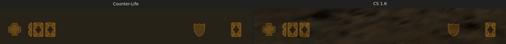           | 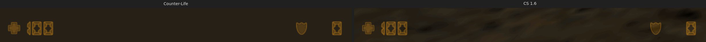           |
| Bottom right: money, ammo            | 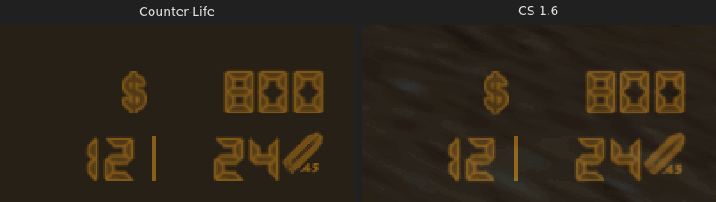          | 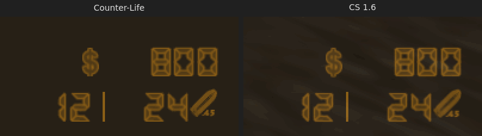          |
| Crosshair, USP at rest               | 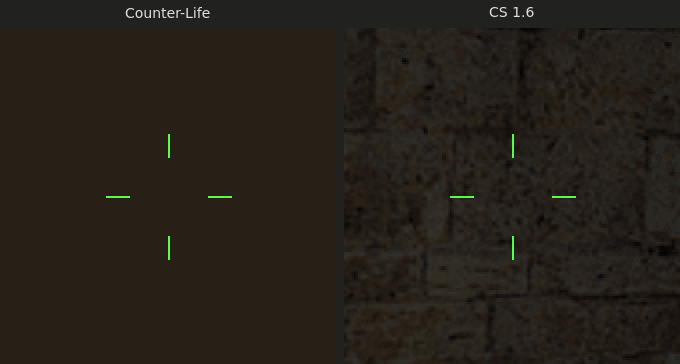    | 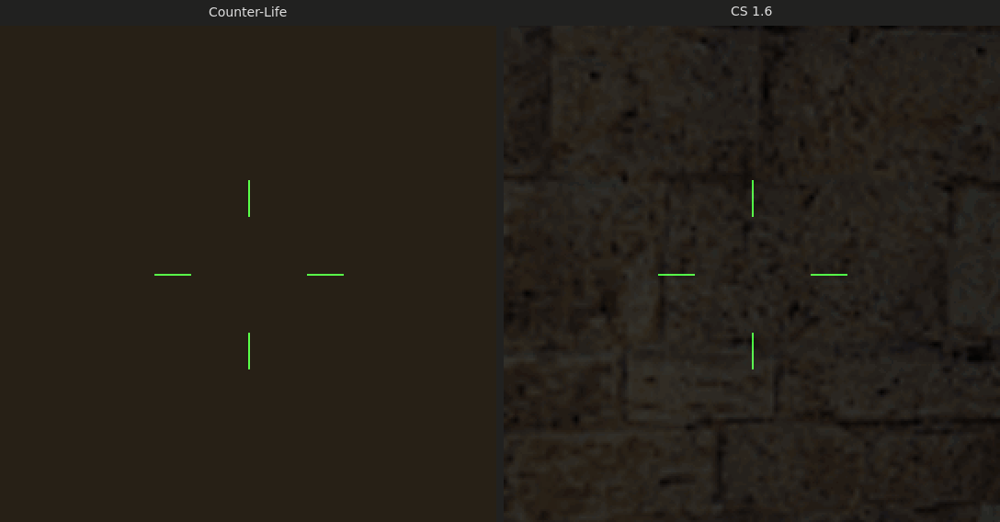    |
| Crosshair, AK-47 at rest             | 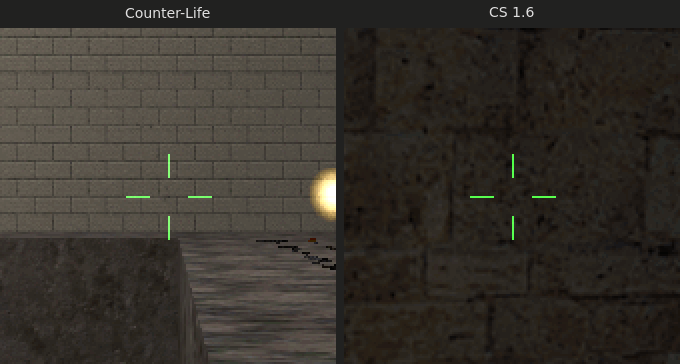   | 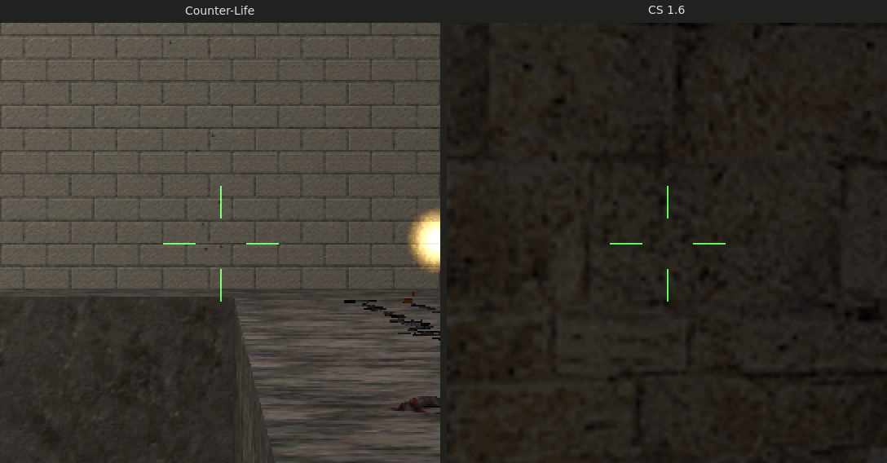   |
| Crosshair, AK-47 600 ms into a burst | 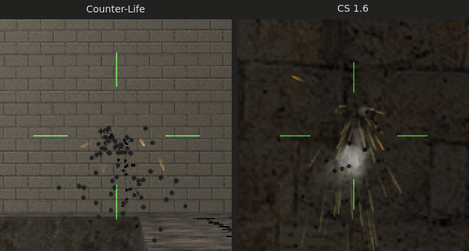 | 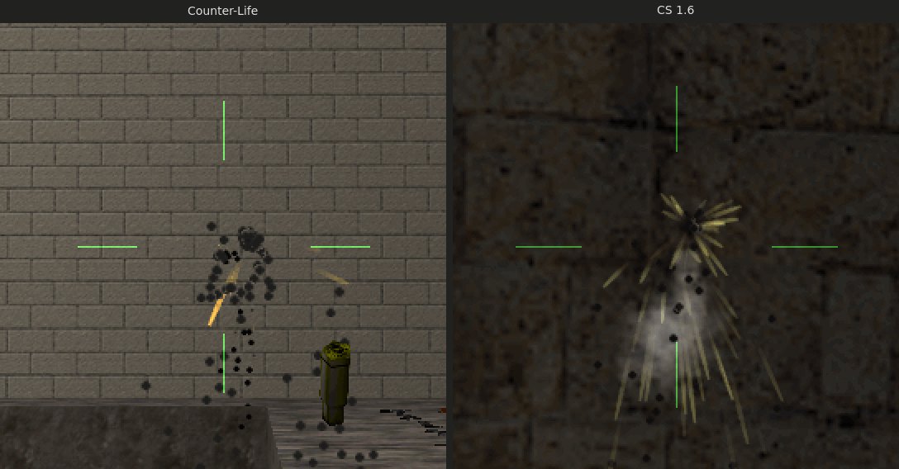 |
| Kill feed, one M4A1 headshot row     | 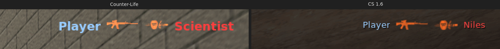     | 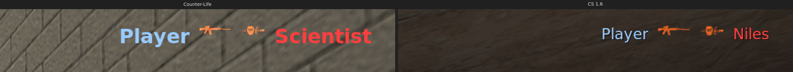     |
| Kill feed, four rows                 | 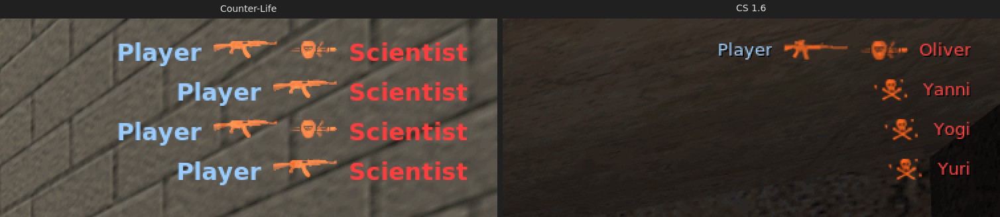       | 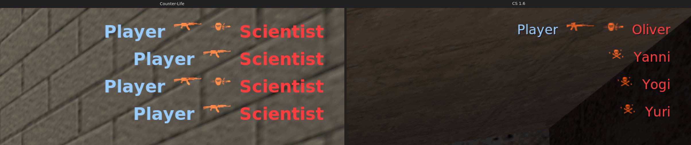       |
| Weapon menu (native in Sven)         | 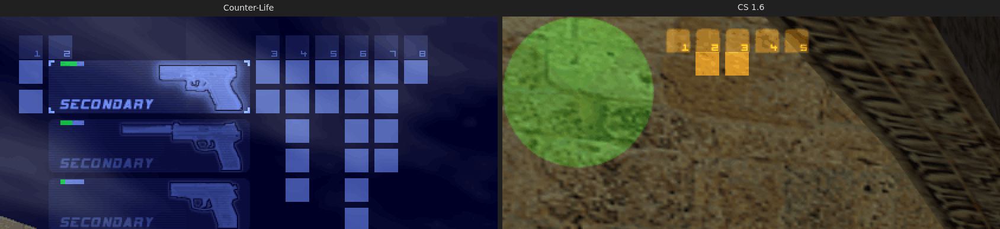           | no CS reference                                      |

The Counter-Life crops of the bottom and of the USP crosshair come from the `e2e-elements` reference state, on the
backdrop (39, 32, 22), which is the colour of the CS floor. The other Counter-Life crops show the testcenter world. The
four CS rows are one M4A1 headshot and three `bot_kill` deaths (skulls); the four Counter-Life rows are four AK-47
kills, head and body in turn. Thus the contents of the rows differ, but the layout rules are the same. The CS weapon
menu reference shows only the bucket headers.

### Measured differences

**Health, armour, money and ammo.** The 16 HUD glyphs of the reference state are in
[Status elements, Evidence](#evidence). The integrated run gave the same boxes and colours at both sizes:

- Every edge of every glyph is within 1 px of CS 1.6.
- 1 px differences: the money "$" is 24 px high (CS 25); the last two money digits are 16 px wide (CS 17, one column
  more on the left); at 2560×1440 the CS health and armour digits are 1–2 px wider, the top of the armour shield is 1 px
  lower, and the ammo icon starts 1 px further left. The CS floor is brighter there, so the colour threshold takes one
  more column of the CS glyph.
- Colours: the added red and green are within 4 levels at 1600×900 and within 9 levels at 2560×1440 (the armour shield:
  87, 54 against 96, 61). The settled HUD orange is (100, 62, 0) on both sides.

**Crosshair** (gap / length in pixels, then the alpha from the red and blue that the line adds to the background):

| State                  | CS 1.6 1600×900 | Counter-Life  | CS 1.6 2560×1440 | Counter-Life  |
| ---------------------- | --------------- | ------------- | ---------------- | ------------- |
| USP at rest            | 20 / 12, 255    | 20 / 12, 255  | 32 / 20, 255     | 32 / 20, 255  |
| AK-47 at rest          | 10 / 12, 255    | 10 / 12, 255  | 16 / 20, 255     | 16 / 20, 255  |
| AK-47 600 ms into fire | 32 / 22, ≈130   | 36 / 25, ≈133 | 58 / 40, ≈124    | 53 / 36, ≈150 |

- All lines are 1 px thick, and the four lines of a crosshair have the same gap and length.
- At rest the lines are the same pixels in both games.
- During held fire both games stay in the band of the CS rules for the AK-47: distance 12.4 to 15, so a gap of 31–37 px
  at 1600×900 and 49–60 px at 2560×1440. A screenshot falls at a random time between two shots, so the two games show
  other points of the band.
- During fire the alpha also depends on the time since the last shot. An earlier 1600×900 run of this branch gave 35 /
  25 with an alpha of about 160. The Counter-Life alpha can be up to one update higher than the CS alpha, because the
  server sends the lines at most 10 times per second and one network round trip after a shot, and between two sends the
  client ramps the alpha up (see [Updates and network cost](#updates-and-network-cost)).
- The alpha estimate needs an even background. Where a mortar line of the testcenter wall runs under a line, the
  estimate of that line is too low; such lines are not in the table.

**Kill feed**, M4A1 headshot row and the four rows (lit pixels):

| Fact                                   | CS 1.6 1600×900           | Counter-Life              | CS 1.6 2560×1440          | Counter-Life              |
| -------------------------------------- | ------------------------- | ------------------------- | ------------------------- | ------------------------- |
| Icon tops, rows 1–4                    | 61, 91, 121, 151          | 61, 91, 121, 151          | 97, 145, 193, 241         | 97, 145, 193, 241         |
| Name tops, row 1                       | 63                        | 63                        | 100                       | 101                       |
| Right margin                           | 22–23                     | 22                        | 36–37                     | 36                        |
| Gaps: killer, weapon, headshot, victim | 9, 11, 9                  | 9, 11, 10                 | 15, 17, 16                | 15, 17, 17                |
| `d_m4a1` lit box                       | 48 × 15                   | 47 × 14                   | 48 × 15                   | 47 × 14                   |
| `d_headshot` lit box                   | 35 × 16                   | 35 × 15                   | 35 × 16                   | 35 × 15                   |
| Killer name "Player", lit box          | 40 × 13                   | 63 × 18                   | 69 × 23                   | 105 × 29                  |
| Name colours (brightest pixel)         | 153,204,255 and 255,63,63 | 152,203,254 and 253,63,63 | 153,204,255 and 255,63,63 | 152,203,254 and 253,63,63 |
| Name shadow                            | black, +1, +1             | none                      | black, +1, +1             | none                      |
| Icon tint (added green ÷ red)          | 0.31                      | 0.31                      | 0.31                      | 0.31                      |

- The rows, the right edge, the gaps and the icons agree with CS 1.6 within 1 px.
- The names are the large difference: "Player" is 1.6 times as wide at 1600×900 and 1.5 times as wide at 2560×1440, in a
  bold face and without the shadow. Because the names are wider, the icons and the killer name of a Counter-Life row
  start further left than in CS for the same names.

**Weapon menu.** The native Sven menu stays: blue (100, 130, 200) frames and icons, eight buckets and Sven's selection
frame. CS draws its buckets in HUD orange.

## Limits that a server cannot remove

The Sven client draws these parts itself, or it gives the server no control over them. Only a change of the Sven client
could remove them.

| Limit                          | Counter-Life                                                                                                                                                           | CS 1.6                                                               | Why the server cannot change it                                                                                                                                                                                               |
| ------------------------------ | ---------------------------------------------------------------------------------------------------------------------------------------------------------------------- | -------------------------------------------------------------------- | ----------------------------------------------------------------------------------------------------------------------------------------------------------------------------------------------------------------------------- |
| Weapon selection menu          | the native Sven menu: the CS weapon pictures of the weapon txts, but tinted (100, 130, 200), with Sven's buckets and selection frame                                   | HUD orange, CS buckets and frame                                     | The slot keys are client commands, so only the client draws the menu. `HIDEHUD_WEAPONS` and `HIDEHUD_WEAPON_SELECT` also stop weapon switching. The native colour is a constant in `client.so` (`sven-client-hud.md` 2.4, 4). |
| Pickup history                 | the native Sven history, tinted (100, 130, 200)                                                                                                                        | HUD orange                                                           | The same constant colour. The history is part of the native ammo HUD, which also draws the weapon menu (`HIDEHUD_WEAPONS`).                                                                                                   |
| Kill-feed name face and size   | the HudMessage font `CreditsFont` ("Ariel", weight 600): on a Linux client with this host's fontconfig Bitstream Vera Sans Bold, em 18 px at H 900 and 30 px at H 1440 | Verdana (console font), 14 px at H 900, 24 px at H 1440              | HudMessage text has one font. The client picks the face, and the size follows the screen height (`sven-client-hudtext.md` 3).                                                                                                 |
| Kill-feed name shadow          | none                                                                                                                                                                   | a black copy 1 px right and 1 px down                                | HudMessage has no shadow. The eight text slots already hold the eight names, so a black second copy has no slot.                                                                                                              |
| Kill-feed name colour          | one step darker: 152, 203, 254 and 253, 63, 63                                                                                                                         | 153, 204, 255 and 255, 63, 63                                        | The client draws text one step darker than the colour that it gets, and 255 cannot go higher.                                                                                                                                 |
| Kill-feed name widths          | right for a Linux client with this host's default fontconfig                                                                                                           | –                                                                    | The server cannot know the face of a client. A Windows client picks the face through GDI, so its names can be some pixels away from the icons.                                                                                |
| Icon edges                     | sheet rects drawn 1:1, so a kill-feed icon is 1 px narrower and shorter (`d_m4a1` 47 × 14)                                                                             | bilinear filter half a texel off (48 × 15)                           | The client draws custom sprites 1:1. The generated number sprites copy the CS filter into their frames; the CS icon sheets are used as they are.                                                                              |
| `hud_bordersize`               | the server assumes 16                                                                                                                                                  | –                                                                    | A client cvar. With another value the names move against the icons ([Name position and width](#name-position-and-width)).                                                                                                     |
| Client crosshair cvars         | the CS defaults: (50, 250, 50), size `auto`, not translucent, dynamic                                                                                                  | `cl_crosshair_color`, `_size`, `_translucent`, `cl_dynamiccrosshair` | The server cannot read client cvars.                                                                                                                                                                                          |
| Screen size                    | the player's `.hudres`, else `cs16_hud_res`                                                                                                                            | the real size                                                        | The server cannot read the video mode of the client. A wrong size scales the crosshair wrongly and puts the kill-feed icons in the wrong place.                                                                               |
| Crosshair timing               | the lines follow a shot one network round trip later, at most 10 times per second                                                                                      | each client frame                                                    | Each update is four reliable messages (280 bytes); the server cannot run code on the client.                                                                                                                                  |
| Sven's own death notices       | the Sven server prints each player death as a notify line at the top left                                                                                              | none                                                                 | No AngelScript API stops it. The Counter-Life metamod plugin on `main` drops these lines.                                                                                                                                     |
| Console prints at the top left | with `developer 1` the client shows each console print at the top left, also the kill-feed console line                                                                | only in the console                                                  | A client setting. The test client has `developer 1` in `autoexec.cfg`, so the e2e screenshots show these lines.                                                                                                               |

Parts of the CS HUD that this port does not draw, because co-op Sven has no CS rounds, teams, bomb or radar data: the
radar (channels 10–15 stay reserved for it), the round timer, the buy zone and other status icons except the C4, the
bomb timer, team colours for players (every player is CT blue), team kills and the spectator HUD.

The limits of each element that a later change can remove (downloads, channels, bandwidth, the armour value, the second
ammo row) are in its own section: [status elements](#limits), [crosshair](#limits-1) and
[kill feed](#what-sven-cannot-copy).

## Reproduce

Each run needs a sandbox server, its own display and ports, and the CS 1.6 references in `.e2e/reference` (git ignores
them; `e2e-elements` reads the main checkout's copy).

```sh
just sandbox /abs/path/.svends-hud && export SVEN_SERVER_DIR=/abs/path/.svends-hud
export CL_DISPLAY=:107 CL_LISTEN_PORT=27072 CL_RESOLUTION=1600x900
just install && just install-e2e && just check 27071
just e2e-elements 27071 el1600 /abs/crops            # reference state, checks against CS
just e2e-hud 27071 int1600                           # 15 states
just e2e-killfeed 27071 weapon_m4a1 head             # one headshot row and the -clear frame
just e2e-hudproof 27071 /abs/proof                   # foundation proof (patches the sandbox copy of the plugin)
just fixture-crosshair :107 1600x900 27071 27072 /abs/path/.hl-hud   # CS 1.6 AK-47 rest and firing
deno run -A tests/e2e/comparesheet.ts 1600x900 <shots dir> int1600 el1600 .e2e/reference docs/hud/compare
```

Stop the Xvfb of the display before you change `CL_RESOLUTION`, because `just display` keeps a running one. The CS
fixture starts its own Xvfb on its display, so run it while no Sven client uses that display. `comparesheet.ts` reads
the shots of all scenarios from one directory: copy the `e2e-killfeed` and `e2e-hudproof` shots next to the others,
because a later run overwrites them.
