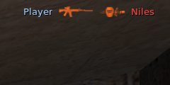
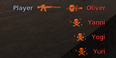
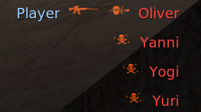

# CS 1.6 kill-feed reference (Valve client)

Counter-Life must draw the kill feed exactly like Counter-Strike 1.6. This fixture runs Valve's own CS 1.6 client
(`cstrike/cl_dlls/client.so`), makes kills that a script controls and saves screenshots of the feed. Use these
screenshots and the measurements in section 5 as the reference for pixel comparisons.

## 1. Summary

| Fact                                                  | 1600x900                             | 2560x1440                             | Rule                                                    |
| ----------------------------------------------------- | ------------------------------------ | ------------------------------------- | ------------------------------------------------------- |
| Scale value `s(n)`                                    | s(5)=9, s(12)=22, s(16)=30, s(32)=60 | s(5)=15, s(12)=36, s(16)=48, s(32)=96 | `s(n) = (int)(n * H / 480)`                             |
| Line `i` y (top of the icon rect and of the text box) | 60 + 30·i                            | 96 + 48·i                             | `s(32) + i * s(16)`                                     |
| Right anchor (end of victim text box)                 | x = 1578                             | x = 2524                              | `W - s(12)`                                             |
| Gap between parts                                     | 9                                    | 15                                    | `s(5)`                                                  |
| Icons                                                 | 1:1, 16 px high                      | 1:1, 16 px high                       | 640 sprite set, no scaling                              |
| Name font                                             | 14 px                                | 24 px                                 | `EngineFont` from `platform/resource/TrackerScheme.res` |
| CT name colour                                        | 153,204,255                          | 153,204,255                           | 0.6, 0.8, 1.0                                           |
| T name colour                                         | 255,63,63                            | 255,63,63                             | 1.0, 0.25, 0.25 (63.75 truncated)                       |
| Icon colour                                           | additive 255,80,0                    | additive 255,80,0                     | tint × texel, added to the frame                        |
| Lines                                                 | 4 at most                            | 4 at most                             | a fifth notice drops the oldest                         |
| Lifetime                                              | 6.0 s                                | 6.0 s                                 | `hud_deathnotice_time` 6                                |

## 2. How the fixture works

### 2.1 Parts

| Part                 | Job                                                                                                                              | Where                                                                          |
| -------------------- | -------------------------------------------------------------------------------------------------------------------------------- | ------------------------------------------------------------------------------ |
| ReGameDLL_CS `cs.so` | Server DLL with ZBot (`bot_add_t`, `bot_goto_mark`, `bot_kill`, …) and `give` (with `sv_cheats 1`). Valve's `cs.so` has neither. | `../ReGameDLL_CS/build-linux-i386/regamedll/cs.so` (untracked, upstream clone) |
| Fixture root         | Isolated Half-Life root: a symlink farm of the Steam install with real files where the game writes                               | `../.hl-fixture`                                                               |
| `fixture.cfg`        | Server and client settings, run by the listen server on every map start                                                          | `tests/fixture/fixture.cfg`                                                    |
| `killfeed.ts`        | Drives the game (console, mouse, screenshots) and saves the reference set                                                        | `tests/fixture/killfeed.ts`                                                    |
| `feed-metrics.ts`    | Measures the feed in a screenshot against a frame of the same view without notices                                               | `tests/fixture/feed-metrics.ts`                                                |
| `frame.ts`           | Raw RGB frames through ImageMagick (no image library)                                                                            | `tests/fixture/frame.ts`                                                       |

### 2.2 Fixture root

`just fixture-root` makes the root with `cp -as` from the Steam install. In such a farm the directories are real and the
files are symlinks. A file that the game creates (in these runs only `qconsole.log`) is therefore a new real file in the
farm. A file that the game rewrites through a symlink changes the Steam install. The recipe replaces these symlinks with
real copies:

- `hl.conf`, `cstrike/*.cfg`, `cstrike/*.dt`, `cstrike/*.vdf`: the engine writes video mode, cvars and the voice ban
  list on exit.
- `platform/config/*`: VGUI writes `InGameDialogConfig.vdf` and `ServerBrowser.vdf`. An early run found this through the
  leak check below.
- `cstrike/dlls/cs.so`: the ReGameDLL build.
- `cstrike/BotProfile.db`, `cstrike/BotChatter.db`: copied from Condition Zero (`czero/`). CS 1.6 does not ship them and
  ZBot needs them.
- `cstrike/maps/de_dust2.nav`: copied from `czero/maps`. Its header records a BSP size of 2057288 bytes, which is the
  size of `cstrike/maps/de_dust2.bsp`, so the mesh fits the CS 1.6 map. ZBot does not have to generate a mesh.
- `cstrike/fixture.cfg`: from `tests/fixture`.

`just fixture-stop` checks for leaks. It lists every farm symlink whose target changed after the start of the run. Each
such file is a write that went into the Steam install. Other programs can also write into the Steam install (another
session ran CS from it during this work), but they cannot change files that the farm holds as real copies, so the check
reports only writes through farm symlinks.

### 2.3 Launch

`just fixture-start <display> <WxH> <port> <clientport>` does these steps:

1. It starts `Xvfb <display> -screen 0 <WxH>x24 +extension GLX`.
2. It starts
   `hl.sh -steam -game cstrike -windowed -condebug -w W -h H -port <port> +clientport <clientport>
   +lservercfgfile fixture.cfg +sv_lan 1 +maxplayers 12 +map de_dust2`
   under the Steam runtime (`ubuntu12_32/steam-runtime/run.sh`), with `SteamAppId=10`. Steam must be running.
3. The runtime cannot set the `en_US.UTF-8` locale, so the engine first shows an SDL message box with the title
   `Warning`. The recipe finds the window and clicks its OK button at (width/2, height − 27).
4. `-condebug` writes the console to `<root>/qconsole.log`. The recipe waits for the line
   `is joining the Counter-Terrorist force`.

`+lservercfgfile fixture.cfg` replaces the stock `listenserver.cfg`, which sets `sv_cheats 0` on every map start.
`fixture.cfg` also does these things:

- `motdfile` names a file that does not exist, and `humans_join_team CT` with `mp_auto_join_team 1` skips the team and
  class menus. No menu must be closed by hand.
- `mp_round_infinite 1`: kills never end the round, so nothing respawns or moves.
- `mp_roundrespawn_time -1`: a bot that joins in the middle of the round spawns at once.
- `mp_deathmsg_flags 0`: ReGameDLL adds extra fields to `DeathMsg` by default. With 0 it sends only killer, victim,
  headshot and weapon, the same as Valve's server.
- `bot_zombie 1`, `bot_chatter off`, `bot_quota 0`: bots stay passive and silent until the script needs them.
- `sensitivity 1`, `m_yaw 0.022`, `m_pitch 0.022`, `m_rawinput 1`, `m_filter 0`, `default_fov 90`,
  `gl_widescreen_yfov 1`: the aim maths depends on these values.
- `hud_deathnotice_time 6`: the stock value.

### 2.4 Capture procedure

`killfeed.ts` does these steps. Each step is deterministic, except the bot fight in step 7.

1. Set the name to `Player` (Steam sets the persona name on connect), `give weapon_m4a1`, select it.
2. Turn the view 12° down from the first CT spawn of de_dust2. Mark the nav area under the crosshair (`bot_nav_edit 1`,
   `bot_nav_mark`, `bot_nav_edit 0`). Bind F9 to `bot_kill`.
3. For each victim: add a T bot with a fixed Condition Zero profile name (`bot_add_t Neil`). Take a frame of the empty
   view. Send `bot_goto_mark` (again every 8 s while no bot is in view, because a bot that has not spawned yet ignores
   the order). The bot walks from the T spawn into the view.
4. Find the bot as the largest connected patch of pixels that changed against the empty frame. When its box stays still
   for two frames 0.7 s apart, freeze all bots with `bot_stop 1`.
5. Aim at the head (8% of the box height below its top) or the chest (40%). The script converts the screen point to a
   turn: the focal length is H / 1.5 pixels (vertical field of view of fov 90 at 4:3, kept by `gl_widescreen_yfov 1`)
   and one mouse count turns 0.022°. The turn uses GoldSrc's `AngleVectors` with the current pitch. A measured turn of
   200 counts moved the scene 46 px at 900 px height, as the model predicts (600 · tan 4.4°).
6. Take the "before" frame. Fire single taps and read `qconsole.log` until `Player killed <victim>` appears. Then take
   frames for 7.5 s and record the feed rows in each frame.
7. Steps 3 to 6 run for these captures: a chest kill (`m4a1`), a head kill (`headshot`), and a head kill with three
   extra passive bots that F9 kills 2 s later (`stack4`). Then five passive bots die together through F9 (`max4`). At
   the end, bots fight with `bot_zombie 0`, `bot_difficulty 3` and `mp_forcerespawn 1`. The script saves a frame when
   four deaths happen within 5 s and the player has been alive for 3 s (`fight`).

## 3. Rerun

Run from the repository root or from a worktree. The recipes find `../ReGameDLL_CS` and `../.hl-fixture` through the
main checkout (`git rev-parse --git-common-dir`).

```sh
just fixture-killfeed                    # 1600x900 on :97, about 5 minutes
just fixture-killfeed :96 2560x1440      # 2560x1440 on :96
just fixture-metrics .e2e/reference/cs16-killfeed-1600x900-headshot.png \
  .e2e/reference/cs16-killfeed-1600x900-headshot-before.png
```

`fixture-killfeed` runs `fixture-build` (no-op when the build is current), `fixture-root`, `fixture-start`, the capture
script and `fixture-stop`. Use the single recipes to drive the game by hand, for example `just fixture-start` and then
`CL_DISPLAY=:97 just con 'bot_add_t Neil'`.

Run one game for each fixture root at a time. The games share `qconsole.log` and the config files of the root. For
parallel runs, set a second root with `CS_FIXTURE_ROOT` and use other ports.

| Variable             | Default                                                 | Use                                                     |
| -------------------- | ------------------------------------------------------- | ------------------------------------------------------- |
| `HL_DIR`             | `~/.local/share/Steam/steamapps/common/Half-Life`       | Steam install (read only)                               |
| `REGAMEDLL_DIR`      | `<project root>/ReGameDLL_CS`                           | ReGameDLL source; the build goes to `build-linux-i386/` |
| `CS_FIXTURE_ROOT`    | `<project root>/.hl-fixture`                            | fixture root                                            |
| `CS_FIXTURE_DISPLAY` | `:97`                                                   | default Xvfb display                                    |
| `CL_STATE_DIR`       | `<repo>/.e2e`                                           | pid files, logs and `reference/`                        |
| `STEAM_RUNTIME_RUN`  | `~/.local/share/Steam/ubuntu12_32/steam-runtime/run.sh` | Steam runtime                                           |

Requirements: Steam running and signed in, Half-Life with CS 1.6 and Condition Zero installed, Xvfb with GLX, xdotool,
ImageMagick 7, Deno 2, CMake 3.5 or newer, gcc and g++ with 32-bit libraries, fd and rg.

## 4. Screenshots

The full screenshots are in `.e2e/reference/` (not in git), named `cs16-killfeed-<W>x<H>-<name>.png`. The directory
`cs16-killfeed-reference/` next to this file holds small crops of the feed.

| Name            | Shows                                                                                                                                                |
| --------------- | ---------------------------------------------------------------------------------------------------------------------------------------------------- |
| `m4a1`          | One line: `Player` (CT) killed `Neil` (T) with the M4A1, no headshot.                                                                                |
| `headshot`      | One line: `Player` killed `Niles` with an M4A1 headshot (`d_m4a1` then `d_headshot`).                                                                |
| `stack4`        | Four lines: `Player [M4A1][headshot] Oliver`, then `[skull] Yanni`, `[skull] Yogi`, `[skull] Yuri` (`bot_kill` deaths show the skull and no killer). |
| `max4`          | Five deaths in one frame (Waldo, Wally, Walt, Wesley, Uri). Four lines show; Waldo, the oldest, is gone.                                             |
| `fight`         | Bots fighting: four lines with T and CT killers and victims and pistol icons. The view is wherever the player stood (he can die and respawn).        |
| `<name>-before` | The same view as `<name>` without notices, 0.6 s before the shot. Input for `feed-metrics.ts`.                                                       |
| `timeline.json` | For each capture: the aim point, the bot box, the feed rows in each frame (ms after the kill) and the lifetime.                                      |





## 5. Measured facts

### 5.1 Method

- `feed-metrics.ts` compares the screenshot with the "before" frame of the same view. Changed pixels in the top right
  quarter form lines (rows) and parts (columns split by a gap of more than s(5)/2). A part with pixels that got darker
  is text, because names have a drop shadow and additive icons cannot darken the frame. The boxes cover lit pixels only.
- Icon rects: a fit of the decoded sprite texels (`640hud1.spr`) against the red that the icon added gives the drawn
  position to 0.05 px. All icons fit at an integer rect position plus about 0.5 px in x and y: HUD sprites are sampled
  with bilinear filtering half a pixel off the texel grid. Each icon therefore spreads 1 px to the right and down.
- Times: a frame takes about 0.2 s at 1600x900 and 0.6 to 1.3 s at 2560x1440. Its time is the middle of the grab. The
  time zero is the moment the console log showed the kill (40 ms poll).

### 5.2 Line geometry

| Item                                                           | 1600x900         | 2560x1440         |
| -------------------------------------------------------------- | ---------------- | ----------------- |
| Icon rect top, line 0…3                                        | 60, 90, 120, 150 | 96, 144, 192, 240 |
| Lit icon rows, line 0 (`d_m4a1` / `d_headshot`, `d_skull`)     | 61–75 / 61–76    | 97–111 / 97–112   |
| Text top (cap height) and bottom (descender), line 0           | 63 and 75        | 100 and 122       |
| Height of `Neil` (no descender)                                | 10 px            | 18 px             |
| Line step                                                      | 30 px            | 48 px             |
| Right margin from last lit pixel to the screen edge            | 22–23 px         | 36–37 px          |
| Victim text box right edge (from the ink and the side bearing) | 1578 = W − 22    | 2524 = W − 36     |

The icon and the text of a line use the same y. The font puts the top of the capitals 3 px (900) or 4 px (1440) below
that y.

### 5.3 Horizontal layout

All parts are packed against the right anchor. Left to right: killer name, gap, weapon icon, gap, [headshot icon, gap,]
victim name. A suicide (`bot_kill`) has no killer name and no first gap. Every gap is s(5). Examples from the `headshot`
frames:

| Part                      | 1600x900 rect or ink | 2560x1440 rect or ink |
| ------------------------- | -------------------- | --------------------- |
| `Player` ink              | 1394–1433 (40 px)    | 2271–2339 (69 px)     |
| gap                       | 9                    | 15                    |
| `d_m4a1` rect (48×16)     | x 1443, y 60         | x 2355, y 96          |
| gap                       | 9 (1491 → 1500)      | 15 (2403 → 2418)      |
| `d_headshot` rect (36×16) | x 1500, y 60         | x 2418, y 96          |
| gap                       | 9 (1536 → 1545)      | 15 (2454 → 2469)      |
| `Niles` ink               | 1546–1576 (31 px)    | 2471–2522 (52 px)     |

The lit pixels of an icon are not its rect: `d_m4a1` has texels in columns 0–46 and rows 1–14, `d_headshot` in 0–35 and
0–15, `d_skull` in 4–27 and 1–15. Thus the lit gap between the M4A1 icon and the victim is 10 (900) or 17 (1440) px, and
between a skull and the victim 12 to 13 (900) or 18 to 20 (1440). Name ink also has side bearings of about 1 px (900) or
2 px (1440).

### 5.4 Icons

- Sprites come from the 640 set of `cstrike/sprites/hud.txt` at 1:1 at both resolutions: `d_m4a1` 48×16 (`640hud1`
  192,96), `d_headshot` 36×16 (`640hud1` 0,240), `d_skull` 32×16 (`640hud1` 224,240). At 1440p the icons look small next
  to the 24 px names.
- Colour: the texel value times the tint 255,80,0, added to the frame. Measured added colour at the brightest texel:
  208–211, 65–66, 0 for `d_m4a1` (brightest texel 208) and up to 229, 72, 0 for `d_skull`. The green-to-red ratio is
  0.31 (80/255) and blue is 0. On the dark ceiling of the captures the icons look orange (about 250,100,30). Over the
  bright sky in `1600x900-fight` they go to pink and white.
- The headshot icon follows the weapon icon after a gap of s(5), on the same y, with the same tint.
- A death without a weapon sprite (`bot_kill` sends `world`) shows `d_skull`.

### 5.5 Names

- Font: the engine console font `EngineFont` from `platform/resource/TrackerScheme.res` (Verdana, weight 600, drop
  shadow). Its height comes from the screen height: 14 px for 768–1023 and 24 px for 1200 and more. This host has no
  Verdana, so fontconfig gives Noto Sans. The name widths agree with Noto Sans Regular: at 14 px `Player`, `Neil`,
  `Niles`, `Oliver` render 40, 24, 31 and 39 px wide (measured 40, 24, 31, 39). At 24 px they render 68, 41, 53 and 66
  px (measured 69, 40, 52, 66). A machine with Verdana installed draws other glyphs.
- Colour: CT 153,204,255; T 255,63,63. At 24 px most glyph pixels have this exact colour. At 14 px most stem pixels are
  anti-aliased to about 80% (for example 131,169,208 and 209,56,55) and only a few reach the full colour.
- Shadow: black, offset by +1,+1. Every darkened pixel has a lit text pixel up and to the left of it.
- The player is CT, so his name is blue as killer and as victim (`fight`).

### 5.6 Lines over time

- At most 4 lines. Five deaths in one frame (`max4`) show the last four. The first death is gone.
- New notices go to the bottom. Line 0 is the oldest.
- Each notice stays 6.0 s. In two runs with frames 0.2 s apart at 1600x900, a notice was still visible 5.84–6.01 s after
  the kill and gone 6.05–6.21 s after it. Runs with slower frames (2560x1440, or a loaded host) agree within their frame
  spacing.
- When the top notice expires, the lines below move up one step at once. In `stack4` the kill shows alone until 2.0 s,
  four lines show from 2.2 s, three lines from 6.05 s (the skulls move up to rows 61, 91, 121) and no lines from 8.3 s.
- A notice that arrives while the console is open gets an old start time. In a run with `bot_kill` typed into the
  console about 1 s after a kill, all four lines went away together at 6.1 s. While the console is open the client shows
  the main menu and draws no HUD (no radar, no crosshair), so the HUD time stops at the last HUD frame. The capture
  script uses a key bind for `bot_kill` for this reason.

## 6. Cross-check with cs16-client

`cs16-client` (FWGS) is a source reimplementation. Its kill feed is in `cl_dll/death.cpp`. The table compares it with
the measurements above.

| Fact                      | Valve client (measured)             | cs16-client                                                                                                          | Same            |
| ------------------------- | ----------------------------------- | -------------------------------------------------------------------------------------------------------------------- | --------------- |
| Line cap                  | 4                                   | `MAX_DEATHNOTICES 4` (death.cpp:42), oldest moved out (death.cpp:190-194)                                            | yes             |
| Lifetime                  | 6.0 s from the message              | `hud_deathnotice_time` "6" (death.cpp:58), time = `m_flTime` + cvar (death.cpp:262), clamp to 6 s (death.cpp:43, 98) | yes             |
| Expiry                    | oldest first, lines move up         | remove and `memmove` (death.cpp:90-96)                                                                               | yes             |
| Line 0 y                  | s(32) = 60 / 96                     | `YRES(32) + 2` = 62 / 98 (death.cpp:107, cl_util.h:77)                                                               | no, 2 px lower  |
| Line step                 | s(16) = 30 / 48                     | 20 px at all resolutions (death.cpp:107)                                                                             | no              |
| Right anchor              | victim text box ends at `W - s(12)` | ends at `ScreenWidth` (death.cpp:115)                                                                                | no              |
| Killer to icon gap        | s(5) = 9 / 15                       | 5 px (death.cpp:121, 126)                                                                                            | no              |
| Icon to headshot icon gap | s(5)                                | 0 (death.cpp:139-144)                                                                                                | no              |
| Icon to victim gap        | s(5)                                | 0 (death.cpp:139, 145, 153)                                                                                          | no              |
| Icon tint and blend       | 255,80,0 additive                   | 255,80,0 with `SPR_DrawAdditive` (death.cpp:129, 136-137)                                                            | yes             |
| Headshot icon             | after the weapon icon, same tint    | death.cpp:141-146                                                                                                    | yes, but no gap |
| Name colours              | 153,204,255 and 255,63,63           | `g_ColorBlue` 0.6,0.8,1.0 and `g_ColorRed` 1.0,0.25,0.25 (util.cpp:69-70, 75-93)                                     | yes             |
| Suicide                   | skull, no killer name               | killer 0 or killer = victim (death.cpp:248-249), skull when no sprite (death.cpp:114)                                | yes             |
| Name font                 | engine console font with shadow     | `pfnDrawConsoleString` (include/draw_util.h:96-106)                                                                  | yes             |
| Team kill                 | not captured                        | 10,240,10 for weapon `teammate` (death.cpp:130-133)                                                                  | not checked     |
| Spectator layout          | not captured                        | y = `ScreenHeight / 5 + 2 + 20 * i` (death.cpp:111)                                                                  | not checked     |

The differences are all in the layout: Valve scales the top, the line step, the margin and the gaps with `s(n)`, and
cs16-client uses `YRES(32) + 2` and fixed pixels. The measurements confirm the formula in
`docs/research/cs16-hud-spec.md` §3.9 (branch `docs/cs16-hud-spec`): top `s(32)`, step `s(16)`, margin `s(12)`, gap
`s(5)`, with one correction: the T name colour is 255,63,63, not 255,64,64.

## 7. Limits and quirks

- The script works only on de_dust2 from the first CT spawn (the 12° look-down picks the nav area).
- The spectator layout and the team-kill colour are not captured.
- `notarget` and `noclip` print nothing and have no effect in this engine build, also with `sv_cheats 1` before the map
  loads. The fight capture therefore lets bots kill the player.
- The engine renders names with the fonts of the host (section 5.5). Compare Counter-Life on the same host.
- `xdotool type` needs `--` before text that starts with `-` (for example `-moveup`). The `con` recipe does not add it.
