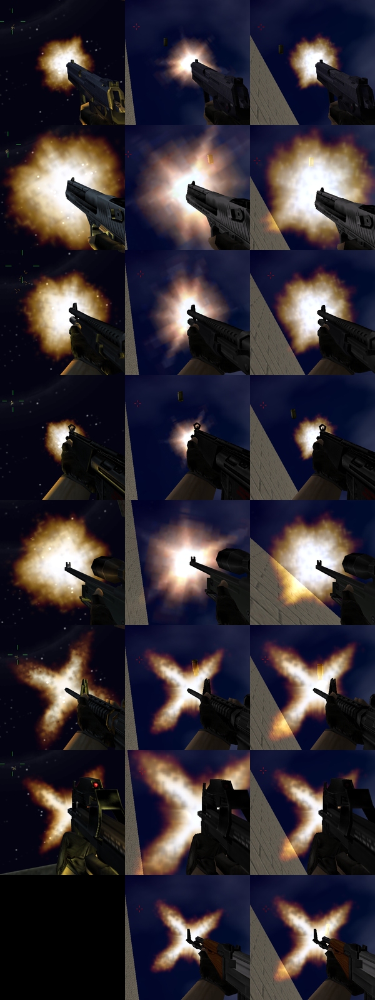
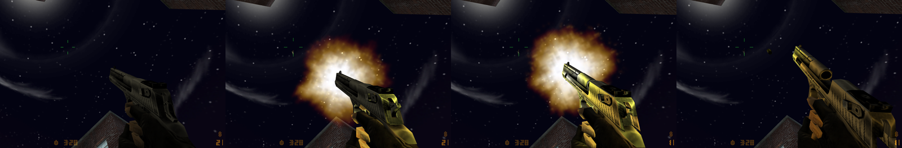
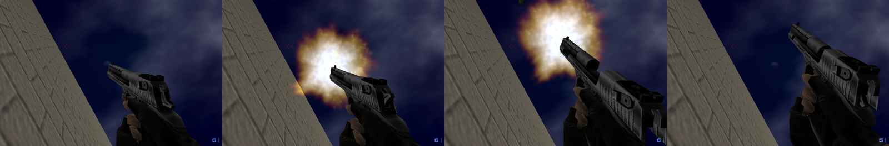

# Muzzle flash: the CS 1.6 sprites and sizes in Sven Co-op

Status: done on branch `feat/cs-muzzle-flash`. Fixes defect 2 of the [asset audit](asset-audit.md).

## Result

All 24 CS firearms now fire Sven's scripted muzzle flash (studio event 5005). Each event names a file in `events/` that
draws the CS 1.6 sprite at the CS 1.6 size. Before this change, 15 view models fired events 5001/5011/5021. Sven sends
these events to the engine, and the engine drew Half-Life's star sprite from `svencoop/sprites/`. A server cannot
replace that file on a client.

| Weapons                                                         | CS 1.6 event (type) | CS 1.6 sprite and width         | Sven event file                              | Sven width |
| --------------------------------------------------------------- | ------------------- | ------------------------------- | -------------------------------------------- | ---------- |
| Five-SeveN, P228, MAC-10, MP5, TMP, UMP45                       | 5001 11             | `muzzleflash2.spr` × 0.1 = 6.4  | `cs16_muzzleflash2_s3_a0.txt`                | 6          |
| Dual Elites                                                     | 5001 11, 5011 11    | `muzzleflash2.spr` × 0.1 = 6.4  | `cs16_muzzleflash2_s3_a0.txt`, `…_s3_a1.txt` | 6          |
| USP (unsilenced, silenced)                                      | 5001 11, 5021 11    | `muzzleflash2.spr` × 0.1 = 6.4  | `cs16_muzzleflash2_s3_a0.txt`, `…_s3_a2.txt` | 6          |
| M4A1 silenced                                                   | 5001 11             | `muzzleflash2.spr` × 0.1 = 6.4  | `cs16_muzzleflash2_s3_a2.txt`                | 6          |
| Desert Eagle, Glock 18, M3, XM1014, Scout                       | 5001 21             | `muzzleflash2.spr` × 0.2 = 12.8 | `cs16_muzzleflash2_s6_a0.txt`                | 12         |
| AWP                                                             | 5001 31             | `muzzleflash2.spr` × 0.3 = 19.2 | `cs16_muzzleflash2_s9_a0.txt`                | 18         |
| AK-47, AUG, FAMAS, Galil, SG552, G3SG1, SG550, M249, M4A1 plain | 5001 22, 5021 22    | `muzzleflash3.spr` × 0.2 = 14.4 | `cs16_muzzleflash3_s7_a0.txt`                | 14         |
| P90                                                             | 5001 12             | `muzzleflash3.spr` × 0.1 = 7.2  | `cs16_muzzleflash3_s4_a0.txt`                | 8          |

Widths are in world units. In a file name, `s` is the Sven `scale` and `a` is the attachment. The attachments are the
ones that the old events used (5001 → 0, 5011 → 1, 5021 → 2), so every flash stays at the muzzle where it was. The port
swaps attachments 0 and 2 of the M4A1 together with its events, so its plain flash is on attachment 0.

The CS 1.6 `muzzleflash2.spr` (a soft fireball) comes from the local CS install through `cstrike-assets.txt` and lands
at `sprites/cs16/muzzle/muzzleflash2.spr`. The rifle X is `sprites/cs16/csflashx.spr`, which the port already shipped
and which is a byte copy of CS 1.6 `muzzleflash3.spr`. The old `events/cs16_flashx.txt` (rifles and P90, scale 6) is
gone: it drew the rifle X 2.4 units (17%) too small and the P90 X 4.8 units (67%) too large.



`muzzle-flash/flashes.png`: one row for each weapon (USP, Desert Eagle, M3, MP5, AWP, M4A1, P90, AK-47). Columns: CS
1.6, Sven before this change, Sven after it. Each tile is a 400 × 400 pixel square around the flash core of the median
shot, shown at half size. CS 1.6 has no AK-47 tile, because a CT cannot buy it. CS 1.6 also lights the gun gold (see
"Remaining differences").

## How CS 1.6 draws a muzzle flash

- Valve's CS client (`cstrike/cl_dlls/client.so`, SHA-1 `f2bd6f7a…`) has the plain HLSDK `HUD_StudioEvent` (0xa6ce0):
  events 5001/5011/5021/5031 call the engine's `R_MuzzleFlash(attachment[0..3], atoi(options))`.
- `R_MuzzleFlash` in Valve's engine (`Half-Life/hw.so`, SHA-1 `7f129253…`, local symbols) at 0x13f760:
  - sprite `sprites/muzzleflash{type % 10 % 3 + 1}.spr` from `cstrike/`;
  - scale `(type / 10) × 0.1` (constant at 0x24a958), or 0.5 when that is 0 (0x248810);
  - a random frame `RandomLong(0, frames − 1)` and a random roll `RandomLong(0, 359)` (0–20 for `muzzleflash1`);
  - additive, render amount 255, white;
  - the temporary entity dies at `cl.time + 0.01` (0x24bc90) and is added to the frame at once (`AppendTEntity`).
- The CS sprites: `muzzleflash2.spr` is 64 × 64 pixels with 3 frames, `muzzleflash3.spr` is 72 × 72 with 3 frames. Both
  are additive and parallel. A parallel sprite is `width × scale` units wide. The three frames of each sprite are almost
  the same size: lit radius 25.4/25.7/25.3 pixels for `muzzleflash2`, arm length 43/48/42 pixels for `muzzleflash3`
  (grey level above 32).

## How Sven Co-op draws a muzzle flash

Addresses are in Sven's `client.so` (SHA-1 `aa7c4362…`) and `hw.so` (SHA-1 `41958792…`).

- `HUD_StudioEvent` (client.so 0xb62a4) sends 5001/5011/5021/5031 to the engine's `R_MuzzleFlash`, which loads the
  Half-Life sprites from `svencoop/sprites/`. Events 5005 and 5006 call 0xed154 instead.
- 0xed154 reads `events/<options>` once and keeps it by name. Each line is `<key> <value>`; lines with another key, such
  as `// comment`, are skipped. The keys (table at 0x61ebc0) are `attachment`, `bone` (used only when the attachment is
  negative), `spritename`, `scale`, `colorR`, `colorB`, `colorG`, `rendermode`, `transparency` and `offset`. `scale` and
  the colours are one byte each (`strtol`), so the scale is a whole number from 0 to 255. The value of `colorB` goes to
  the green channel and `colorG` to blue; white flashes do not show this.
- 0xed154 then starts a particle effect of type 8 for the view model or 7 for another entity (0xef8ce, cases 7 and 8):
  - it dies 0.01 s after it starts, like the CS 1.6 flash;
  - the roll is `RandomLong(−16, 16)` and the frame is always 0;
  - the particle has no other update (0xf247a has no case for types 7 and 8).
- The draw function (0xf39c2) puts a square at the attachment that faces the view. Its corners are `± scale` along the
  view's right and up axes, so the flash is `2 × scale` units wide for any sprite size. View-model flashes (type 8) draw
  with the depth test off.
- Sven's `viewmodel_fov` is 0 by default (hw.so 0x13a2e0), so the view model and the flash use the world projection, as
  in CS 1.6. `liblist.gam` sets `vertical_fov 1`, so `default_fov` is the vertical angle. CS 1.6 at FOV 90 shows 73.74°
  vertically at 16:9 (`gl_widescreen_yfov 1`), so Sven at `default_fov 74` shows the same scene size.

Thus a CS width `w` needs `scale = w / 2`. The table above uses the nearest whole number. The in-game comparison below
moved only the AWP from 10 to 9.

## Changes

- `cstrike-assets.txt`: `sprites/muzzleflash2.spr` → `sprites/cs16/muzzle/muzzleflash2.spr`. A player's download cache
  can hold another pack's `sprites/cs16/muzzleflash2.spr`, and a client never downloads a file again.
- `events/`: seven new files (table above); `cs16_flashx.txt` is removed.
- `tools/mdlpatch.ts`: rewrites the event id and the options of matching `mstudioevent_t` records (76 bytes) in place.
  It fails when a rule matches no event or when the options do not fit in 63 bytes. It then compares the result with the
  input and fails when any other byte changed. Self-check: `deno test -R tools/mdlpatch.ts`.
- `models/cs16/wpn/*/v_*_r2.mdl`: the 24 patched view models under new names, because clients keep the old files. The
  originals are removed. `just muzzle-models` makes all 24 files again from the originals in commit `435d391`; the
  result is byte-identical. Each model fires the same number of muzzle events as before (2 to 12).
- The weapon scripts point `V_MODEL` at the new models. `CommonSpritePrecache` (`scripts/cs16/base.as`) precaches both
  sprites and the seven event files; without the precache, clients do not download the event files. `cs16_resources.res`
  lists the new files.

## Calibration in game

### Method

- Both games at 1600 × 900, the same scene size (Sven `default_fov 74`, CS 1.6 FOV 90), 20 frames per second (Sven's
  lowest `fps_max`; CS 1.6 ignores a low `fps_max` unless `fps_override` is 1), looking up at a dark sky so that the
  additive flash is clearly visible: CS 1.6 on `cs_backalley` (night), Sven on `testcenter`.
- `tests/e2e/muzzleflash.ts` records the region `1000x660+500+240` at 60 frames per second while it fires three shots,
  and joins identical recorded frames into game frames. A shot is a game frame that gets brighter and has a white-hot
  core (gain of 200 grey levels or more). For each shot it keeps the frame before, the flash frame and the frame after.
  A later game frame shows the flash again when it has a white-hot core again and a lit area of at least half the first
  one (`flashesAgain`). The second flash is at the muzzle of the recoiled gun, 100 to 250 pixels away.
- Size: the gun, and in CS 1.6 also the light on the gun, are below and right of the muzzle. So the sizes use only the
  part of the flash where the sky is behind it (`measureFlash`). Lit means 32 grey levels above the frame before the
  shot.
  - `radius`, for the round fireball: from the lit area of the upper-left quadrant around the core.
  - `reach`, for the rifle X, which CS 1.6 turns to a random angle: the farthest lit pixel along rays from the core
    across the upper half. The upper half always holds a whole arm of the X.

### Results (pixels at 1600 × 900, median of 1 to 9 shots)

| Weapon (CS width → Sven width) | Measure | CS 1.6 | Sven before | Sven after | after / CS |
| ------------------------------ | ------- | ------ | ----------- | ---------- | ---------- |
| USP (6.4 → 6)                  | radius  | 74     | 67          | 72         | −3%        |
| MP5 (6.4 → 6)                  | radius  | 55     | 52          | 57         | +4%        |
| Desert Eagle (12.8 → 12)       | radius  | 159    | 146         | 155        | −3%        |
| M3 (12.8 → 12)                 | radius  | 119    | 115         | 115        | −3%        |
| AWP (19.2 → 18)                | radius  | 135    | 130         | 131        | −3%        |
| M4A1 plain (14.4 → 14)         | reach   | 173    | 159         | 186        | +8%        |
| P90 (7.2 → 8)                  | reach   | 147    | 239         | 159        | +8%        |
| AK-47 (14.4 → 14)              | reach   | –      | 137         | 156        | –          |

- "Sven before" is HL's star for the first five rows and `cs16_flashx.txt` (scale 6) for the X.
- The AWP at scale 10 measured radius 146 (+8%) and reach 170 (+6%). At scale 9 it measures radius 131 (−3%) and reach
  152 (−6%). Thus the AWP uses 9, the only width that differs from `w / 2` rounded.
- The X measures vary by about ±10% from shot to shot, because CS 1.6 turns the X to a random angle and its three frames
  have arms of 42 to 48 pixels. At scale 6 the rifle X measured 159 (−8%), at 7 it measured 186 (+8%), so the computed
  width decides: 14 units for 14.4. The P90 at scale 6 measured 239 (+63%); at 3 it would measure about 119 (−19%), so
  it uses 4.

### Re-check in the review

A second run used new scenes: Sven on `testcenter` again, CS 1.6 on `cs_backalley` with the moon near the edge of the
region `900x660+700+240`. It adds the silenced M4A1.

| Weapon (CS width → Sven width) | Measure | CS 1.6 | Sven | Sven / CS |
| ------------------------------ | ------- | ------ | ---- | --------- |
| USP (6.4 → 6)                  | radius  | 67     | 71   | +6%       |
| MP5 (6.4 → 6)                  | radius  | 55     | 58   | +5%       |
| Desert Eagle (12.8 → 12)       | radius  | 168    | 154  | −8%       |
| M3 (12.8 → 12)                 | radius  | 117    | 118  | +1%       |
| AWP (19.2 → 18)                | radius  | 140    | 131  | −6%       |
| M4A1 silenced (6.4 → 6)        | radius  | 40     | 41   | +3%       |
| M4A1 plain (14.4 → 14)         | reach   | 205    | 184  | −10%      |
| P90 (7.2 → 8)                  | reach   | 165    | 159  | −4%       |

- The Sven values of the two runs agree within 4%. The CS 1.6 values change by up to 9% for the fireball and 18% for the
  X between the runs, because CS 1.6 picks a random frame and angle for each shot.
- With the CS 1.6 shots of both runs together, the fireball radii differ from CS 1.6 by −5% (Desert Eagle, AWP) to +4%
  (USP, MP5). The widths in the table at the top stay as they are.
- The silenced M4A1 flash is at the tip of the silencer in both games.

## Duration

Both engines remove the flash 0.01 s after it starts, so a flash shows in the frame in which its event fires. It shows
in the next frame only above 100 frames per second. In both games, the shoot sequence's frame-0 event can fire in two
frames in a row: `R_StudioClientEvents` (Valve hw.so 0xcc700, Sven hw.so 0xa70a0) sets the window start to −0.01 while
`latched.sequencetime == animtime`, that is, while the sequence has just started. The second flash is at the muzzle of
the second frame, which shows that it is a new event and not a longer flash.

| Game, 20 frames per second | Shots | Flash in 1 frame | Flash in 2 frames |
| -------------------------- | ----- | ---------------- | ----------------- |
| CS 1.6                     | 29    | 17               | 12 (41%)          |
| Sven before                | 24    | 10               | 14 (58%)          |
| Sven after                 | 23    | 13               | 10 (43%)          |
| Sven after, final AWP run  | 12    | 7                | 5 (42%)           |
| CS 1.6, review             | 24    | 16               | 8 (33%)           |
| Sven after, review         | 39    | 19               | 20 (51%)          |

The first count found the second frame only where it lit the area of the first flash. The review counted the saved
frames again with `flashesAgain`, which added two second frames to the first runs. Together, CS 1.6 shows two flash
frames on 20 of 53 shots (38%) and Sven on 35 of 74 shots (47%). With these numbers of shots, the difference is in the
range of random variation.





The two strips show the frame before, two flash frames and the frame after: CS 1.6 at about 90 frames per second, Sven
at 20.

## Remaining differences

- Sven always draws frame 0 and turns the flash by at most 16°. CS 1.6 picks one of three frames and any angle. The
  fireball looks the same either way. The rifle X always stands as an X in Sven; in CS 1.6 it is sometimes a +.
- CS 1.6 lights the gun on each shot. Its weapon events call `EV_MuzzleFlash` (Valve client.so 0x62b60), which sets
  `EF_MUZZLEFLASH` on the view model. `R_StudioClientEvents` then adds an entity light at attachment 0 for 0.05 s: gold
  (255, 192, 64), radius 16, which decreases by 320 per second. An entity light lights models only, not the world. The
  300-unit world light in the same function is only for the `g_bIsTerrorStrike` game. The same code is in Sven's hw.so
  0xa70a0. Sven's scripts set the flag on the player and the weapon entity only, so Sven's view model stays dark. A
  server plugin cannot set it on the client's view model. In the review, one shot lit Sven's view model gold: the first
  MAC-10 shot after a weapon change. The cause is not known.
- Sven draws the view-model flash with the depth test off, so it also shows in front of a close wall. CS 1.6 hides the
  part of the flash that is inside a wall.
- Third-person flashes come from the shoot sequences of the player model. The `p_` and `w_` models have no muzzle events
  in either game. The CS 1.6 player models fire events 5001 and 5011 with type 10 to 50 (`muzzleflash1.spr`, for example
  type 40 for `shoot_carbine` and `shoot_ak47`). Sven's `player.mdl` fires its own effects for the animation groups that
  the port uses: 5001 type 15 for `onehanded`, 5001 and 5031 type 15 for `uzis`, 5005 `muzzle_spaw.txt` for `m16` and
  `saw`, 5005 `muzzle_MP5.txt` for `mp5`, 5005 `muzzle_SG.txt` for `shotgun`, 5011 and 5021 type 15 for `sniper`. Each
  player uses the player model on the client, so this change does not touch these flashes. They were not compared in
  game.

## Reproduce

```sh
# Patched models and the self-checks
just muzzle-models                        # byte-identical *_r2.mdl from 435d391
deno test -R tools/mdlpatch.ts
deno test -A tests/e2e/muzzleflash.ts

# Sven: sandbox server, install, offscreen client (display :102)
just sandbox /abs/path/.svends-muzzle && export SVEN_SERVER_DIR=/abs/path/.svends-muzzle
just install && just install-e2e && just server 27051 testcenter
CL_DISPLAY=:102 CL_LISTEN_PORT=27052 just client +connect 127.0.0.1:27051
CL_DISPLAY=:102 just con 'default_fov 74; net_graph 0; cl_showfps 0'   # then "retry" so the FOV applies
just cmd 27051 'as_command e2e.give weapon_csdeagle'                   # and the other weapons
# hold Up (+lookup) and turn until the sky is above and left of the muzzle, then:
just e2e-muzzleflash :102 .e2e/muzzle/sven 1000x660+500+240 deagle=weapon_csdeagle awp=weapon_awp

# CS 1.6 in an isolated Half-Life copy, on cs_backalley, as CT; "fps_override 1", look up at the sky, then:
just e2e-muzzleflash :102 .e2e/muzzle/cs 1000x660+500+240 'deagle=deagle; weapon_deagle' 'awp=awp; weapon_awp'
just e2e-muzzleflash measure .e2e/muzzle/cs/deagle-1.png    # measure a saved shot again
```

A client keeps every file that it downloaded. When you test a changed event file or model under the same name, first
delete it from the client's `svencoop_downloads/`.
