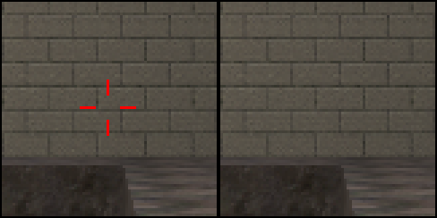
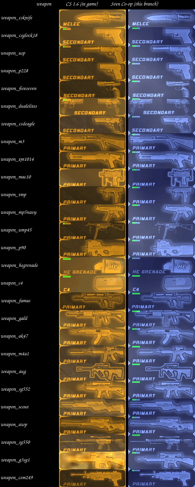
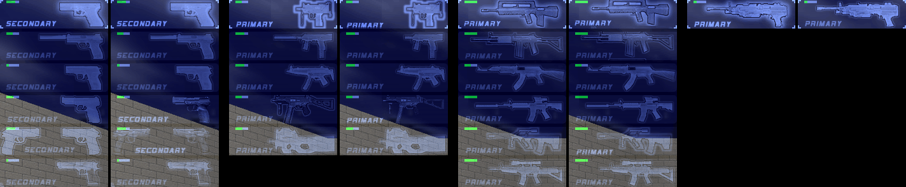
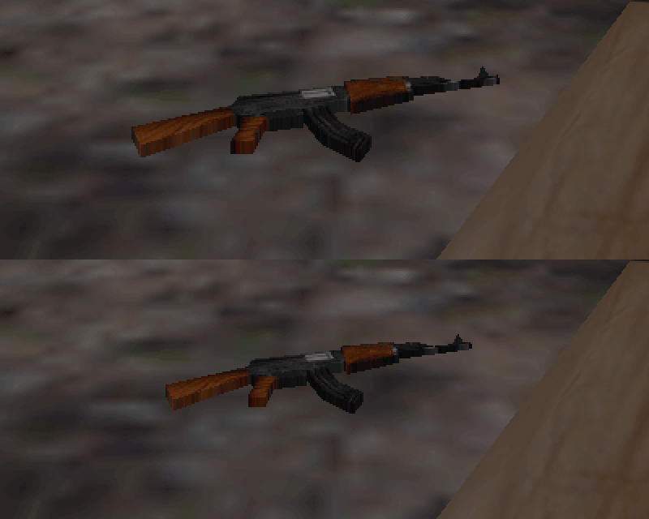
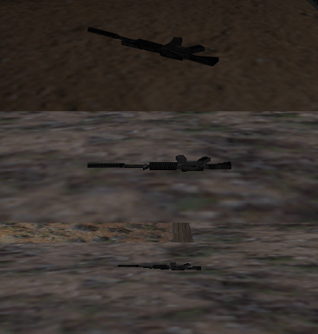

# Weapon icons and dropped-weapon size

Status: implemented on branch `feat/cs-weapon-icons` and checked in game (Sven Co-op 5.26 client and dedicated server,
build 10269, Linux) and against stock Counter-Strike 1.6 at 1600×900.

## Result

| Item                                                       | Before                                                                                                        | After                                                                                                       |
| ---------------------------------------------------------- | ------------------------------------------------------------------------------------------------------------- | ----------------------------------------------------------------------------------------------------------- |
| Weapon selection icons (`weapon`, `weapon_s`)              | R4to0's `cs1024.spr`; seven icons restyled (asset audit, section 4)                                           | CS 1.6 sheets and rects; 54 of 54 crops pixel-identical to CS 1.6                                           |
| Ammo icons (`ammo`)                                        | CS rects in `640hud7.spr` (already identical)                                                                 | the same rects, now in the icon folder; 27 of 27 crops identical                                            |
| Native crosshair                                           | a red cross of 24 pixels (the whole `crosshairs.spr` frame) for 22 weapons; none for the C4 and the 4 snipers | the same cross for the 23 weapons that have a crosshair in CS 1.6 (now also the C4); none for the 4 snipers |
| Dropped weapons                                            | `pev.scale` 1.4, or a per-weapon value from 1.0 to 1.6                                                        | 1.0, as in CS 1.6                                                                                           |
| Ammo pickups without their own scale (M249, Glock 18, USP) | 1.5                                                                                                           | 1.0, as the 13 magazines that set 1                                                                         |

Evidence: `tests/weapon-lists.test.ts` (automatic), `tools/audit.ts` (81 of 81 crops with mean |Δ| 0 against CS 1.6),
and the screenshots in [`weapon-icons/`](weapon-icons/).

## 1. Weapon lists

Sven reads `sprites/<dir>/<weapon>.txt`. `<dir>` is the second argument of `g_ItemRegistry.RegisterWeapon`. Sven reads
only the rows with resolution 640 and the keys `weapon`, `weapon_s`, `ammo`, `ammo2`, `crosshair`, `zoom`, `autoaim` and
`zoom_autoaim` ([`sven-client-hud.md`](sven-client-hud.md), 4.1–4.3).

Changes:

- `scripts/cs16/base.as`: `WEAPON_LIST_DIR = MAIN_CSTRIKE_DIR + "icons/"`. All 27 weapon scripts register and precache
  their list as `WEAPON_LIST_DIR + SPR_CAT + classname + ".txt"`, for example `sprites/cs16/icons/rifl/weapon_ak47.txt`.
- The lists copy the 640 rows `weapon`, `weapon_s` and `ammo` of `cstrike/sprites/weapon_*.txt`. Five names differ:
  `weapon_csm249` → `weapon_m249`, `weapon_csknife` → `weapon_knife`, `weapon_csdeagle` → `weapon_deagle`,
  `weapon_csglock18` → `weapon_glock18`, `weapon_dualelites` → `weapon_elite`.
- `crosshair` uses `cs16/icons/crosshairs 0 0 256 256` (the whole frame, as on `main`) in the 23 lists of weapons that
  have a crosshair in CS 1.6. CS 1.6 hides the `crosshair` sprite and draws a dynamic crosshair in code
  (`cs16-client/cl_dll/ammo.cpp:632-639`, `1053-1059`) for every weapon except the AWP, Scout, SG550 and G3SG1
  (`ammo.cpp:1611-1615`). So the four snipers use `cs16/icons/crosshairs 0 0 1 1` for `crosshair` and `zoom`: pixel
  (0, 0) of that alpha-test sprite is palette index 255, which the engine drops. CS draws the `zoom` sprite (the sniper
  scope) only at FOV 40 or less (`ammo.cpp:1061-1068`); the port draws `wpn/scope.mdl` instead. The CS HUD work hides
  the native crosshair with `HIDEHUD_CROSSHAIR` when it draws the CS crosshair, so the lists do not hide it.
- No `autoaim` rows: Sven uses `crosshair` when `autoaim` is missing. CS also has a `zoom` row for the XM1014; Sven uses
  `crosshair` when `zoom` is missing, so the row is not necessary.
- `CommonSpritePrecache` precaches `crosshairs` and the 16 sheets (`WEAPON_LIST_SPRITES`). `cs1024.spr` had no other
  user and is removed.

| List                     | `weapon`       | `weapon_s`     | `ammo` (`640hud7`) |
| ------------------------ | -------------- | -------------- | ------------------ |
| `lmg/weapon_csm249`      | 640hud3 0 0    | 640hud6 0 0    | 0 96               |
| `melee/weapon_csknife`   | 640hud10 0 135 | 640hud11 0 135 | 0 72               |
| `misc/weapon_c4`         | 640hud1 0 0    | 640hud4 0 0    | 96 96              |
| `misc/weapon_hegrenade`  | 640hud3 0 45   | 640hud6 0 45   | 72 96              |
| `pist/weapon_csdeagle`   | 640hud10 0 90  | 640hud11 0 90  | 24 72              |
| `pist/weapon_csglock18`  | 640hud1 0 45   | 640hud4 0 45   | 48 72              |
| `pist/weapon_dualelites` | 640hud14 0 90  | 640hud15 0 90  | 48 72              |
| `pist/weapon_fiveseven`  | 640hud14 0 135 | 640hud15 0 135 | 120 96             |
| `pist/weapon_p228`       | 640hud12 0 90  | 640hud13 0 90  | 120 72             |
| `pist/weapon_usp`        | 640hud1 0 90   | 640hud4 0 90   | 96 72              |
| `rifl/weapon_ak47`       | 640hud10 0 0   | 640hud11 0 0   | 72 72              |
| `rifl/weapon_aug`        | 640hud14 0 45  | 640hud15 0 45  | 0 96               |
| `rifl/weapon_famas`      | 640hud17 0 90  | 640hud18 0 90  | 0 96               |
| `rifl/weapon_galil`      | 640hud17 0 45  | 640hud18 0 45  | 0 96               |
| `rifl/weapon_m4a1`       | 640hud2 0 45   | 640hud5 0 45   | 0 96               |
| `rifl/weapon_sg552`      | 640hud10 0 45  | 640hud11 0 45  | 0 96               |
| `shot/weapon_m3`         | 640hud1 0 135  | 640hud4 0 135  | 0 72               |
| `shot/weapon_xm1014`     | 640hud12 0 135 | 640hud13 0 135 | 0 72               |
| `smg/weapon_mac10`       | 640hud14 0 0   | 640hud15 0 0   | 96 72              |
| `smg/weapon_mp5navy`     | 640hud1 0 180  | 640hud4 0 180  | 48 72              |
| `smg/weapon_p90`         | 640hud12 0 0   | 640hud13 0 0   | 120 96             |
| `smg/weapon_tmp`         | 640hud2 0 0    | 640hud5 0 0    | 48 72              |
| `smg/weapon_ump45`       | 640hud16 0 0   | 640hud16 0 0   | 96 72              |
| `snip/weapon_awp`        | 640hud2 0 135  | 640hud5 0 135  | 24 96              |
| `snip/weapon_g3sg1`      | 640hud2 0 180  | 640hud5 0 180  | 72 72              |
| `snip/weapon_scout`      | 640hud12 0 45  | 640hud13 0 45  | 72 72              |
| `snip/weapon_sg550`      | 640hud14 0 180 | 640hud15 0 180 | 0 96               |

All icon rects are 170×45 and all ammo rects are 24×24. All sheets are 256×256 additive sprites, so every rect is inside
its sheet. The UMP45 uses the same rect for `weapon` and `weapon_s`, as in CS 1.6.

## 2. Why the sheets have their own folder

A client does not download a file again when it has a file with the same path (`CL_CheckFile`, `hw.so` 0x121830; see
[`asset-audit.md`](asset-audit.md), "Client download cache"). Thus a changed file must get a new path. That is why the
lists moved from `sprites/cs16/<category>/` to `sprites/cs16/icons/<category>/`.

The sheets need a new path too. The test client's `svencoop_downloads/sprites/cs16/` already held
`640hud1/2/4/5/10–15.spr` from other Sven Co-op weapon packs. These files are not the CS 1.6 files (`cmp`): their
texture format is normal, not additive, and `640hud10.spr` shows other weapons ("BONK-HAMMER", "KITCHEN KATANA"). The
same folder holds lists of those packs (`weapon_katana.txt`, `weapon_rabbithammer.txt`, `weapon_vulcanus.txt`). After a
connection to a server that offered the CS 1.6 `sprites/cs16/640hud10.spr`, the cached file still had its old date and
its old content. So `cstrike-assets.txt` now can give a destination for each import, and `just install` copies the 16
sheets that the lists use to `sprites/cs16/icons/`. The kill feed had the same problem: it read
`sprites/cs16/640hud1.spr`, `640hud2.spr` and `640hud16.spr`, and on this client the first two are foreign files. Their
death icons happen to be close copies (mean |Δ| below 1.2 in `640hud1`, 3.4 and 4.1 for the Galil and FAMAS in
`640hud2`), but another pack can put anything there. The kill feed now draws from the same three sheets in
`sprites/cs16/icons/` (`CS16BASE::WEAPON_LIST_DIR`), so `cstrike-assets.txt` no longer copies them to `sprites/cs16/`.
In game, a scripted kill of a pinned headcrab drew the CS `d_skull` from `sprites/cs16/icons/640hud1.spr`, and the
client log has no missing sprite.

The offscreen test client uses the player's own `svencoop_downloads`. A test run that offers an intermediate version of
a file leaves that version in the player's cache. After this work I removed the files that my intermediate run had put
there (27 lists under `sprites/cs16/icons/` and `sprites/cs16/640hud17.spr`, `640hud18.spr`).

## 3. Crosshair

`sprites/cs16/icons/crosshairs.spr` (moved from `sprites/cs16/`, unchanged) is a 256×256 alpha-test sprite with 24
visible pixels (palette index 224, red) around (127, 127). The claim "100 % index 255" in
[`sven-client-hud.md`](sven-client-hud.md) (review table, row 21) is wrong. The rect `0 0 256 256` draws the whole
frame, so the red cross shows, as on `main`. The 80×80 crop at the screen centre has the 24 red pixels with the M4A1 and
the AK-47, and none with the AWP:



This is a static stand-in. The CS 1.6 dynamic crosshair (green by default, with a gap that changes) comes with the CS
HUD work.

## 4. In-game comparison with CS 1.6

Method:

- Sven: sandbox server on `testcenter` (it gives all 27 weapons), offscreen client at 1600×900,
  `hud_selection_timeout 10`, each weapon selected with its slot key. Each icon crop is 170×45 at
  `x = 16 + 25 × (slot − 1)`, `y = 37 + 50 × (row − 1)`.
- CS 1.6: listen server on `de_dust2`, every weapon bought on its team (CT and T), its slot opened. Each icon crop is
  170×45 at `x = 138 + 25 × (slot − 1)`, `y = 30`.

Every pair shows the same picture. The colours differ because Sven multiplies native HUD sprites by (100,130,200) and CS
by (255,160,0). The selection frame and the bucket numbers come from each game's own `hud.txt`, which a server cannot
change, and each game draws its own ammo bars ([`sven-client-hud.md`](sven-client-hud.md), 2.4 and 4.4).



The menu columns before and after the change (slots 2, 4, 6 and 8; each pair is before | after). The Five-SeveN, Dual
Elites, UMP45, FAMAS, Galil and the selected M249 change visibly:



`tools/audit.ts` (run on this branch, output not committed) gives mean |Δ| 0 against CS 1.6 for all 81 `weapon`,
`weapon_s` and `ammo` crops of the 27 lists, and reports no rect outside its sheet and no missing file.

## 5. Dropped weapons

CS 1.6 does not scale weapon world models (`ReGameDLL_CS/regamedll/dlls/wpn_shared/`;
[`asset-audit.md`](asset-audit.md), section 5). Changes:

- `WeaponBase::CommonSpawn` sets `pev.scale = 1.0` (was 1.4).
- The weapon `Spawn` overrides are removed: Desert Eagle 1.6, AK-47 1.2, P90 1.2, AUG 1.3, M4A1 1.3, SG552 1.3, G3SG1
  1.3, XM1014 1.15, Scout 1.15, MP5 1.1, C4 1, HE grenade 1, FAMAS 1, Galil 1, MAC-10 1, and two lines in comments (TMP,
  AWP). The other twelve weapons, TMP and AWP included, used the base 1.4.
- `AmmoBase::CommonSpawn` no longer sets 1.5. Only the M249, Glock 18 and USP magazines used it; 13 magazines set 1 and
  8 set 0.7, 1.1 or 1.2. At scale 1 the Glock 18 and USP magazines are 4.6 and 5.4 units long (vertex bounds of their
  `mags.mdl` submodels), next to 5.3 to 6.5 for the P228, Five-SeveN and Desert Eagle magazines that already used 1; at
  1.5 they were 6.9 and 8.1. `models/cs16/ammo/mags.mdl` is not a CS 1.6 model (CS has no ammo pickups), so the other
  per-magazine values (0.7 to 1.2) stay.

All `w_` models except `w_knife.mdl` are byte-identical to CS 1.6 ([`asset-audit.md`](asset-audit.md), (a)). The port's
`w_knife.mdl` uses the `p_knife` mesh. At scale 1 it is about 19.3 units long; the CS 1.6 `w_knife.mdl` is 20.3 units
long (idle bounds, `tools/mdl.ts`). So 1.0 is also correct for the knife.

Measurement at a fixed place: `as_command e2e.spawn weapon_ak47 120` in front of the spawn point, before and after the
change. The AK-47 is 227×59 px before (scale 1.2) and 189×49 px after: ratio 0.833 = 1/1.2.



Measurement after `drop` (M4A1): the weapons land at different distances, so I calculate the length on the floor. For a
floor point at pixel (x, y) and a level view: depth z = h·f / (y − H/2), side offset X = (x − W/2)·z / f. Values:

| Game               | eye height h            | f (px)                                | ends of the weapon (px) | length |
| ------------------ | ----------------------- | ------------------------------------- | ----------------------- | ------ |
| CS 1.6             | 53 (36 + `VEC_VIEW` 17) | 600 (fov 90 at 4:3 = 73.74° vertical) | (710, 676), (874, 719)  | 42.2   |
| Sven, before (1.3) | 64 (36 + 28)            | 643 (`default_fov 70`, vertical)      | (693, 669), (874, 669)  | 52.9   |
| Sven, after (1.0)  | 64                      | 643                                   | (738, 614), (843, 618)  | 40.9   |

The model is about 42.3 units long (diagonal of its idle bounds, 23.0 × 35.5). Before/after is 1.29 (expected 1.3). The
Sven drops lie almost across the view, so their result depends little on f. Each end is read to about ±2 px. The Sven
values of h (Half-Life `VEC_VIEW` 28) and f (`default_fov 70` with `vertical_fov 1` in `liblist.gam`) are assumptions;
the before/after ratio does not depend on them.



## Reproduce

```sh
deno test -R -E tests/weapon-lists.test.ts      # lists against CS 1.6, crosshair rows, shipped and precached
deno run -R -E --allow-run=magick -W=docs/research/asset-audit tools/audit.ts > /tmp/report.md  # "(b) HUD lists"
git checkout docs/research/asset-audit/hud-icons.png   # the run rewrites the montage of the old audit

just sandbox "$PWD/../.svends-icons" && export SVEN_SERVER_DIR="$PWD/../.svends-icons"
just install && just install-e2e && just server 27053 testcenter
CL_DISPLAY=:103 CL_LISTEN_PORT=27054 just client +connect 127.0.0.1:27053
CL_DISPLAY=:103 just con 'hud_selection_timeout 10'
CL_DISPLAY=:103 just ui 6 && CL_DISPLAY=:103 just shot slot6     # repeat the key to select the next weapon
just cmd 27053 'as_command e2e.spawn weapon_ak47 120'
CL_DISPLAY=:103 just con drop
```

## Limits

- Only the weapon pictures can match. Sven draws them in its own colour (100,130,200), with its own selection frame and
  bucket numbers.
- The native crosshair is the static red cross of `main`; the CS dynamic crosshair is not drawn yet.
- The magazine pickups keep their own scales, because CS 1.6 has no model to compare.
